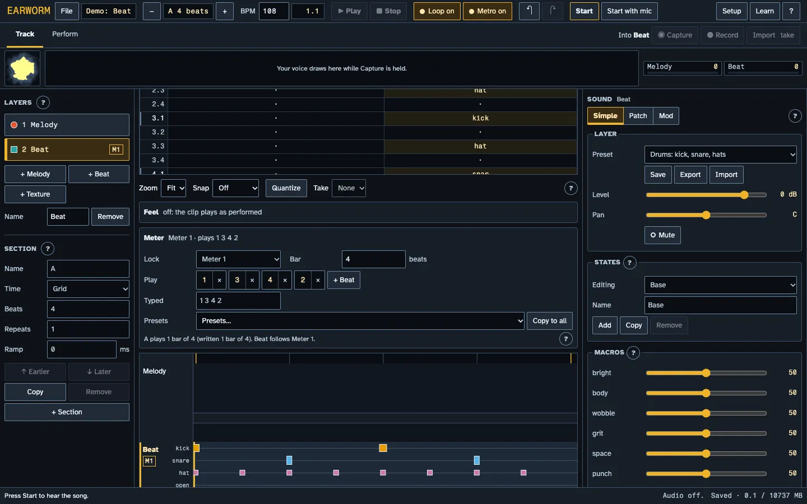
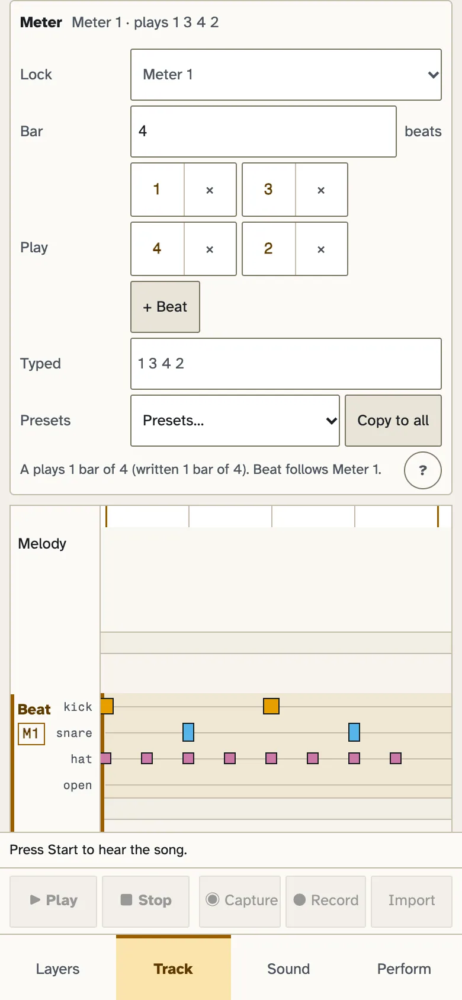

# Stage R1: typed meters, locks and patterns

Built Nov 22, 2026, from [meter.md](meter.md) "Build plan > R1", with every question there at its recommended answer (the owner's approval: "Assume yes on everything. Build."). A clip locked to a meter is now cut into beat slices along that meter's bars and played in the order its section's pattern gives: `1 2 3` plays a 4/4 groove in 3/4 by dropping beat 4, `1 2 3 3` plays a 3/4 one in 4/4 by playing beat 3 twice, `1 3 4 2` shuffles the bar. It happens when the track plays and exports, after Feel, and the take and its notes never change. Meter 1's pattern also sets how long the section plays, and the click counts its bars. Bars from a layer, polymeter for the meters after Meter 1 (R2), and recording into remapped clips and drawing them in played order (R3) are not in this stage.

## What was built

| Part | Where |
| --- | --- |
| Schema 7: `Project.meters` (typed bars: beats per bar from each section's start), `Section.play` (a pattern per meter), `ClipBase.meter` (the lock). All optional; a document without them plays as before, and an older build refuses a schema 7 document rather than play it in the wrong meter. The 6 to 7 step changes only the number. | `web/src/project/types.ts`, `migrate.ts` |
| The model: the order beats play in (a last part bar plays the pattern's beats that exist in it), the section's played length under Meter 1, the cut at the earliest hard anchor within an eighth of a beat (60 ms at most) that weighs at least 0.3 of the heaviest there, the runs, and where two runs meet. Pure functions. | `web/src/project/meter.ts` (`playOrder`, `cutAt`, `remapRuns`) |
| What a locked clip plays, built from the runs: notes and hits (copied into every run that plays their slice, dropped with a dropped beat, ended where their run ends; a held note a run starts in the middle of starts again if a quarter beat is left), the warp map the curves are read through (two anchors at each join), and the take audio's stretch map (a hard run point per piece, the Feel or placement map's points inside). Lanes and morph markers stay in played time; those past a shortened loop are not sent. | `remapEvents`, `remapWarp`, `remapStretch` in `meter.ts`; `Compiler.remap` in `compile.ts` |
| The compiler: after Feel, each locked clip in a grid section whose meter has a pattern there is remapped; its loop becomes its played length; Meter 1's pattern sets the section's length. A remapped clip with take audio sends a stretch map in hits mode even without Feel (Feel's own mode when Feel is on). The engine, the track blob format and the stretcher are unchanged. | `trackInput` in `compile.ts` |
| Commands, one undo step each: `setMeter` (add, rename, beats per bar, remove: removing frees its clips and drops its patterns; Meter 1 cannot be removed), `setMeterPlay` (a section's pattern, or as written; `all` for Copy to all sections), `lockClips` (one clip, or all of a layer's). Meter 1's beats per bar and the click's bar are one number: changing either changes both. | `web/src/project/commands.ts` |
| The Meter row, under Feel on the field grid, for the selected layer: Lock (Free or a meter, for all the layer's clips; "Mixed" when they differ), Bar (beats per bar), Play (the pattern as beat chips: press to repeat, drag to move, × to drop, + Beat), Typed (`1 3 4 2`), Presets (As written, Drop last, Repeat last, Shuffle) and Copy to all, a live line ("A plays 4 bars of 3 (written 4 bars of 4). Beat follows Meter 1."), and a "?" bubble. Folded, its summary reads "Meter 1 · plays 1 2 3". The chips are one Tab stop: ← → move between them, Shift ← → moves a beat, Delete drops it, Enter repeats it. On a coarse pointer each chip and its × are 44 px. | `web/src/app/meter-ui.ts`; `web/index.html`; `style.css` |
| The track's lock in words: "M1" (or "M mixed") on the layer's row in the layer list and beside its name in the timeline, so it is never told by color. | `renderLayers` in `app/main.ts`; `layoutNames` in `app/gl-timeline.ts` |
| Bars on screen and on the click: the grid's bar lines and Snap's "Bar" follow Meter 1's beats per bar; while playing, the ruler's playhead, each locked lane's playhead and the pattern grid's playing row follow the written beat being played (they skip a dropped beat and go back for a repeated one); the click accents Meter 1's bars as the playing section plays them. | `gridLines`, `snapChoices` in `m3/geometry.ts`; `writtenAt`, `clipWrittenAt`, `playedBar` in `meter.ts`; `pushMetro` and the animation frame in `main.ts`; `draw` in `gl-timeline.ts` |
| The prototype's grooves and measures moved into the tests, and two fixtures that carry each groove stem's anchors from Rust to the app's compiler and its stretch maps back. | `crates/analysis/tests/common/grooves.rs`, `crates/analysis/tests/fixtures/meter_anchors.txt` and `meter_maps.txt`, `web/src/project/meter-fixture.test.ts` |
| Listening examples, before and after. | `docs/r1-examples/` (below) |

 

## How to check it

| Command or action | What it checks |
| --- | --- |
| `pnpm test` | Every TypeScript and Rust test, including the ones below |
| `cd web && npx vitest run src/project/meter.test.ts` | The runs: drops, repeats, shuffles, a pattern longer than the bar, the last part bar, cuts at the earliest strong anchor (and not past 60 ms), a late run start trimming the run before, an early one after a late end, a cut before the loop start; notes copied, dropped, ended at their run and started again mid-way; the warp and stretch maps |
| `cd web && npx vitest run src/project/meter-compile.test.ts` | Through the compiler: meters and locks without a pattern compile to the same track, byte for byte; Meter 1 at `1 2 3` shortens the section while a free clip plays as written; a locked take sends a hits-mode stretch map without Feel; a beat clip's hits; a flexed and remapped sung take's curves; the commands and their undo |
| `cd web && npx vitest run src/golden/golden.test.ts` | Every golden fixture still compiles to its stored track blob and renders as before |
| `cargo test -p analysis --release --test meter -- --nocapture` | The prototype's six cases through the app's maps and the engine, against the prototype's figures; the engine against the stretcher; exports, call sizes, play from eight points, live against export; no allocation with eight remapped layers |
| `METER_WRITE=1 cargo test -p analysis --release --test meter the_anchors` then `WRITE_FIXTURE=1 npx vitest run --root web src/project/meter-fixture.test.ts` | Write the two fixtures again (only after the anchor detector or the remap changes on purpose) |
| `R1_EXAMPLES=docs/r1-examples npx vitest run --root web src/project/meter-examples.test.ts` | Writes the listening examples again; `R1_SONG=<wav>` (48 kHz) adds a song of your own |
| The app: Learn, Beat demo, select Beat, Meter: Lock Meter 1, Presets "Drop last", Start, Play | The loop plays three beats, the click counts 1 2 3, the playhead skips beat 4; type `1 3 4 2`, press a chip, drag one, ×, undo |

## Results

Measured on the build machine (Apple M4) on Nov 22, 2026.

| Check | Result |
| --- | --- |
| Unit tests for runs (the list in meter.md's R1) | Pass: 18 tests in `meter.test.ts`. |
| Every golden fixture compiles to a byte-identical track blob with no meters, and the golden renders are unchanged | Pass. The stored-blob check passes for all eight fixtures; a document with two meters and a lock but no pattern for its clip's meter also compiles byte for byte to the track it had without them. |
| The prototype's six cases through the engine: spectral distance to the ideal within 0.1 dB of the prototype's, no click more than 3 dB over the ideal | Pass, table below. Every distance is 0.03 to 0.09 dB above the prototype's (why: "Where the build differs"); the worst click is +2.9 dB, the prototype's own worst. |
| Determinism: two exports bit-identical; 128- and 333-sample calls bit-identical | Pass (four-shuffle, three remapped layers through the whole engine). |
| Play from eight points matches a whole render from the next slice on | Pass, on each layer's stretcher (hits mode): every start repeats exactly and matches from the next hard point. Through the whole engine the master's DC blocker restarts at Play, as in Q2. |
| Live playback from a stop against an export | Pass: bit-identical. |
| The no-allocation test with eight remapped layers | Pass: 12 s of 128-sample calls through loop wraps, the other pattern loaded while playing, a stop and a play, then 24 export calls: 0 allocations. |
| The engine plays what the stretcher renders | -94.8, -∞ and -102.4 dB for drums, bass and keys (the stretcher through the layer's gain and the master), from 20 ms on: a play from a stop starts the first slice at full level where a stretcher seeked to 0 fades it in. |
| A flexed and remapped sung take: every note's curve starts within 1 ms of its moved note, copies included | Pass for `1 3 4 2`, `1 2 3 3` and `1 2 3` on the sung-melody fixture with Feel at 8ths. |
| Cost | Building the runs, the notes and the stretch map for an 8-bar clip shuffled `1 3 4 2` with 128 anchors and 128 notes: 87 µs in the compiler. The engine does nothing new (meter.md measured hits-mode playback of a remapped take at the cost of one run). |
| The app, in headless Chrome at 1440 × 900 (dark) and 390 × 844 (light, touch) | The Meter row on the field grid, nothing wider than the window, every control in it 44 px on touch (the "?" is 32, as every help button). Lock, presets, typed patterns, chip press, ×, drag, Shift → and Delete, a bad pattern ("a pattern names beats 1 to 4"), undo: each one step. Beat demo locked at `1 2 3`: the position readout ran 1, 2, 3, 1 and the click's beat 1, 2, 3, 1. No console errors. |
| The owner listens to a drum take, a full imported song and a sung take, each `1 2 3` and `1 3 4 2` | Ready, below. Not yet heard. |
| `pnpm test` | All pass in 132 s: 480 Vitest tests in 60 files (one more file of 3 is skipped: the listening examples, which run only when asked) and 371 Rust tests (4 ignored, as before). |

### The six cases

Spectral distance to the ideal (dB, 0 is identical) over the whole render and near the joins, and the high band in the 8 ms before each join against the ideal's. Three layers (drums, bass, keys) locked to Meter 1, each cut at its own anchors, as the app compiles them.

| Case | Pattern | Distance, all / near joins | Prototype | Clicks, mean / worst | Prototype worst |
| --- | --- | --- | --- | --- | --- |
| 5/4 to 4/4, drop beat 5 | `1 2 3 4` | 0.70 / 2.10 | 0.64 / 2.19 | -2.1 / -1.9 | +0.0 |
| 5/4 to 4/4, drop beat 4 | `1 2 3 5` | 3.65 / 9.32 | 3.62 / 9.50 | +2.5 / +2.9 | +2.9 |
| 4/4 to 3/4 | `1 2 3` | 0.46 / 1.42 | 0.39 / 1.27 | -0.6 / -0.0 | -0.1 |
| 3/4 to 4/4, repeat beat 3 | `1 2 3 3` | 0.31 / 0.55 | 0.22 / 0.46 | -2.3 / -0.6 | +0.0 |
| 3/4 to 4/4, repeat beat 1 | `1 1 2 3` | 0.64 / 1.60 | 0.57 / 1.58 | -1.2 / -0.8 | -0.1 |
| 4/4 shuffled | `1 3 4 2` | 2.54 / 3.82 | 2.48 / 3.49 | -1.2 / +0.4 | +1.7 |

### Listening

In `docs/r1-examples/`, 48 kHz mono, one pass of the loop each. Each source went through the app as Import take does (the live tier, the second pass for notes, hits and anchors), was placed from the section start on a layer that plays its raw input beside its synth voice, locked to Meter 1, and rendered by the wasm engine. The three files of a source share one gain. Listen to each pair in order:

1. **`drums-0-as-written.wav`, then `drums-1-123.wav` and `drums-2-1342.wav`.** Q2's drum loop A (100 bpm, swung, a late snare), two bars of 4/4: in 3/4, then shuffled.
2. **`sung-0-as-written.wav`, then `sung-1-123.wav` and `sung-2-1342.wav`.** Q2's sung line (late, loose, legato). Listen for the cuts in the voice: meter.md expected sung material to sound worse than drums, and nothing measured it.
3. **The song**, on this machine only: `/Users/jhammond/firstmate/data/earworm-meter-r1/examples/song-0-as-written.wav`, `song-1-123.wav`, `song-2-1342.wav`. The real band from meter.md (drums, synth bass and a synth lead from GarageBand's Apple Loops, Disco Funk, 116 bpm), one file imported as one take. Apple Loops may not go in the repository, so neither do its renders.

## Where the build differs from the design

- **Schema 7, not 6.** P3 took schema 6 for poly takes before this stage.
- **One meter in the interface.** The document, the commands and the compiler take any number of typed meters (a second meter's clips loop inside the section), and Lock lists every meter the project has, but the row has no way to add one: the meters list and polymeter are R2's. Until then a project has Meter 1 only.
- **The timeline draws clips as written.** Drawing them in played order, with source beat numbers on the slices, is R3. Until then the grid's bar lines are Meter 1's written bars (they match what is drawn), and the playhead shows which written beat is playing: under `1 2 3` it skips beat 4. The Meter row's line says how the section plays ("4 bars of 3, written 4 bars of 4").
- **The click gets its bar from the host.** The engine counts bars from each section's start with one bar length, so the app sends Meter 1's played bar when a section with another pattern starts playing. A section's first beat is always accented; the change arrives within a frame, long before the next bar. No engine change.
- **Where two runs meet.** The design covers a late run start after an early end (the earlier run ends there). The opposite, an early start after a late end, would leave a gap: the later run starts where the earlier one ends, reading at most an eighth of a beat of what came before its hit.
- **Only notes start again.** A held note a run starts in the middle of plays again; a hit never does, so a drum hit is never doubled at a join.
- **The six cases come out 0.03 to 0.09 dB above the prototype.** The prototype rendered one pass with 0.3 s of lead-in and cut within 60 ms of each beat; the app loops, its take starts 30 ms before beat 1 (so beat 1's early hits play at the end of the loop, as they would in a recorded loop), and the cut window is an eighth of a beat as designed (47 ms at 160 bpm, 52 at 144). The `1 2 3 3` case is closest to the limit, 0.09 dB over.
- **New clips start free.** A capture, an import or a first drawn note in a section makes a free clip, and capturing a take into a locked clip replaces it with a free one. The track's chip then says "M mixed" and Lock sets it again. R3's question on arming ("Record in the new meter") is not built; for a mic take its effect, a free clip that plays as recorded, is what R3 would do.
- **The click's bar and Meter 1's beats.** Setup's click bar still takes 1 to 32 and Meter 1 takes 2 to 16; a click bar outside 2 to 16 leaves Meter 1 as it was.
- **Found along the way, not changed:** an imported file longer than its section wraps its notes into the loop and reads its raw audio through the notes' warp map, so the as-written playback of such a take jumps around. The listening examples trim each file to whole bars for that reason. It is Q2's import, not the remap.
- **Not done:** the owner's listening (check 6).

## Questions for the owner

1. **Is it worth keeping?** Listen to the drums, the sung line and the song at `1 2 3` and `1 3 4 2`. Recommended: if the drums and the song sound usable, go on to R2 (bars from a layer, more meters); if the sung line's cuts are too rough, R3 should say so on screen for sung takes.
2. **New clips on a locked track.** Recommended: a new clip on a track whose clips all lock to one meter locks to it too (a drawn note, an import); a mic take into a remapped clip waits for R3's prompt. Or keep every new clip free, as now?
3. **The timeline until R3.** Written-time drawing with a playhead that skips and repeats beats: clear enough until clips are drawn in played order, or should R3's drawing come before R2?
