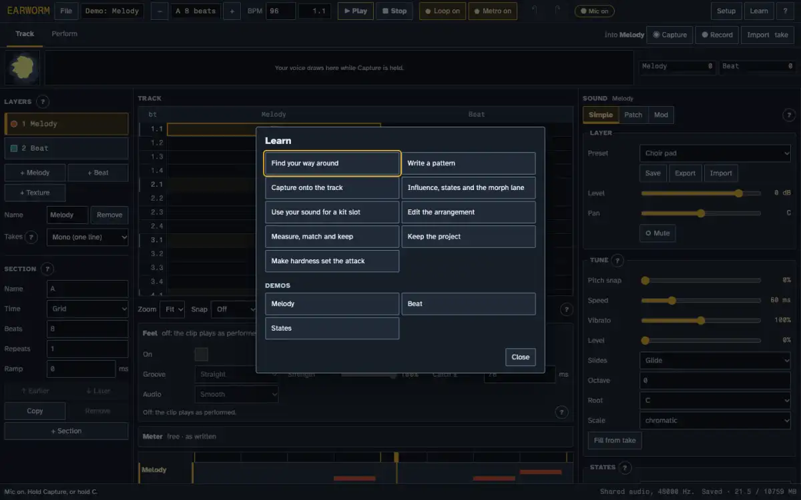
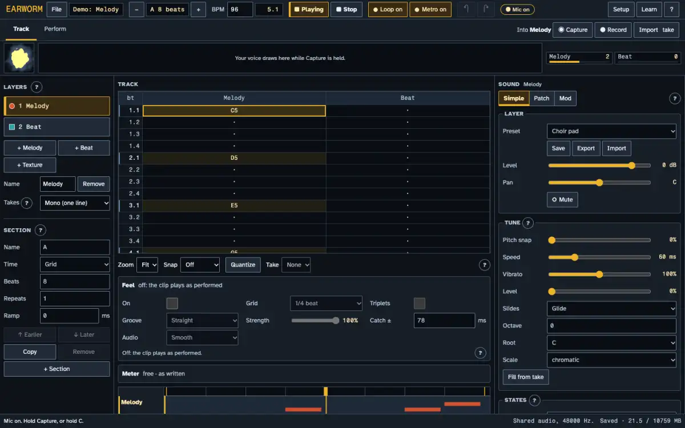
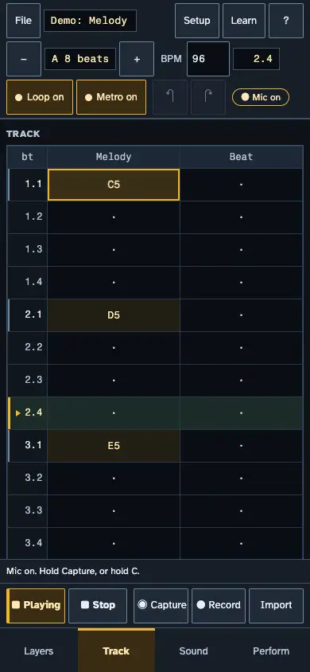

# Getting started

[Guide contents](README.md)

This chapter gets a sound out of Earworm in about two minutes, then walks the screen so the later chapters make sense.

## Your first sound in two minutes

1. Put on headphones.
2. Open <https://jhammond045.github.io/earworm/> in Chrome or Edge. The first visit reloads the page once by itself; that is expected.
3. Press **Learn** at the top right. Under **Demos**, press **Melody**. Earworm opens a short song: eight notes on a choir pad, with the click on.
4. Press **Start** in the transport. This opens the audio. The microphone stays off.
5. Press **▶ Play**, or the **Space** bar. You hear the melody loop with a click.
6. While it plays, open the **Preset** menu in the Sound panel on the right and pick **Glass**, then **Reed**. The melody changes sound as you pick.
7. Press **Space** again to stop.

That is the whole loop of Earworm: a song made of layers, a sound on each layer, and one transport that plays it.

To sing into it, press **Enable mic** in the transport (or reload and press **Start with mic** instead of **Start**), allow the microphone when the browser asks, and hold **Capture** (or hold the **C** key) while you hum. [Capturing your voice](02-capturing-your-voice.md) and the first tutorial, [Hum a melody into a synth line](tutorials/01-hum-a-melody.md), go through it step by step.

## Start, Start with mic, Enable mic

Browsers do not let a page make sound or listen until you press something, so Earworm waits for you:

- **Start** opens the audio only. Use it when you only want to listen, edit or play from the keys.
- **Start with mic** opens the audio and asks for the microphone.
- **Enable mic** appears after a plain Start, for when you decide to sing after all.

After Start, the chip in the transport says **Mic on** or **Mic off**, and later the MIDI device too. The line at the bottom right says how the audio runs (**Shared audio, 48000 Hz** is normal) and whether the song is saved.

## The screen

**The transport** runs across the top and is always there:

| Control | What it does |
| --- | --- |
| **File** and the project name | Open, save, export. See [Saving, sharing and exporting](12-saving-sharing-exporting.md). |
| **−  A 8 beats  +** | The section you are looking at and its length. The − and + step to the previous or next section. |
| **BPM** and the position | The tempo of this section, and where the playhead is, as beat.16th like the grid's rows. |
| **▶ Play** and **■ Stop** | Play starts at the beginning of the section on screen. Space does the same; Esc stops. |
| **Loop** | On: after the last section, start again at the first. New projects start with it on. |
| **Metro** | The click. You hear it live only; it is never in a recording or an export. Its level, beats in a bar and sound are in **Setup**. |
| **↶ ↷** | Undo and redo. One history covers everything in the app, and it is saved with the project. |
| **Start** / **Mic on** | The audio and mic state described above. |
| **Setup** | Mic timing, the metronome, vowel bands, the theme, and links to older test pages. |
| **Learn** | Lessons and demos. |
| **?** | The keyboard shortcuts. |

**The place bar** under it picks what fills the screen. **Track** is for making the song: layers on the left, the track in the middle, the sound on the right. **Perform** is for playing it: layers on the left and a play surface. On the right of the bar, **Into Melody** names the layer that **◉ Capture**, **● Record** and **Import take** put a take on.

**The monitor strip** shows the Klont (a glyph whose spikes follow brightness and grit, whose wobble follows motion and whose halo follows space), the live pitch ribbon that draws your voice while Capture is held, and a small meter per layer counting the voices sounding.

**The panels:**

- **Layers.** Each layer is one instrument. A circle is a melody, a square a beat, a diamond a texture. Pick one to work on it. Under the list are its name, how takes into it are read (Mono or Poly), and the section's settings.
- **Track.** The pattern grid (one column per layer, one row per 16th note), then the timeline (the same section drawn in time), then the Feel and Meter rows, the morph markers and the automation lane.
- **Sound.** The selected layer's sound: **Simple** (preset, level, Tune, states, macros, gestures, kit slot, Influence), **Patch** (every knob of the patch) and **Mod** (modulation routes).

**The status line** at the bottom says what just happened ("Placed 10 notes…") and sometimes offers the next step as a button, such as **Quantize it →**.

On a narrower window the panels take turns: a tab bar at the bottom switches between **Layers**, **Track**, **Sound** and **Perform**. See [Phones and tablets](14-phones-and-tablets.md).

## Words used in this guide

- **Song** or **project**: everything you are working on, saved under one name.
- **Section**: a part of the song (A, B, …) with its own length, tempo and repeat count.
- **Layer**: one instrument line. Melody and texture layers play notes; a beat layer plays hits on four kit slots (kick, snare, hat, open).
- **Clip**: what one layer plays in one section: its notes or hits, its take, and its automation.
- **Take**: a recording of your voice (or a file) placed on a clip. Earworm keeps the audio and reads notes or hits out of it.
- **State**: a full setting of a layer's sound. A layer can have up to eight and move between them.

Next: [Capturing your voice](02-capturing-your-voice.md).
