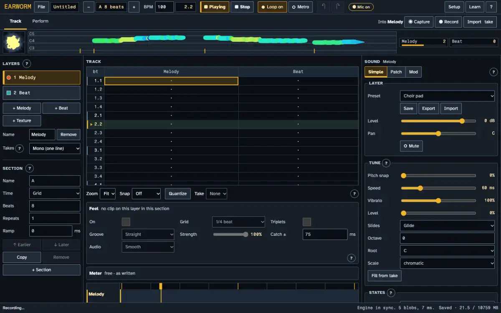
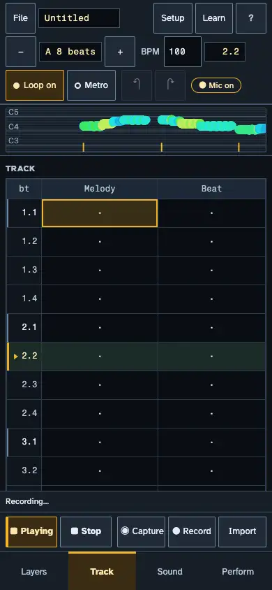
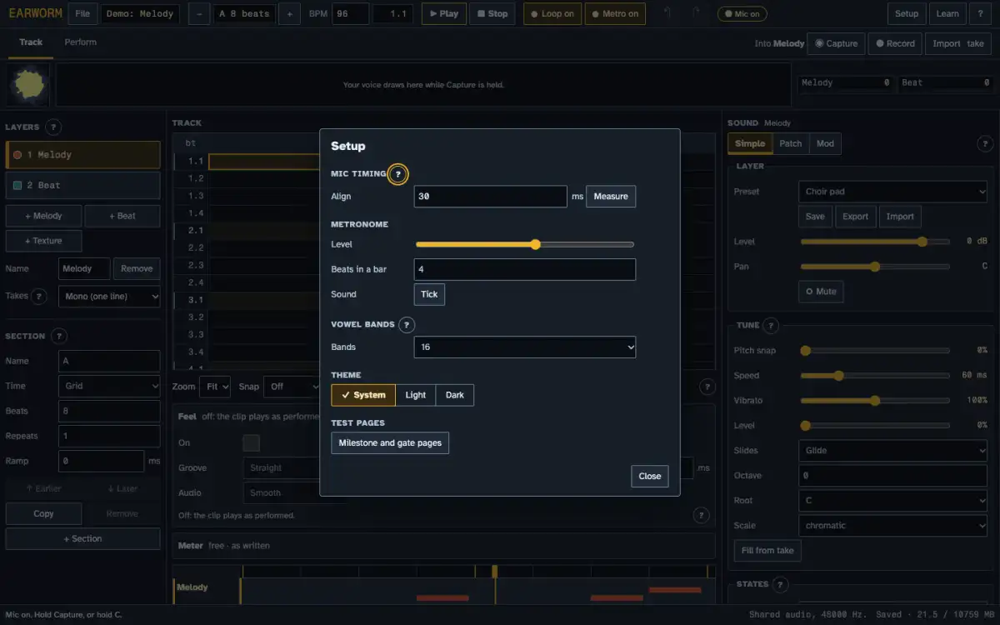

# Capturing your voice

[Guide contents](README.md) · In the app: Learn, **Capture onto the track**

Capture records your voice into the selected layer and turns it into something the synth can play: notes on a melody or texture layer, hits on a beat layer. The audio is kept too, so you can play it back, blend it with the synth, or stretch it.

## Before you start

- Wear headphones. Earworm does not cancel echo: the mic is opened with echo cancellation, noise suppression and automatic gain all off, so it hears exactly what you sing, and it would also hear your speakers.
- Press **Start with mic**, or **Enable mic** after a plain Start, and allow the microphone. The transport chip says **Mic on**.
- Pick the layer in the Layers panel. The place bar says where the take goes: **Into Melody**.

## Hold to capture

1. Hold **◉ Capture**, or hold the **C** key.
2. If the song is stopped and the section is on a grid, you hear one bar of count-in clicks; then the section starts playing and recording begins. If the song is already playing, recording begins at once, over what is playing.
3. Sing, hum or beatbox. Your pitch draws as a ribbon in the monitor strip while you hold.
4. Let go. The status line says **Second pass on 6.0 s…** while Earworm reads the take, then **Placed 10 notes** (or **Placed 28 hits**) and where it put them.

Letting go during the count-in cancels the take ("Count-in cancelled."). A take shorter than half a second is ignored. A take stops by itself after 59 seconds (5 minutes on a Poly layer, see [Polyphonic takes](10-polyphonic-takes.md)).

On a phone the ribbon appears above the track only while Capture or Record runs:

## What a take becomes

**On a melody or texture layer** the take becomes notes, one per sung note, each with its own pitch, length and hardness. The **Tune** box in the Sound panel fills in the **Root** and **Scale** it heard. The pitch you sang between the notes (slides, vibrato) is kept as a curve, so the synth can follow it; **Tune** decides how closely. See [The synth and patches](04-synth-and-patches.md#tune).

**On a beat layer** the take becomes hits, each sorted into one of four kit slots (kick, snare, hat, open) by how it sounds. You can drag a hit to another slot afterwards, or teach Earworm your own sounds first with **Teach (hold)** in the Kit slot box (see [Build a beat from beatbox](tutorials/02-beat-from-beatbox.md)).

Either way, the take replaces what that layer had written in this section. **Undo** brings the old notes back.

After a take lands on a grid section, the status line offers **Quantize it →**, which turns on Feel for the clip. See [Quantizing with Feel](09-quantizing-with-feel.md).

## Getting takes on the beat

There is always a short delay between the speakers (or headphones) and the mic. Earworm takes it off when it places a take, so a note you sang on the beat lands on the beat. The delay it uses is **Align** in **Setup**, 30 ms until you measure it.

To measure: open **Setup**, press **Measure**, and keep the headphones near the mic. Earworm plays five chirps and times them coming back, then writes the result into Align. Measure again when you change headphones or the audio device; if the device changes while you work, Capture pauses and asks you to.

## Other ways to get a take

- **● Record** records a pass: the mic into the selected layer, and everything you play and move at the same time. See [Recording passes and automation](07-recording-and-automation.md).
- **Import take** puts an audio file on the selected layer, from the start of the section. Earworm reads it exactly as it would a capture of the same sound, so it gets notes or hits and can be quantized and stretched. If the layer has no raw input yet, Earworm adds one at full mix, so the file plays as audio. On a layer set to **Poly**, the file's chords come back as notes and no input is added ([Polyphonic takes](10-polyphonic-takes.md)).
- **Listen** in the Perform place lets the mic shape a layer live while you play notes from the keys, without recording. See [Playing live](06-playing-live.md).

## Several takes

Each capture on the same clip stacks on the last. The **Take** menu on the timeline toolbar picks which take the ribbon in the timeline follows. **File → Clean up** later removes takes that nothing uses any more.

Next: [Takes and the timeline](03-takes-and-the-timeline.md).
