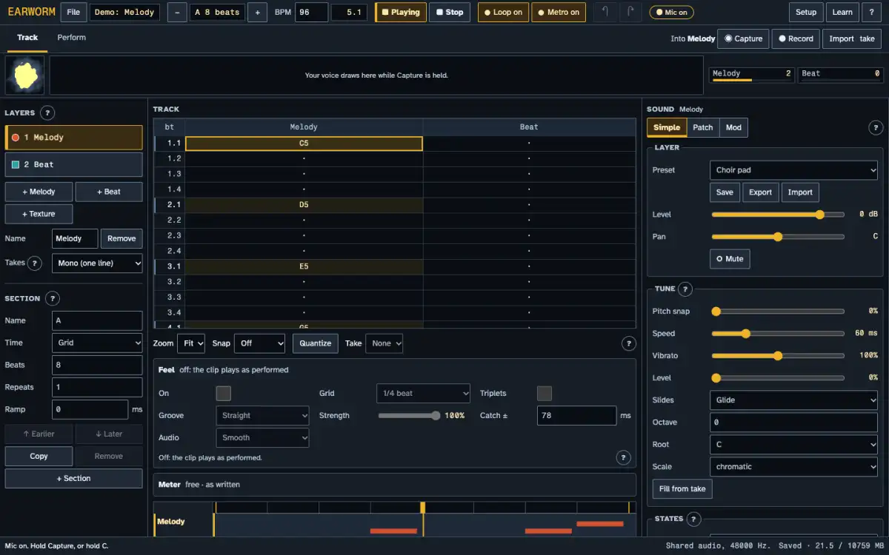
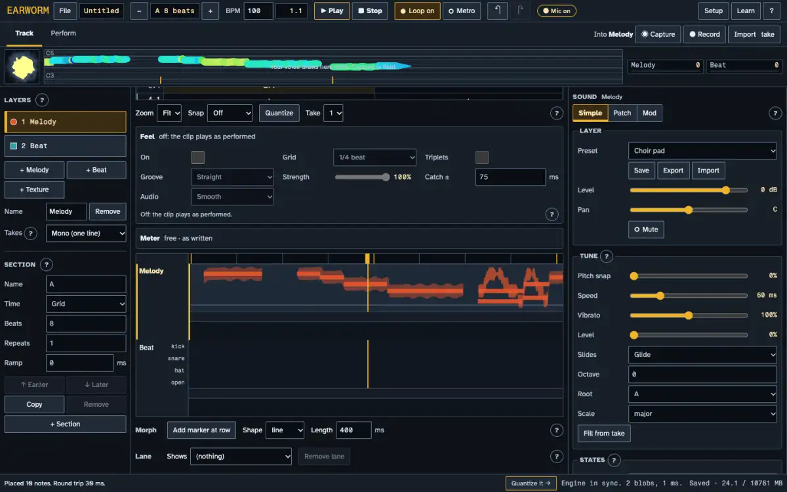
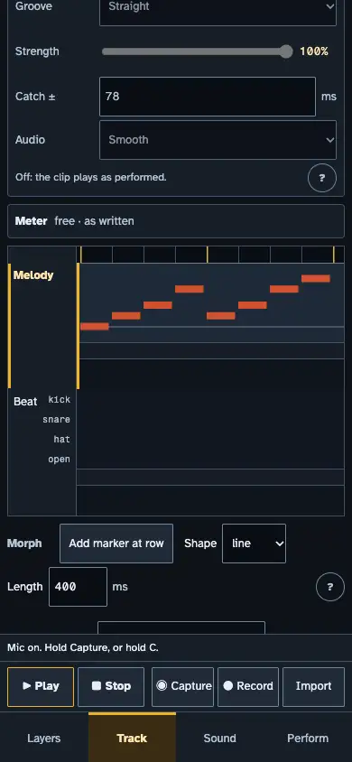

# Takes and the timeline

[Guide contents](README.md) · In the app: Learn, **Find your way around**, **Write a pattern**, **Edit the arrangement**

The Track place shows one section of the song two ways: the **pattern grid**, a table you edit with the keyboard, and the **timeline**, a drawing in time you edit with the mouse or a finger. Both show the same notes and hits, and both follow the playhead.

## Layers

Each layer is one instrument. Add one with **+ Melody**, **+ Beat** or **+ Texture** under the layer list. A melody layer plays notes; a texture layer plays notes too, with sounds meant for pads and noise; a beat layer plays hits on four kit slots. A layer's kind is fixed when you add it.

Select a layer by clicking it. Everything on the right (Sound), the take buttons (Capture, Record, Import) and Perform act on the selected layer. Under the list you can rename it or **Remove** it (the last layer stays). **Takes** says how a take into it is read: **Mono (one line)** for a voice, **Poly (chords)** for a guitar or piano.

A muted layer says **mute** in the list. A layer locked to a meter says **M1** (see [Meters](11-meters.md)).

## Sections

A song is a row of sections. The stepper in the transport (**−  A 8 beats  +**) picks the one on screen. The **Section** box under the layers edits it:

| Field | What it does |
| --- | --- |
| **Name** | The section's name, shown in the stepper. |
| **Time** | **Grid** counts beats at the tempo. **Free** counts seconds, with no beat grid. |
| **Beats** / **Seconds** | How long the section is. |
| **Repeats** | How many times it plays before the next one. |
| **Ramp** | How long, in milliseconds, the tempo takes to arrive from the section before. |
| **↑ Earlier**, **↓ Later** | Move the section in the song. |
| **Copy** | Make a copy right after this one. |
| **Remove** | Drop it (the last section stays). |
| **+ Section** | Add an empty section after this one. |

**BPM** in the transport is the tempo of the section on screen.

## The pattern grid

One column per layer, one row per 16th note, labelled beat.16th, so **2.3** is the third 16th of beat 2. A note shows its name (**C5**), a hit its kit slot (**kick**, **snar**, **hat**, **open**). The row playing has a triangle and a wash.

The grid is one Tab stop. Inside it:

- **Arrows** move the cursor.
- **Enter**, or a double-click, adds a note (or a hit on a beat layer).
- **Delete** removes it.
- **Shift ↑ / ↓** moves the selected note a semitone.
- **1** to **4** set the kit slot of the selected hit.

## The timeline

Under the grid, the timeline draws each layer as a lane:

- **Bars** are notes. A **ribbon** behind them is a take's pitch and loudness (ribbons appear once Earworm has finished tuning the take).
- **Blocks** on a beat lane are hits, on rows named kick, snare, hat and open. Each slot has its own color and shape (a wide block, a tall block, a small square, a hollow square), so you can tell them apart without color.
- The thin strip under each lane holds **morph markers**; the strip under that is **automation**. See [Recording passes and automation](07-recording-and-automation.md).

Editing with the mouse:

- Drag a note or hit to move it. Drag a hit up or down to move it to another kit slot.
- Drag a note's right edge to change its length.
- Double-click empty space to add a note or hit.

With the keyboard, click the timeline (or Tab to it), then: **← →** pick the previous or next note or hit, **↑ ↓** pick the lane above or below, **Shift ← →** move it by the snap (a 16th when Snap is off), **Shift ↑ ↓** move it a semitone (a hit: to the kit slot above or below), **Delete** removes it. A screen reader hears what is picked.

On a touch screen, a finger on a note drags it, a finger on empty space pans, and two quick taps add a note.

The toolbar above the timeline:

- **Zoom**: ½, Fit, 2× or 4×.
- **Snap**: the grid a drag lands on (Off, 1/16 beat up to a Bar).
- **Quantize**: turns on Feel for the selected layer's clip at the Snap grid. See [Quantizing with Feel](09-quantizing-with-feel.md).
- **Take**: which of the stacked takes on this clip the ribbon follows.

## Undo

Every edit is one step in a single history for the whole app: notes, sounds, sections, takes, routes. **Ctrl Z** (⌘ Z on a Mac) undoes, **Shift Ctrl Z** or **Ctrl Y** redoes. A drag, a slider move or a whole recorded pass is one step. The history is saved with the project, so it survives a reload.

Next: [The synth and patches](04-synth-and-patches.md).
