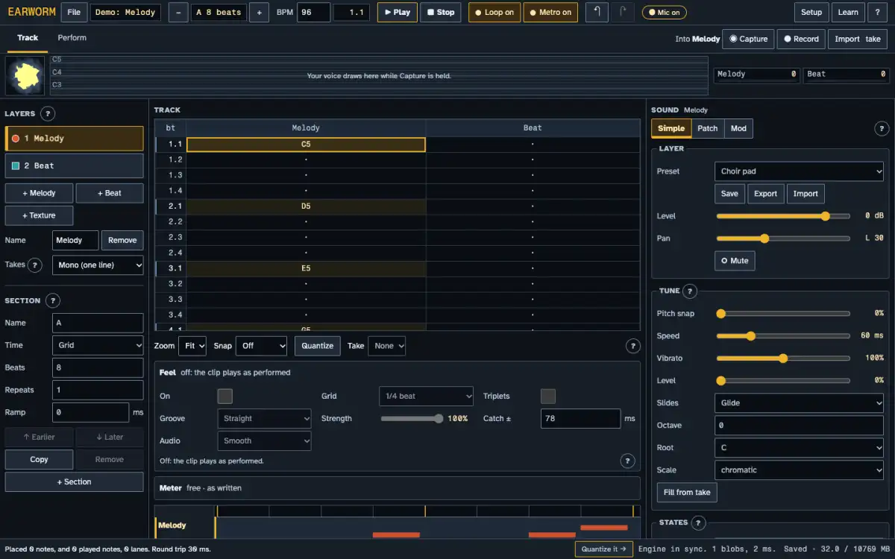
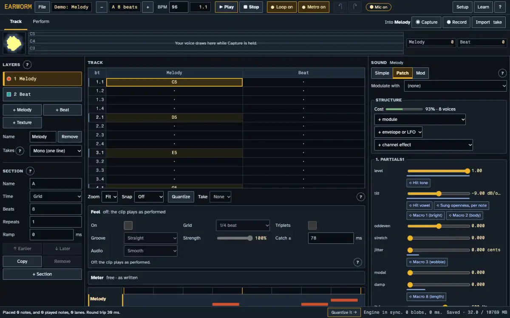
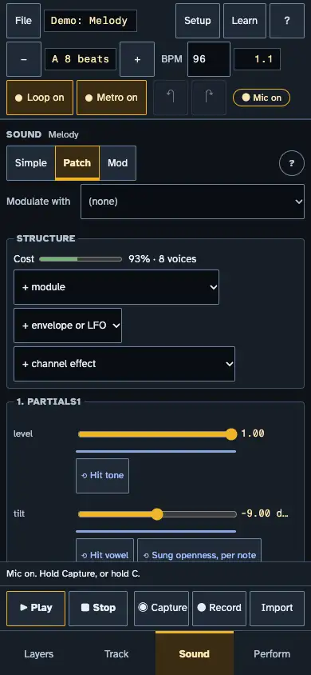

# The synth and patches

[Guide contents](README.md) · In the app: Learn, **Influence, states and the morph lane**, **Use your sound for a kit slot**, **Edit the arrangement**

Every layer has its own synth. The Sound panel edits the sound of the selected layer, in three views: **Simple**, **Patch** and **Mod**. This chapter covers Simple and Patch; Mod has [its own chapter](05-modulation.md).

On a laptop the Sound panel is the right-hand column of the Track place. On a narrow screen it is the **Sound** tab.

## Simple

### Layer

- **Preset** picks a sound. The menu lists the factory presets (Choir pad, Reed, Glass, Buzz, Breath, Bell, Demo bass, Demo lead on a melody layer; a beat layer lists kits: Drums: kick, snare, hats and Percussion: toms, clap, rim), then your own under **Yours**. It reads **Custom** when you have changed the sound so it matches none.
- **Save** keeps this layer's sound as one of your presets. **Export** downloads it as a `.earworm-patch.json` file; **Import** loads one. Loading a preset replaces the patch and every state's values, as one undo step.
- **Level** (dB), **Pan** (reads L, C or R) and **Mute**. See [Mixing](08-mixing-vocal-and-synth.md).

### Tune

Melody and texture layers only. Tune shapes the pitch you sang before the synth plays it:

| Control | What it does |
| --- | --- |
| **Pitch snap** | How hard the sung pitch is pulled to the scale. 0% plays it as sung; 100% lands on scale notes. |
| **Speed** | How fast it gets there, in ms. |
| **Vibrato** | 100% keeps your vibrato as sung; lower flattens it. The slider goes to 200%. |
| **Level** | Evens out the loudness of the sung line. 0% keeps it as sung; toward 100% quiet notes come up and loud ones come down. (The app's help bubble calls this how loud the tuned voice plays.) |
| **Slides** | How a sung slide between notes moves: **Glide** follows it, **Gliss** steps by semitones, **Jump** goes straight to the next note. |
| **Octave** | Shifts the whole line by octaves. |
| **Root**, **Scale** | The key the snap uses: chromatic, major, minor, major or minor pentatonic, blues. |
| **Fill from take** | Sets Root, Scale and the reference pitch from this layer's take again. A new take does this by itself. |

### States

A state is a full setting of the layer's sound. A layer starts with one (**Base**) and can have up to eight. The preset, the macros and Influence edit the state picked under **Editing**. **Add** makes a new one, **Copy** duplicates the one you are editing, **Remove** drops it, **Name** renames it.

A layer moves between its states with morph markers on the timeline ([chapter 7](07-recording-and-automation.md#morph-markers)) or with scenes in Perform ([chapter 6](06-playing-live.md#scenes)).

### Macros

Eight broad moves on top of the preset: **bright**, **body**, **wobble**, **grit**, **space**, **punch**, **air** and **length**. Each slider is 0 to 100 with 50 in the middle. The sound follows while you drag; letting go is one undo step.

### Gestures

How far your live voice pushes this layer while you sing into it: **Loud**, **Open**, **Hard**, **Breath** and **Mouth**. On a beat layer, **Follow** is how far a hit follows the shape of the sung sound.

### Kit slot (beat layers)

Make a drum out of your own sound. Pick the **Slot** (kick, snare, hat or open), then either choose a file with one hit (**From a file**) or press **Record one hit** and make the sound once (the mic must be on). Earworm matches the slot to it. **Hear slot** plays the slot.

**Teach (hold)** is different: hold it and repeat one sound a few times. The next beat take then sorts its hits using what you taught, so your "ts" goes to the hat and your "b" to the kick. What you teach lasts for this session; it is not saved with the project.

### Influence

Move the state you are editing toward a sound you like. Choose an audio file (**From a file**), or hold **Listen (hold)** and make the sound. The meters show how far each aspect would move. Pick which aspects to use with the chips (**Tone**, **Shape**, **Motion**, **Grit**, **Space**), set **Amount**, and press **Commit** to write the blend into the state. **Clear** removes the Influence. **Use the sound itself** adds a grain cloud that plays the steady part of the source's own audio, not only its character. **Play source** plays the file; **Hold note** plays this layer at the source's pitch so you can compare. **Saved** lists sounds kept on the older Influence test page.

## Patch

**Patch** shows everything the sound is made of and every value in it, one card per part:

- **Voice modules** make each note's sound: the partial bank, oscillator, noise, sampler (plays the layer's sound source), click, filter, amp, fold, clang and comb.
- **Envelopes and LFOs** shape a value over each note's life or over time.
- **Layer sources** (the two layer LFOs) move with the whole layer.
- **Channel effects** process the layer's output: crush, tape, filter, delay, reverb, and **input**, which brings in your raw voice ([chapter 8](08-mixing-vocal-and-synth.md)).

Every value has a slider for the state you are editing. A blue bar under a slider shows how far modulation can move it; a mark shows where the sound has it right now. Badges under a slider (**⟲ Macro 1 (bright)**) name the routes into it; press one to open that route in the Mod view.

The **Structure** box at the top builds the patch:

- **Cost** shows how much of the layer's budget the patch uses, and how many voices that leaves (1 to 8). A heavier patch plays fewer notes at once.
- **+ module**, **+ envelope or LFO** and **+ channel effect** add a part.
- On a module card, the input checkboxes say what feeds it (an oscillator can also take another oscillator as a phase input, for FM), **to output** sends it to the layer's output, the arrows reorder it, and **Remove** removes it.
- On a channel card, **bypass** skips the effect, **← →** move it earlier or later in the chain, and **Remove** removes it. A layer can have up to eight effects, with at most two delays and one reverb.

Changing the structure while the layer sounds fades it out over 5 ms and back in with the new patch, so there is no click.

**Modulate with** above the cards picks a modulation source; then a **+** appears beside every slider that source can reach. That is the quickest way to add a route ([chapter 5](05-modulation.md)).

Next: [Modulation](05-modulation.md).
