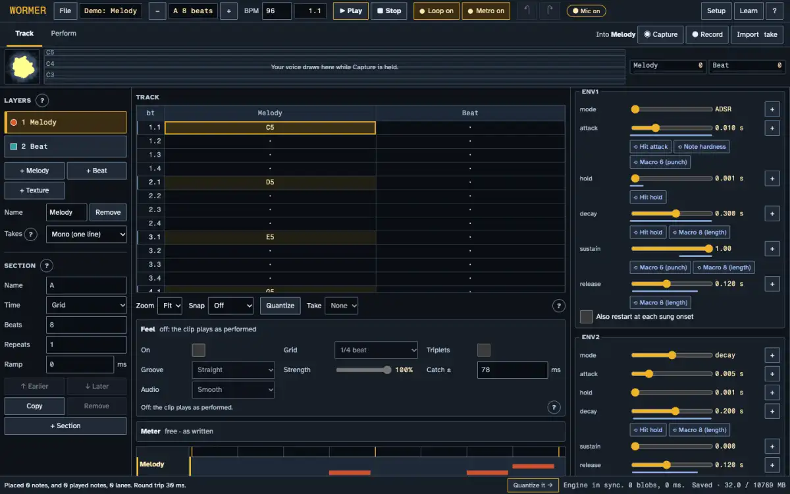
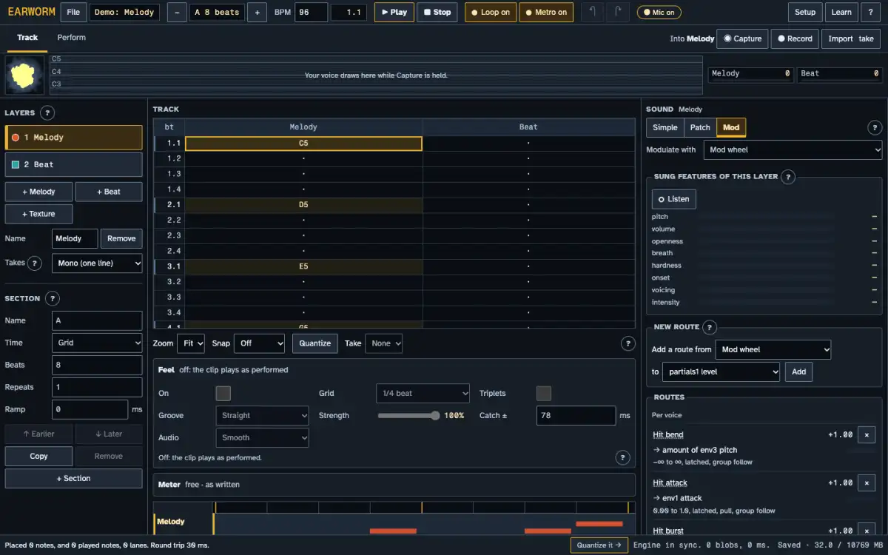
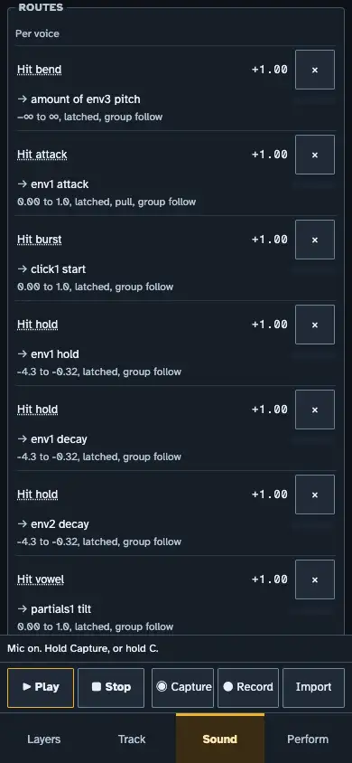

# Modulation

[Guide contents](README.md) · In the app: Learn, **Make hardness set the attack**

Modulation makes a value move by itself: the filter opens as you sing louder, the attack gets shorter on hard notes, the mod wheel adds vibrato. In Earworm each such connection is a **route**: a **source**, the **value** it moves, and a **shaper** that says how.

## Sources

The **Modulate with** menu (in the Patch and Mod views) lists every source:

| Source | Moves with |
| --- | --- |
| **Envelope 1–3**, **LFO 1–3** | Each note's own envelopes and LFOs. |
| **Note pitch**, **Velocity**, **Note hardness** | The note being played. Hardness is how hard it starts: the strength of a sung onset, or a written note's hardness. |
| **Sung pitch / volume / openness / breath / hardness / onset / voicing / vowel / intensity, per note** | What your voice did on that note, read from its take, or from the mic for the voice Live follow plays. |
| **Macro 1–8** | The eight macro sliders (bright … length). |
| **Mod wheel**, **Pitch bend**, **Pressure** | A MIDI keyboard's controls, or their stand-ins in Perform. |
| **Layer LFO 1–2** | Two slow LFOs shared by the whole layer. |
| **Sung … , whole layer** | Your voice as the whole layer hears it: from the mic while the layer listens, else from its take while the song plays. |

**Intensity** is how bright and pressed the voice is: high bands against low ones.

## Adding a route

The quick way, in **Patch**:

1. Pick a source under **Modulate with**.
2. A **+** appears beside every slider that source can reach. Press the one you want.
3. The Sound panel switches to **Mod** with the new route's shaper open.

Or in **Mod**, under **New route**: pick **Add a route from** and **to**, then press **Add**.

A source cannot move itself or its own kind: an envelope or LFO cannot move any envelope or LFO value. Earworm refuses such a route and says why.

## The shaper

The shaper of the selected route sits under the title **Shaper: Note hardness → env1 attack**:

| Control | What it does |
| --- | --- |
| The curve | How the source maps onto the value. Drag its points. **Straight line** resets it. |
| **From**, **To** | The part of the value's range the route covers. |
| **Bend** | Curves the line without moving points. |
| **Rise ms**, **Fall ms** | Smooths the source: how quickly the route follows it up and down. |
| **Polarity** | **up (0 to +1)**, **down (-1 to 0)** or **both (-1 to +1)**. |
| **Mode** | **add** moves the value up or down; **scale (gains only)** multiplies it; **pull toward the source** draws the value toward where the source is. |
| **Group** | Ties the route to one of the layer's gesture depths (loud, open, hard, breath, mouth, follow), so that slider in Gestures scales it. |
| **Via** | A second source that scales the route. For example, Via Mod wheel on an LFO-to-pitch route makes the wheel set the vibrato's depth. |
| **Latch at note start** | Reads the source once when the note starts and holds it. |
| **Amount** | How far the route moves the value, from -1 to +1. Left of the middle reverses it. The amount is kept per state, so a morph between states can deepen or remove a route. |

## The Mod view

From top to bottom:

- **Sung features of this layer**: meters for pitch, volume, openness, breath, hardness, onset, voicing and intensity, and a **Listen** button that lets the mic drive them. Use it to see what your voice is sending before you route it.
- **Shaper**: the selected route, as above.
- **New route**: the form described above.
- **Routes**: every route of the layer, per voice and per layer, as cards. Each card shows its source and amount, the value it moves and where that value is right now, the shaper's settings, and **×** to remove it. Routes that come with the macros are folded away so the list stays short.

In the Patch view, the routes into a slider show as badges under it, and a blue bar shows how far they can move it.

## Ideas

- **Sung volume, whole layer → filter1 cutoff**: the filter opens as you sing louder.
- **Note hardness → env1 attack, amount below 0**: harder notes start quicker. This is [tutorial 3](tutorials/03-hardness-controls-attack.md).
- **Mod wheel → LFO amount on pitch**: classic wheel vibrato.
- **Layer LFO 1 → reverb1 mix**: the room breathes in and out on its own.

Next: [Playing live](06-playing-live.md).
