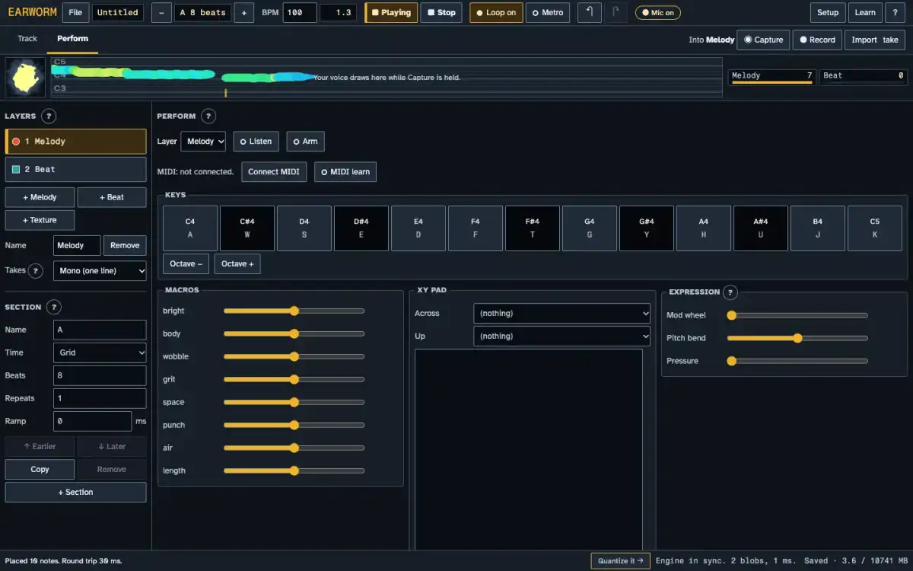
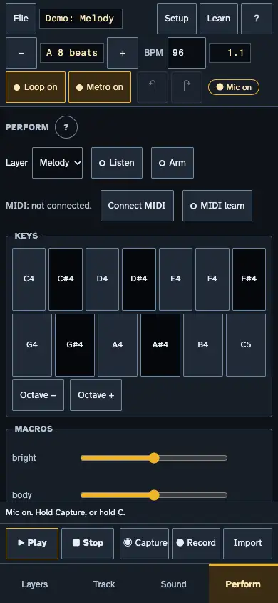

# Playing live

[Guide contents](README.md)

The **Perform** place turns Earworm into an instrument. Press **Perform** in the place bar, or **Alt 3**. It plays the selected layer from the computer keyboard, a MIDI keyboard, the on-screen keys or your voice.



## The top rows

- **Layer**: which layer Perform plays. It follows the layer you select in the Layers panel.
- **Listen**: the mic drives this layer's sung features (its volume, openness, hardness and so on) while the notes come from the keys or MIDI. Sing "ah" and "oo" while holding a key and hear the sound follow your mouth.
- **Arm**: Live follow. Your voice plays the layer directly: sing and the synth follows your pitch, without recording.
- **MIDI**: the device state, **Connect MIDI**, and **MIDI learn**.
- **Sung**: meters for the volume, intensity, hardness and pitch the mic hears.

Listen and Arm need the mic on.

## Computer keys

While Perform is on screen, the keyboard plays an octave from C:

```
 W E   T Y U
A S D F G H J K
C D E F G A B C
```

**A** is C4, **W** is C♯4, through **K** for C5. **Z** and **X** (or **Octave −** and **Octave +**) move the octave. On a beat layer, **A S D F** play kit slots 1 to 4 (kick, snare, hat, open), and the keys show four pads instead.

A pressed key lights up on screen and sounds exactly as a tap or a MIDI note does, so it can be recorded. The keys do nothing while you are typing in a box, and nothing in the Track place.

## MIDI

1. Plug in the keyboard, then press **Connect MIDI**. The browser asks for permission.
2. The line reads **MIDI: <your device name>**, here and in the transport chip.
3. Play. Notes play the selected layer with their velocity. The mod wheel (CC 1), pitch bend and channel pressure become the **Mod wheel**, **Pitch bend** and **Pressure** sources ([Modulation](05-modulation.md)); they do nothing until a route takes from them.

On a beat layer, notes 36, 38, 42 and 46 (General MIDI kick, snare, closed hat and open hat) play kit slots 1 to 4; other notes play nothing there.

**Which layer each MIDI channel plays**, near the bottom, lets one keyboard split or several devices play different layers: set a channel to a layer, and notes on that channel play it whatever is selected. Empty means the selected layer.

The line **MIDI note to engine** shows how long notes take from the device to the sound engine (median, 95th percentile and worst).

Safari has no Web MIDI. Perform says so, and the keys, the XY pad, the wheel stand-ins and the macros still play.

## MIDI learn

Map a knob or fader to anything on screen:

1. Press **MIDI learn**.
2. Touch the control to map: a macro (in Perform or Simple), or any slider in the Patch view. Tabbing to it counts as a touch.
3. Move the knob on your controller.

From then on, that controller sets the value directly in the state you are editing. Moves are committed as one undo step ("Controller") half a second after you stop. Learning the same controller again moves it to the new control; **Forget** in the learned list removes it.

The map is kept with the project. The last map you learned for a device also becomes that device's default for projects that have none.

## Macros, Expression and the XY pad

- **Macros**: the same eight sliders as in the Sound panel, laid out to play.
- **Expression**: **Mod wheel**, **Pitch bend** and **Pressure** stand-ins, for when you have no MIDI keyboard. The bend springs back to the middle when you let go. Like the real ones, they only move what a route takes from them.
- **XY pad**: pick what **Across** and **Up** move (any value of the layer, or a macro), then drag on the pad. With the pad focused, the arrow keys move it too.

## Scenes

Each state of the layer is a scene. Tap a scene button and the layer morphs to that state over **Morph time** (400 ms by default) and stays there. Add states in Sound, **States** ([chapter 4](04-synth-and-patches.md#states)) to have more than one.

While the song plays a clip with morph markers, the markers win. When it stops, or the clip has none, the last scene tapped holds.

## Recording what you play

**● Record** in the transport (or **R**) records everything you play and move here as one pass. See [Recording passes and automation](07-recording-and-automation.md) and [tutorial 4](tutorials/04-live-pass.md).



Next: [Recording passes and automation](07-recording-and-automation.md).
