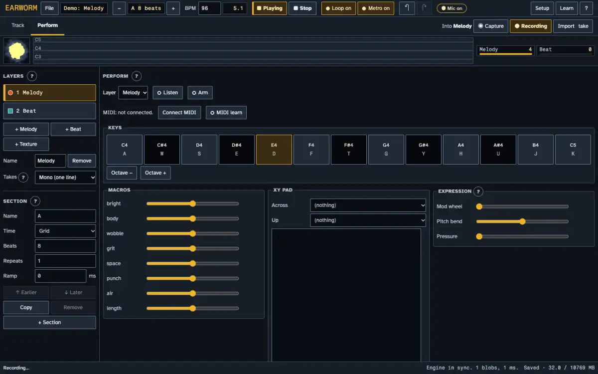
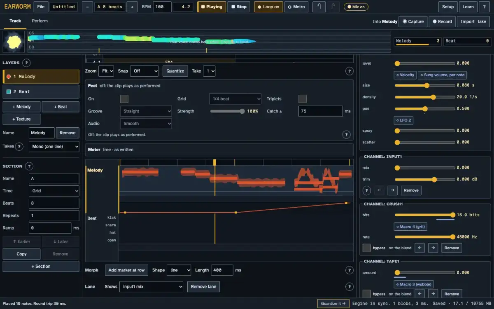

# Recording passes and automation

[Guide contents](README.md)

Capture is for your voice. **Record** is for a whole performance: the notes you play, the knobs you turn and the scenes you tap, recorded together while the song plays, and kept as one undo step.

## Record a pass

1. Select the layer to play.
2. Press **● Record** in the place bar, or **R**. If the song is stopped and the section is on a grid, you get a one-bar count-in, then the section plays. The button reads **● Recording**.
3. Play notes from the computer keys or MIDI, move macros, sliders, the XY pad, the wheel stand-ins or a learned controller, tap scenes.
4. Press **Record** or **R** again to stop.

The status line sums it up, for example **Recorded 3 played notes, 0 lanes.**, and offers **See it on the track →**.

What a pass keeps:

- **Notes** you played, with their velocity, placed where you heard them (the output delay is taken off) and with the layer's Tune octave taken off.
- **Moves** of any value, macro, level, pan, mod wheel, bend or pressure, as **automation lanes** on the clip.
- **Scene taps**, as **morph markers**, with one at the start of the pass for the state the layer was in.
- **The mic**, if it is on, as a take into the selected layer.

**Mind the mic.** With the mic on, the pass also records a take into the selected layer, and a take replaces the notes that layer had in this section, even if you only played keys and the take is silence. To add played notes to what is already there, record with the mic off (press **Start**, not Start with mic). If notes vanish, **Undo** brings the whole pass back out.

While you record, a hand move overrides any automation lane for that value, so you hear what you play. A lane you move records over its old points from your first move to the end of the pass.

## Automation lanes

Each layer's lane in the timeline has a thin strip at the bottom: its automation. It draws one value of the clip over time.

- **Lane → Shows** (under the timeline) picks which value the strip shows and edits: a macro, the level, any value of the patch.
- **Double-click** the strip to add a point; double-click a point to remove it. **Drag** a point to move it in time and value.
- **Remove lane** deletes every point of that lane from the clip.

While the song plays, a lane sets its value; before its first point it holds that point's value, after the last point the last one's. Outside a recording pass, moving the same knob by hand does not override a lane.

## Morph markers

A morph marker moves a layer's sound to one of its states, over a set time, at a point in the section. They sit in the strip just above the automation strip.

1. In Sound, **States**, pick the state the marker should move to (Editing).
2. Put the pattern grid's cursor on the row where the move should start.
3. Under the timeline, set **Shape** (line, ease, late, step or wobble) and **Length** in milliseconds.
4. Press **Add marker at row**.

Drag a marker along its strip to move it. The list under the toolbar names each marker's state; press one there to remove it. A marker's notches count its state's number, so markers can be told apart without color.

While the song plays, the sound follows the markers. Scenes tapped in Perform become markers when you record them.

Next: [Mixing your voice and the synth](08-mixing-vocal-and-synth.md).
