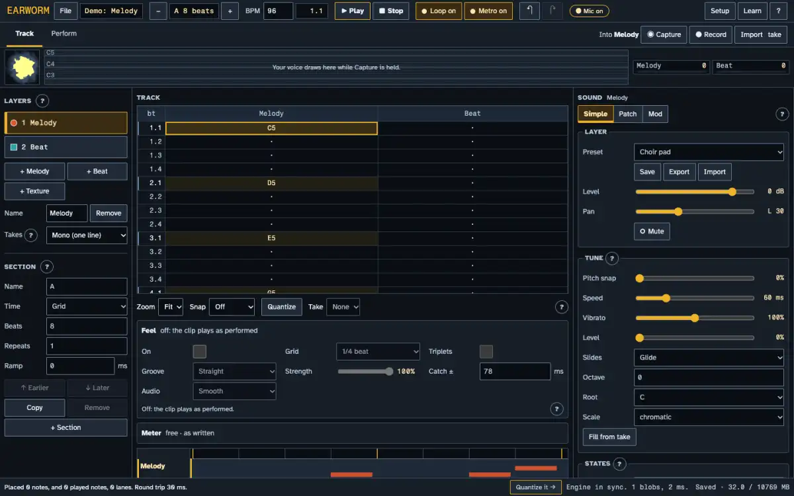
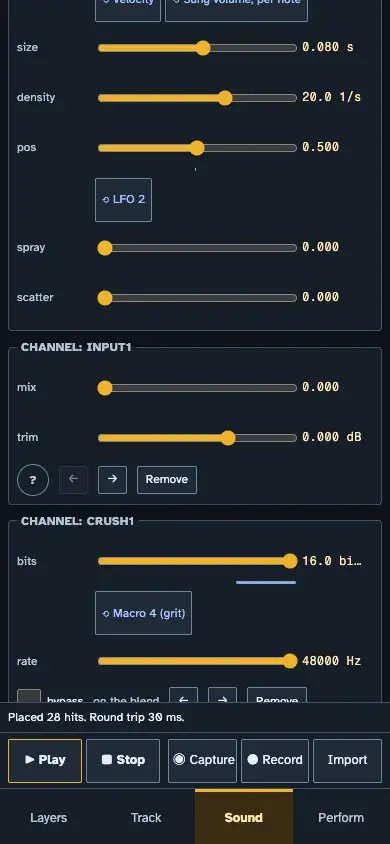

# Mixing your voice and the synth

[Guide contents](README.md)

A take keeps your real voice as well as the notes read from it. By default you hear only the synth playing those notes. This chapter covers the layer's level and place in the mix, and how to bring the real voice back in beside the synth, or slide from one to the other.

## Level, pan and mute

In Sound, **Simple**, the **Layer** box has:

- **Level**: -60 to +12 dB. The number beside it reads the value.
- **Pan**: left to right. It reads **L**, **C** or **R**, so the side is never only a position.
- **Mute**: silences the layer. The layer list says **mute** beside it.

The small meters in the monitor strip count how many voices each layer is sounding.

## The raw input

The **input** channel effect lets your raw voice through beside the synth. It plays:

- the **mic**, live, while the layer is in Listen or Arm in Perform;
- the **take's own audio** on playback, at its place in the song.

To add it: Sound, **Patch**, **+ channel effect**, then **input (the raw mic or take beside the synth)**. Its card, **Channel: input1**, has two values:

- **mix**: 0 is all synth, 1 is all raw voice, and anything between is an equal-power crossfade, so the blend does not dip in the middle.
- **trim**: the raw voice's level, -24 to +12 dB.

Where the input sits in the channel chain matters. Effects **after** it (marked **on the blend**) process the synth and the voice together, so a reverb after the input puts both in the same room. Effects **before** it run on the synth alone, or, with **raw input only** ticked, on the raw voice alone. Use **← →** on a card to move it.

**Import take** adds an input at mix 1 by itself, so an imported file plays as audio straight away.

## Sliding between them

Because **mix** is a value like any other, it can move:

- **Automate it**: Lane → Shows → **input1 mix**, then double-click points into the strip. [Tutorial 5](tutorials/05-synth-to-voice.md) slides from synth to voice across a section this way.
- **Record it**: map a knob with MIDI learn, or put mix on the XY pad, and record a pass while you move it.
- **Modulate it**: route a source to it, for example **Sung volume, whole layer**, so loud notes bring the real voice forward.

## Evening out a take

The **Level** slider in **Tune** does not set a volume. It evens out the loudness your take drives the synth with: at 0% the notes follow your dynamics as sung, and toward 100% quiet notes come up and loud ones come down. Use it when a line was sung unevenly; use the layer's **Level** for its volume in the mix.

## Hearing the result

**File → Export mix (WAV)** renders the whole song to a stereo file, faster than real time, without the click. See [Saving, sharing and exporting](12-saving-sharing-exporting.md).

Next: [Quantizing with Feel and stretching audio](09-quantizing-with-feel.md).
