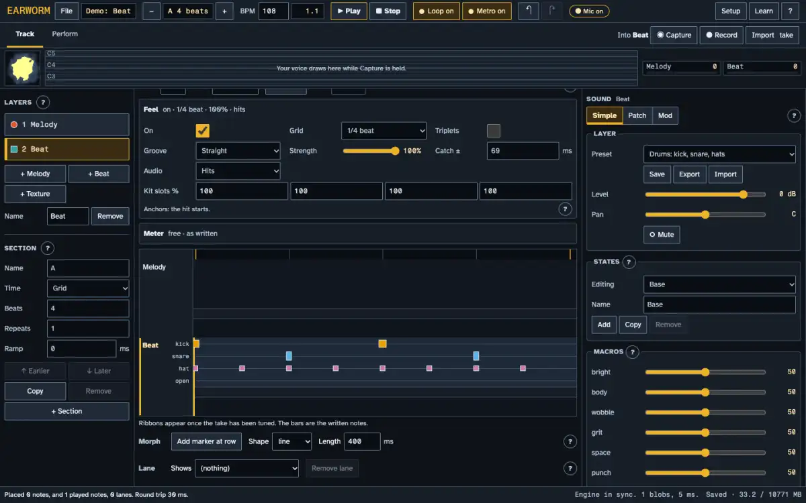
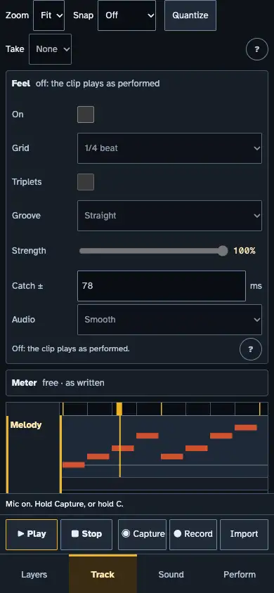

# Quantizing with Feel and stretching audio

[Guide contents](README.md) · In the app: Learn, **Edit the arrangement** (step "Zoom, snap and quantize")

Feel tightens a clip's timing while the song plays, and leaves what you recorded alone. Your notes, hits and take stay exactly as performed; Feel decides where they sound. Turn it off and the performance comes back. Turn **Strength** down and some of your timing comes back.

It also moves the audio: a take's real voice or beatbox is stretched so it lands with the notes, with its pitch kept.

## Turning it on

Any of these turns Feel on for the selected layer's clip in this section:

- **Quantize it →** in the status line, offered right after a take lands.
- **Quantize** on the timeline toolbar. It uses the **Snap** grid, or a quarter beat when Snap is off, at 100% strength.
- The **On** box in the Feel row.

The Feel row sits under the timeline toolbar. Folded, its summary reads like **on · 1/4 beat · 100% · smooth**.

## The Feel row

| Control | What it does |
| --- | --- |
| **On** | Feel on or off for this clip. |
| **Grid** | Where things are pulled to: a beat, ½, ¼ or ⅛ of a beat. |
| **Triplets** | Adds triplet positions of the same size. |
| **Groove** | **Straight**, or **Swing**: every other grid step is pushed late. |
| **Swing** | How far, 50% (straight) to 75%. Shown when Groove is Swing. |
| **Strength** | 100% lands exactly on the grid. Lower keeps part of your own timing. |
| **Catch ±** | How far from a grid line, in ms, a note still gets pulled to it. Notes farther away ride along with their neighbours instead. Changing **Grid** can change Catch to suit; set Catch after Grid. |
| **Audio** | How the take's own audio is stretched: **Hits** cuts it at each attack and moves the pieces (best for drums and beatbox, the default on beat layers); **Smooth** stretches it evenly (best for singing, the default on melody and texture layers). |
| **Kit slots %** | Beat layers only: a strength for each slot (kick, snare, hat, open). Lock the kick and snare at 100% and leave the hats at 50% for a looser feel. |

The line under the row says what Feel is working from, for example **Anchors: 10 from the take (2 soft). The raw input is stretched with the anchors.**

## How it decides

When Earworm reads a take it marks its **anchors**: the moments that should land on a beat. On a beat take these are the attacks of the hits. On a sung take they are the starts of notes; where you slid from one note into the next without a new attack, the anchor is **soft** and only bends the timing rather than cutting it.

When the song plays, each anchor is pulled toward the nearest grid position by Strength (times its kit slot's percentage on a beat layer), if it is within Catch. Notes and hits move with their anchors. Each grid position takes at most one anchor, so two notes never pile up on the same spot. A clip with no take (written notes only) uses the note and hit starts as anchors.

## Stretching audio

The audio moves too, whenever the layer plays its take's audio: after **Import take**, or once you have added an **input** effect ([chapter 8](08-mixing-vocal-and-synth.md)). The stretch keeps the pitch and keeps each attack intact, so a sung consonant or a snare's crack is not smeared.

## Bringing in audio files

**Import take**, beside Record, puts an audio file on the selected layer from the start of the section, as a take. Earworm reads it as it reads a capture: notes or hits, anchors, and a curve of the sound. It also adds an **input** at full mix, so you hear the file. The status line says what came in, for example **Imported hum.wav: 6.0 s, 10 notes, 10 anchors. The layer plays it as audio (an input element at mix 1).** Then **Quantize it →** to tighten it.

Next: [Polyphonic takes from guitar or piano](10-polyphonic-takes.md).
