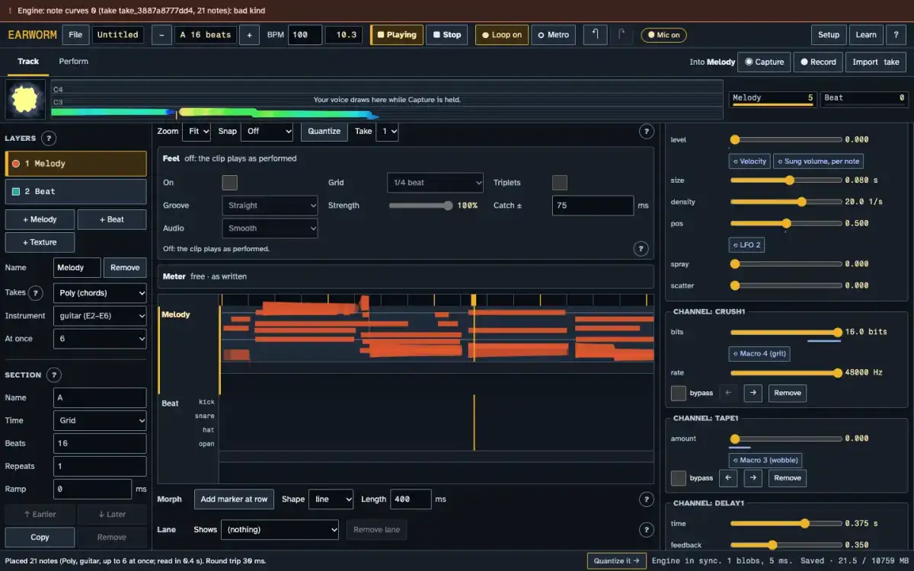
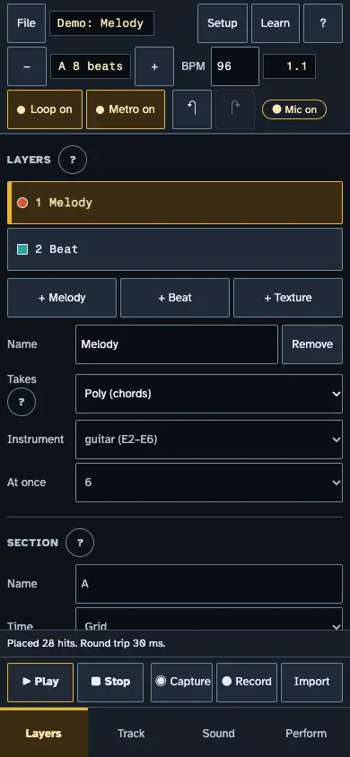

# Polyphonic takes from guitar or piano

[Guide contents](README.md)

A normal take hears one line of notes, as a voice sings it. Set a layer to **Poly** and a take into it can hold chords: strum a guitar or play a piano into the mic, and the take comes back as several notes at once, which the layer's synth then plays.

## Set the layer to Poly

1. Select a melody or texture layer.
2. In the Layers panel, set **Takes** to **Poly (chords)**.
3. Pick the **Instrument**. It sets the range Earworm listens to:
   - **guitar (E2–E6)**, 6 notes at once by default;
   - **piano (A0–C8)**, 8 at once;
   - **other (A1–C7)**, 8 at once.
4. **At once** is how many notes may sound together, 1 to 8. Counts above what the layer's patch can play are greyed out. Changing the instrument resets this to its default unless you had changed it.

## Capture

Hold **◉ Capture** (or **C**) and play, as for a voice. Some differences:

- **The layer is silent while you play.** There is no live chord sound yet. You hear the song and your instrument.
- A Poly take can run up to **5 minutes**.
- When you let go the status line says **Reading the notes of 10.6 s…**; a few seconds later, **Placed 21 notes (Poly, guitar, up to 6 at once; read in 0.4 s)**.

Each note keeps a curve of its own: how its pitch bent, how loud it was and how it faded, so a bent guitar string bends on the synth too.

When more notes ring than **At once** allows, a new note takes the free voice nearest in pitch; if every voice is busy, it replaces the quietest note only if it is clearly louder, otherwise it is dropped. Lower **At once** for a cleaner, sparser part; raise it for full chords.

## Getting good chords

- A clean, close signal works best: a guitar into an audio interface, or the mic close to the soundhole or the piano's strings.
- Play in time with the click; [Feel](09-quantizing-with-feel.md) can tighten it afterwards.
- Pick a sound with a slow release, such as **Glass** or **Choir pad**, so the chords ring.
- **Import take** reads a file as one line even on a Poly layer. For chords from a recording, play the recording into the mic, or capture the instrument live.

## Known issue

In the current build, after a Poly take a red line may appear at the top of the page: **Engine: note curves 0 (take …, 21 notes): bad kind**. The notes still play, at their own pitches, but without their per-note bends and volume curves. This is a known bug in the app.

Next: [Meters and re-metering](11-meters.md).
