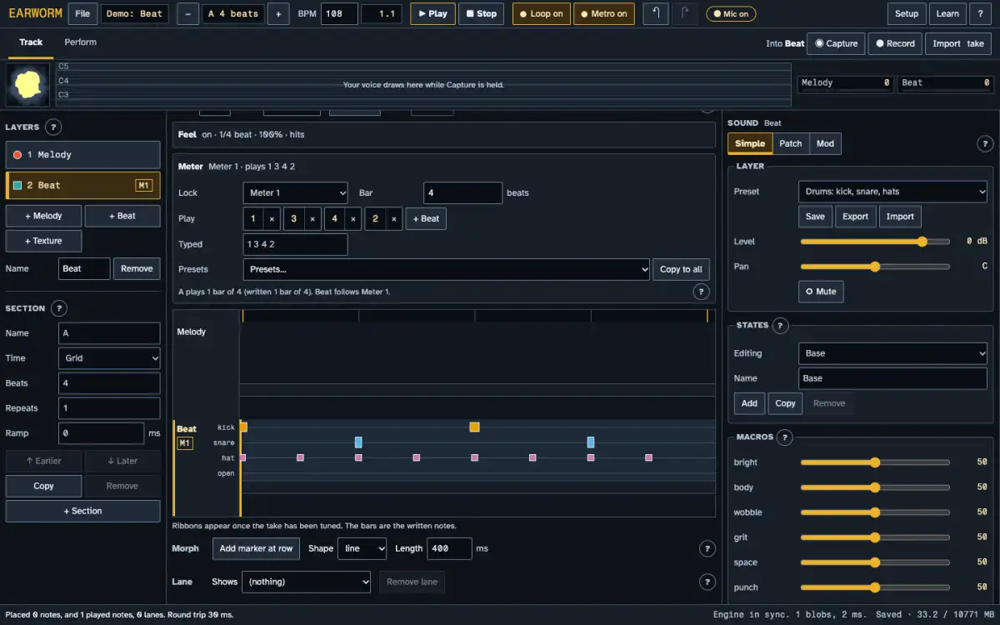
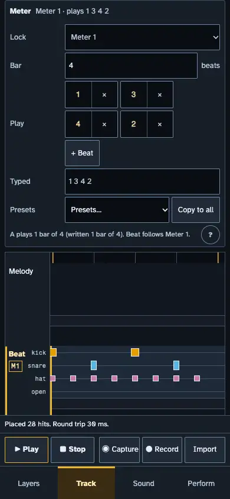

# Meters and re-metering

[Guide contents](README.md)

Re-metering plays the beats of each bar in a new order, without touching what you recorded. Drop the last beat of a 4/4 groove and it plays in 3/4. Play a beat twice and a 3/4 groove plays in 4/4. Swap beats around and the same groove turns into a new one.

## How it works

A **meter** cuts each bar into beats. Every clip **locked** to the meter is cut along those beats and played in the order the section's **pattern** gives:

| Pattern (on a 4-beat bar) | What you hear |
| --- | --- |
| `1 2 3 4` (as written) | The bar as recorded. |
| `1 2 3` | Beat 4 dropped: a bar of 3. |
| `1 2 3 3` | Beat 3 twice, beat 4 dropped. |
| `1 3 4 2` | The same four beats, shuffled. |
| `1 2 3 4 4` | Beat 4 repeated: a bar of 5. |

Each cut falls on the clip's own hit or note nearest the beat, so a hit played a little early stays with its beat. Takes, notes and hits are never changed; set the pattern back to as written and everything plays as recorded.

**Meter 1** is the song's main meter. Its pattern also sets how long the section plays, where the bar lines fall, and which click is accented. Re-metering works in grid sections.

## The Meter row

Under the Feel row in the Track place, for the selected layer. Folded, its summary reads like **Meter 1 · plays 1 2 3**.

| Control | What it does |
| --- | --- |
| **Lock** | **Free** plays this layer's clips as written. **Meter 1** locks them all to the meter. It reads **Mixed** if the layer's clips differ. |
| **Bar** | Beats per bar of the meter. For Meter 1 this is the same number as **Beats in a bar** in Setup: change one and the other follows. |
| **Play** | The pattern as beat chips. Press a chip to repeat it, drag it to move it, **×** to drop it. **+ Beat** adds the first beat the bar does not play yet, or the last one again. |
| **Typed** | The pattern as numbers, for example `1 3 4 2`. Empty plays as written. |
| **Presets** | **As written**, **Drop last**, **Repeat last**, **Shuffle 1 3 4 2**. |
| **Copy to all** | Uses this section's pattern in every section. |

The line under it says what happens, for example **A plays 1 bar of 3 (written 1 bar of 4). Beat follows Meter 1.**

The pattern belongs to the section, so a verse can play in 3 and a chorus in 4. The lock belongs to the layer, so you can keep a melody as written while its beat is re-metered, or the other way round.

A locked layer shows **M1** beside its name in the layer list and in the timeline, so the lock is never shown by color alone.

## While it plays

The playhead, each locked lane's playhead and the pattern grid's playing row follow the written beat being played: they skip a dropped beat and jump back for a repeated one. The click counts Meter 1's bars as played, so `1 2 3` clicks in three.

A note held across a dropped beat can ring on without its attack. If a pattern sounds clipped, try a cut at a different beat, or drop a different one.

## Keys

The chips are one Tab stop. **← →** move between them, **Shift ← →** moves a beat earlier or later, **Delete** drops it, **Enter** repeats it.

See [tutorial 8](tutorials/08-four-four-to-three-four.md) for a walk-through.

Next: [Saving, sharing and exporting](12-saving-sharing-exporting.md).
