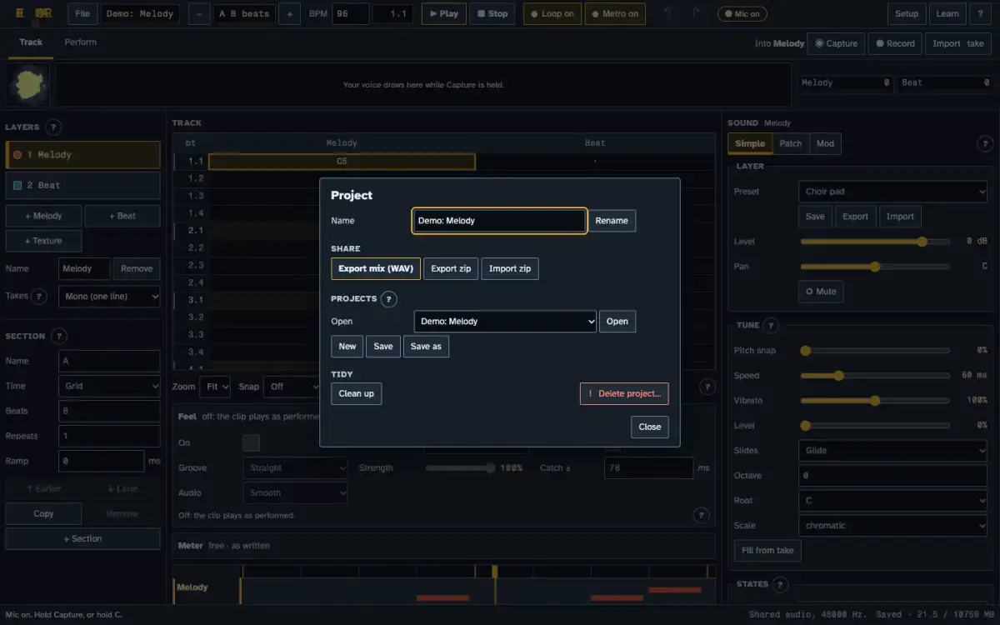
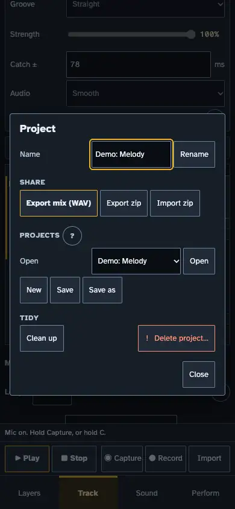

# Saving, sharing and exporting

[Guide contents](README.md) · In the app: Learn, **Keep the project**

## Saving happens by itself

Earworm saves the song in this browser as you edit, together with its undo history. The footer says **Saved** (or **Saving** while it writes) and how much of the browser's storage the songs use, for example **21.5 / 10759 MB**. When you open Earworm again it reopens the last song.

Everything stays in this browser on this computer. Another browser, another computer, or a private window will not see it. To move a song, or keep a copy that survives clearing the browser's data, export a zip.

## The File dialog

Press **File** in the transport.

**Name** and **Rename**: the song's name, also shown in the transport.

**Share**

- **Export mix (WAV)** renders the whole song, every section and repeat, to a stereo WAV file, faster than real time. The click is never in it. The engine line at the bottom right says how fast it went, for example **Mix saved. 47.3× realtime, peak 0.38.** The file is named after the song.
- **Export zip** downloads one zip with the song and all the audio it uses: takes, imported files, sounds. Keep it as a backup or send it to someone.
- **Import zip** opens such a zip, including one made by an older version of Earworm.

**Projects**

- **Open** lists the songs kept in this browser.
- **New** starts an empty song with a Melody and a Beat layer.
- **Save** writes the song now (it is saved as you go anyway).
- **Save as** keeps a copy under the name above.

**Tidy**

- **Clean up** removes takes and sounds that nothing in the song or in the undo history still uses, to free storage. Undo puts a cleaned-up take back in the song, but its audio is gone for good.
- **Delete project…** removes the song from this browser.

## Demos

**Learn → Demos** opens a copy of a demo song (Melody, Beat or States). Your changes go into the copy, named **Demo: Melody** and so on; the built-in demo stays as it was.

## Presets

A layer's sound can be saved on its own: Sound, Simple, **Save** keeps it under **Yours** in the Preset menu, in this browser. **Export** downloads it as a `.earworm-patch.json` file you can send or keep; **Import** loads one, checks it, and adds it to Yours.

## MIDI maps

What you map with MIDI learn is saved in the song. The last map learned for each device is also kept in the browser as that device's default for other songs.

## Storage

When the songs use 80% of what the browser allows, the footer adds **nearly full**. Export zips of songs you want to keep, then **Clean up** or **Delete** old ones.

Next: [Keyboard shortcuts](13-keyboard-shortcuts.md).
