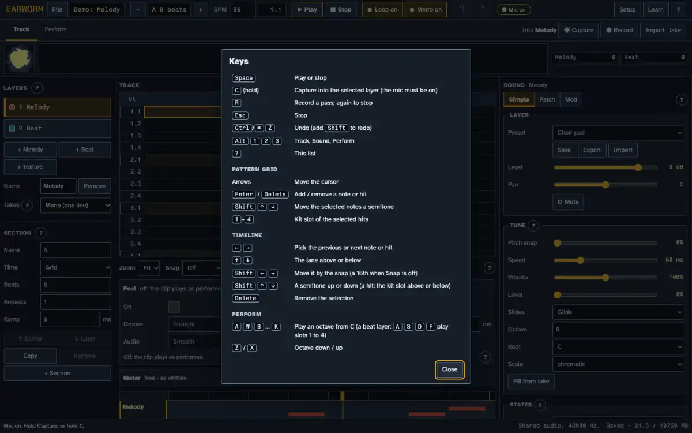
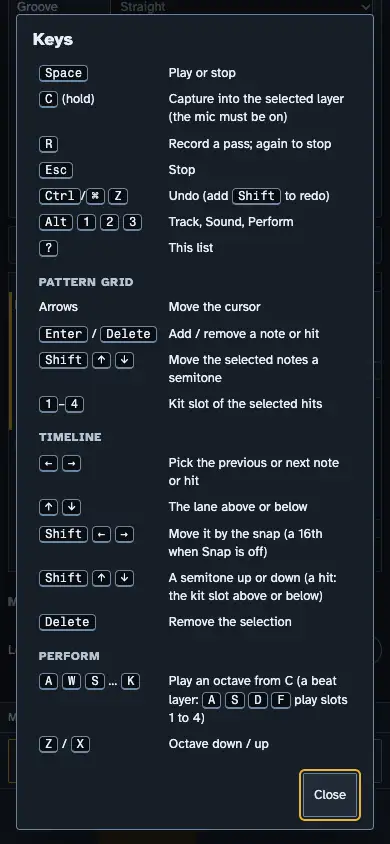

# Keyboard shortcuts

[Guide contents](README.md)

Press **?** (or the **?** button at the right of the transport) for this list inside the app.

## Everywhere

| Key | What it does |
| --- | --- |
| **Space** | Play from the start of the section, or stop. On a focused button, checkbox or tab, Space presses that control instead. |
| **C** (hold) | Capture into the selected layer. The mic must be on. |
| **R** | Start recording a pass; press again to stop. |
| **Esc** | Stop. Also closes a dialog or a help bubble. |
| **Ctrl Z** / **⌘ Z** | Undo. |
| **Shift Ctrl Z** / **Shift ⌘ Z**, or **Ctrl Y** | Redo. |
| **Alt 1**, **Alt 2**, **Alt 3** | Track, Sound, Perform. |
| **?** | The key list. |

C, R and Space do nothing while you are typing in a box or while a dialog is open.

## Pattern grid

| Key | What it does |
| --- | --- |
| **Arrows** | Move the cursor. |
| **Enter** | Add a note (or a hit on a beat layer). |
| **Delete** | Remove the note or hit. |
| **Shift ↑ / ↓** | Move the selected notes a semitone. |
| **1** – **4** | Set the kit slot of the selected hits. |

## Timeline

Click the timeline or Tab to it first.

| Key | What it does |
| --- | --- |
| **← →** | Pick the previous or next note or hit. |
| **↑ ↓** | Pick the lane above or below. |
| **Shift ← →** | Move it by the snap (a 16th when Snap is off). |
| **Shift ↑ ↓** | A semitone up or down; for a hit, the kit slot above or below. |
| **Delete** | Remove it. |

## Perform

Only while the Perform place is on screen.

| Key | What it does |
| --- | --- |
| **A W S E D F T G Y H U J K** | Play an octave from C (A is C, W is C♯, … K is the C above). |
| **A S D F** on a beat layer | Kit slots 1 to 4. |
| **Z** / **X** | Octave down / up. |
| **Arrows** on the focused XY pad | Move the pad. |

## Meter chips

| Key | What it does |
| --- | --- |
| **← →** | Move between beats. |
| **Shift ← →** | Move a beat earlier or later. |
| **Enter** | Repeat it. |
| **Delete** | Drop it. |

Next: [Phones and tablets](14-phones-and-tablets.md).
