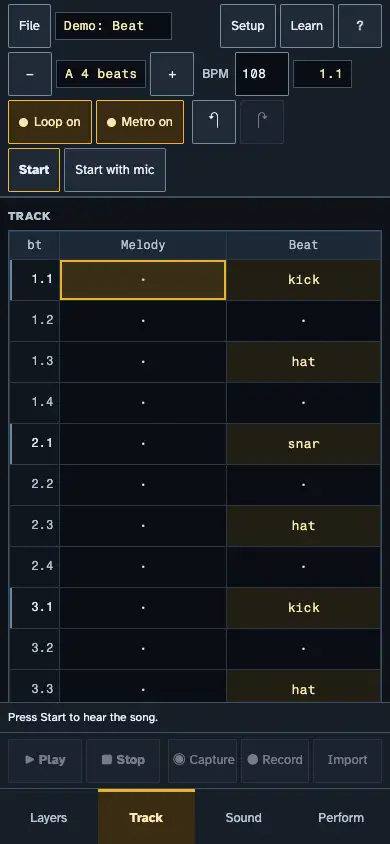
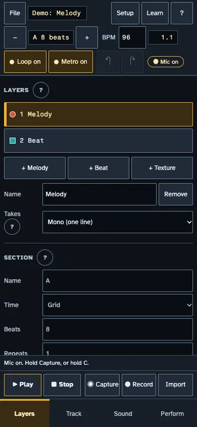
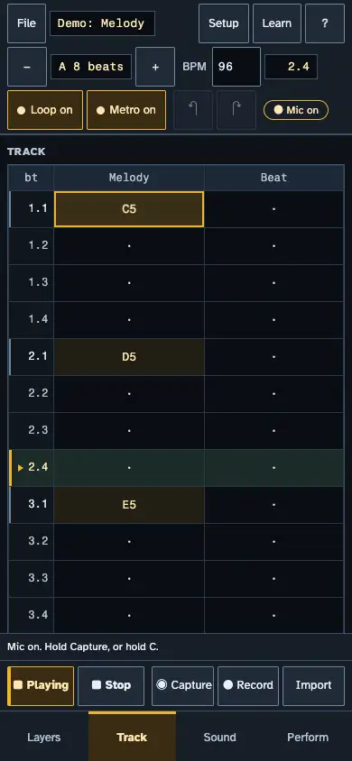
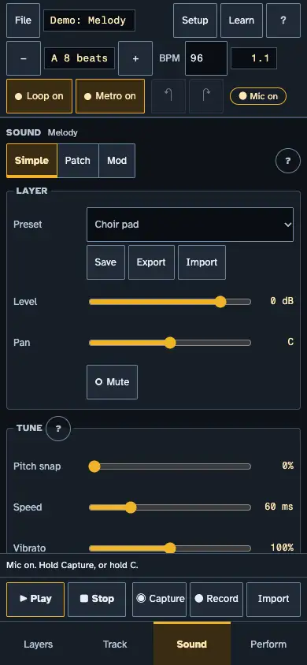
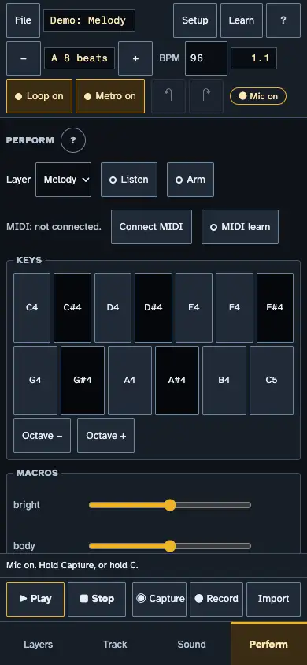
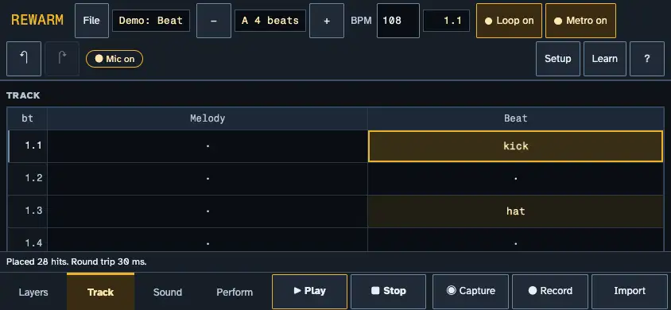
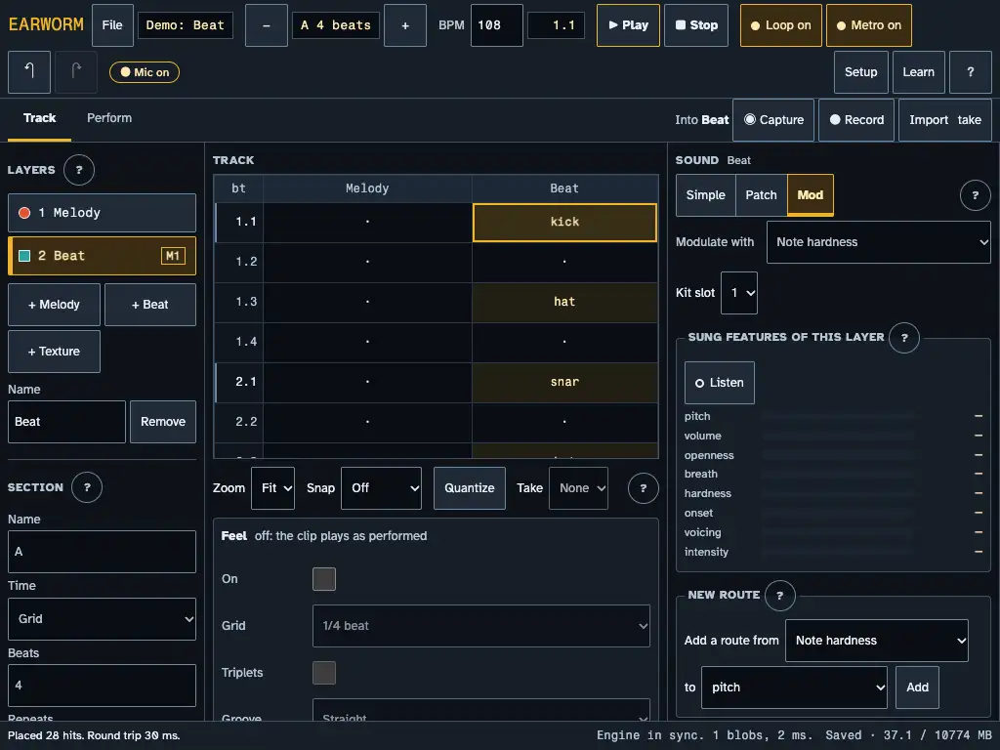

# Phones and tablets

[Guide contents](README.md)

Earworm works on a phone or tablet in the browser, with a layout made for a narrow screen. Headphones matter even more here, since a phone's speaker sits right by its mic.

## On a phone

The whole page scrolls. At the top are File, the section, the tempo, Loop, Metro, Undo and Redo; they scroll away as you work, and come back when you scroll up.

The **dock** stays at the bottom:

- the status line;
- **▶ Play**, **■ Stop**, **◉ Capture**, **● Record** and **Import**;
- the places: **Layers**, **Track**, **Sound** and **Perform**, one at a time.

Hold **Capture** with your thumb while you sing. The pitch ribbon and the voice meters appear above the track only while Capture or Record runs, to leave room for the track the rest of the time.

| Layers | Track | Sound | Perform |
| --- | --- | --- | --- |
|  |  |  |  |

### Touch on the timeline

- A finger on a note or hit drags it.
- A finger on empty space pans the timeline.
- Two quick taps on empty space add a note.

Every button and box is at least 44 pixels tall on a touch screen, and each meter chip and its × too.

### Phone on its side

Turned sideways, the dock's controls share one row, and the Klont and voice meters stay hidden until Capture or Record runs.

## On a tablet

A tablet in landscape gets the laptop layout: Track (layers, track, sound side by side) and Perform. In portrait, or on a smaller tablet, the four places take turns as on a phone. In a narrow layer column, the names sit above their controls so nothing is cut off.

## Things to know

- Phones and tablets have no MIDI in Safari, and often none at all. The on-screen keys, the XY pad and the wheel stand-ins in Perform still play.
- There is no computer keyboard, so Capture and Record are the dock buttons, and Undo is in the header (scroll up).
- Mobile browsers may stop the audio when the screen locks or you switch apps. Press Start again when you come back.
- Measure the mic timing (**Setup → Measure**) with the headphones you will use; a Bluetooth headset adds a lot of delay.

Next: [Accessibility](15-accessibility.md).
