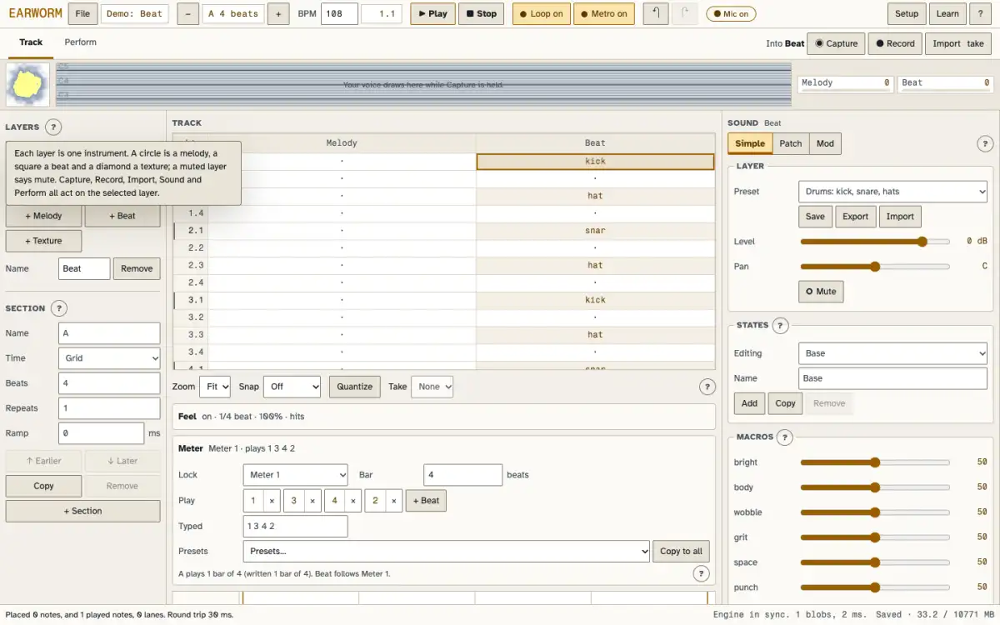
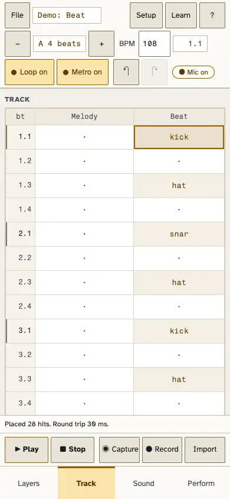

# Accessibility

[Guide contents](README.md)

Earworm is built from ordinary buttons, boxes, sliders and a grid, so it works with a keyboard and a screen reader, and it does not rely on color to say anything.

## Keyboard

- Everything can be reached with **Tab**. The first two stops are skip links: **Skip to the track** and **Skip to the sound**.
- The pattern grid is a single Tab stop; the arrows move inside it. The timeline is one Tab stop too, with arrow keys to pick and move notes and hits. The meter chips are one stop with arrows inside.
- Space, C and R have one meaning each (play/stop, hold to capture, record a pass), and leave you alone while you type in a box.
- **Alt 1 / 2 / 3** jump to Track, Sound and Perform.
- The full list is in [Keyboard shortcuts](13-keyboard-shortcuts.md), and behind **?** in the app.

## Screen readers

- Every control has a name that says what it does ("Tempo in beats per minute", "Section length in beats", "Import an audio file as a take").
- The status line, the project name and the section stepper are live regions: a screen reader hears "Placed 10 notes" or a new section name as it changes.
- On the timeline, a live region says what is picked, for example "Beat: kick at 1.1".
- Help is behind the **?** buttons, as native popovers: Tab to a **?**, press Enter to open, Esc to close.

## Not by color alone

- **Kit slots** each have a color (orange, sky blue, purple, yellow, from a palette chosen to stay distinct for color-blind eyes), a shape (kick a wide block, snare a tall one, hat a small square, open a hollow square), an outline, and their names beside their rows.
- **Morph markers** carry notches that count their state's number.
- **Toggles** (Loop, Metro, Mute, Listen, Arm, MIDI learn) show a ring that fills when on, and their label changes ("Loop on").
- **Pan** reads L, C or R. **Mute** says mute in the layer list. A meter lock says **M1**.
- The playing row in the grid has a triangle as well as a wash.

## Light and dark

**Setup → Theme**: **System** follows your computer's setting, or pick **Light** or **Dark**. The choice is kept in this browser. Both themes keep body text at a contrast of at least 4.5:1 and control edges at 3:1.

## Size and motion

- Nothing to click is smaller than 24 pixels; on a touch screen, 44.
- Browser zoom works; the layout reflows down to the phone layout.
- When your system asks for reduced motion, Earworm reduces its animation.

## Hearing

Earworm is a music app and much of it is about sound, but what it hears and does is also written down: the status line says what a take became, the Sung meters show what the mic hears as numbers, and the voice meters count what each layer plays.

Next: [Troubleshooting](16-troubleshooting.md).
