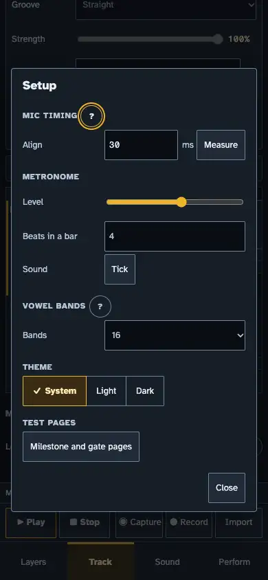

# Troubleshooting

[Guide contents](README.md)

## No sound

- Press **Start** first. Browsers do not let a page make sound until you press something on it.
- Check the layer is not muted (the layer list says **mute**) and its **Level** is not at the bottom.
- The click (**Metro**) is live only; it is never in an export.
- On a phone, the audio can stop when the screen locks or you switch apps. Reload and press Start.

## The microphone

**The browser did not ask, or I said no.** A red line at the top says **No microphone: …**. Allow the mic for this site in the browser: in Chrome, click the icon left of the address, set Microphone to Allow, and reload. Then **Start with mic**, or **Start** and **Enable mic**.

**Capture says "Capture needs the mic: press Enable mic."** The audio is on but the mic is not. Press **Enable mic**.

**The wrong mic.** Earworm uses the browser's default microphone. Change it in the browser's site settings (Chrome: the icon left of the address, or Settings → Privacy and security → Site settings → Microphone) or in the system's sound settings, then reload.

**The take is full of the backing track.** Use headphones. Earworm turns the browser's echo cancellation off so it hears your voice as it is, which also means it hears speakers.

**"Ignored: 0.32 s is under 0.5 s."** Hold Capture a little longer. A take must be at least half a second.

## Timing and latency

**Takes land late or early.** Open **Setup** and press **Measure** with the headphones on and near the mic. Earworm plays five chirps and writes the round trip into **Align**. Measure again for each pair of headphones or audio interface.

**Capture paused.** The audio device changed (headphones plugged or unplugged). Measure again in Setup, then carry on.

**Bluetooth headphones** add a lot of delay, often more than 150 ms, and it can drift. Wired headphones are much better for singing along.

**The sound lags when I play the keys.** Close other tabs and apps that use audio. Wired headphones help here too. With MIDI, the line **MIDI note to engine** in Perform shows how long notes take to reach the engine; a few milliseconds is normal.

## Browser support

Earworm is built and tested in **Chrome**. Edge runs the same engine. It needs WebAssembly, an AudioWorklet and, for the lowest latency, a cross-origin isolated page; the public build sets that up by reloading itself once on the first visit.

The engine line at the bottom right says how the audio runs:

- **Shared audio, 48000 Hz.** Normal.
- **Fallback audio, … This page is not cross-origin isolated.** Earworm still works, through a slower path. Reload once; if it stays, the page is being served without the headers it needs (for example from a plain file server).

Other browsers:

- **Safari** has no Web MIDI. The Perform place says **This browser has no Web MIDI (Safari, for one). The keys, pad, wheel and macros below still play.** The rest of Earworm has not been checked in Safari.
- **Firefox** has not been checked. If something does not work there, use Chrome.
- The help bubbles need a browser with popover support (Chrome and Edge 114 or later).

## MIDI

- **MIDI: Permission to use Web MIDI API was not granted.** Allow MIDI for the site in the browser's site settings, reload, and press **Connect MIDI** again.
- **The keyboard is connected but nothing plays.** Check the selected layer, and whether **Which layer each MIDI channel plays** sends that channel to another layer.
- **On a beat layer only four keys play.** That is by design: notes 36, 38, 42 and 46 (General MIDI kick, snare, closed and open hat) play kit slots 1 to 4.
- **The mod wheel does nothing.** The wheel, bend and pressure only move what a route takes from them. Add a route in Sound → Mod ([Modulation](05-modulation.md)).

## Performance

- The **Cost** meter in Sound → Patch shows how heavy a layer's patch is and how many voices it leaves. A heavy patch plays fewer notes at once; remove modules you do not need.
- Many layers with stretching audio, grains or reverbs add up. Mute layers you are not working on.
- If the sound crackles, close other tabs, plug in a laptop on battery, and avoid **Fallback audio** (see above).

## Things that look wrong

**Notes vanished after recording a pass.** With the mic on, a pass records a take into the selected layer, and a take replaces that layer's notes in the section. If the mic heard nothing, no take is kept and the notes stay, but a mic that hears your speakers records them. Undo once to get the notes back. To add played notes on top while the speakers play, record with the mic off. See [Recording passes](07-recording-and-automation.md#record-a-pass).

**The pitch ribbon still shows an old take.** The ribbon in the monitor strip shows the last capture until the next one, or until you open another song. The timeline shows the take on each clip.

## Storage

- **"nearly full"** in the footer: the browser's storage for this site is 80% used. Export zips of songs you want, then **File → Clean up** and **Delete project…** old ones.
- **My songs are gone.** Clearing the browser's site data, or using a private window, removes them. Import a zip if you exported one.

## Still stuck

The older test pages, under **Setup → Test pages**, include **Delay**, which measures the round trip in detail, and the **Live** page, which is the simplest "sing and the synth follows" test of the mic and audio path.
