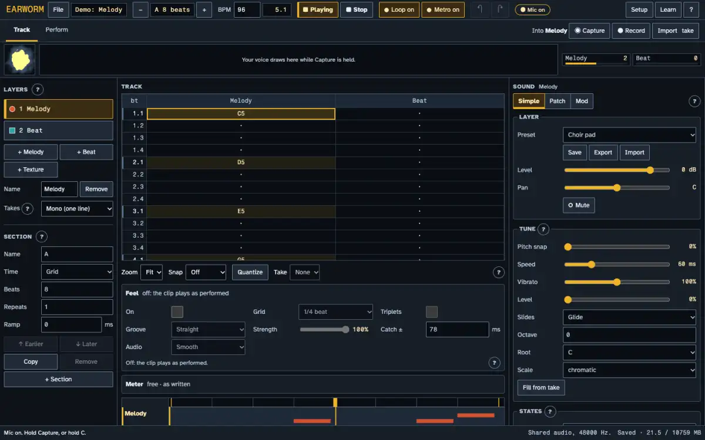

# Earworm user guide

Earworm turns your voice into music. Sing, hum or beatbox into the page and Earworm writes what you did as notes and drum hits, plays them on a synth, and lets you shape the sound, the timing and the groove until it is a track. You can also play it live from the computer keyboard or a MIDI keyboard, bring in an audio file, or capture chords from a guitar or piano.

It runs in your browser. Nothing you record leaves your computer: the songs, the takes and the sounds are kept in the browser on this machine until you export them.

The public build is at <https://jhammond045.github.io/earworm/>.

## What you need

- A recent Chrome or Edge on a laptop or desktop. Firefox and Safari open it too, with limits listed in [Troubleshooting](16-troubleshooting.md#browser-support).
- A microphone. The one built into a laptop works; a USB or headset mic works better.
- **Headphones.** Earworm listens and plays at the same time. With speakers, the mic hears the song and gets confused.
- A MIDI keyboard is optional. The computer keyboard plays notes too.

## Start here

1. [Getting started](01-getting-started.md): your first sound in two minutes, and how the screen is laid out.

## Chapters

2. [Capturing your voice](02-capturing-your-voice.md): hold Capture, sing, and get notes or hits.
3. [Takes and the timeline](03-takes-and-the-timeline.md): the track grid, the timeline, sections, layers, editing notes and hits.
4. [The synth and patches](04-synth-and-patches.md): presets, Tune, states, macros, gestures, kit slots, Influence, and building a patch.
5. [Modulation](05-modulation.md): sources, the shaper, routes and the Mod view.
6. [Playing live](06-playing-live.md): the Perform place, computer keys, MIDI, MIDI learn, the XY pad and scenes.
7. [Recording passes and automation](07-recording-and-automation.md): Record, automation lanes and morph markers.
8. [Mixing your voice and the synth](08-mixing-vocal-and-synth.md): level, pan, mute, and the raw voice beside the synth.
9. [Quantizing with Feel and stretching audio](09-quantizing-with-feel.md): tighten timing without losing the performance.
10. [Polyphonic takes from guitar or piano](10-polyphonic-takes.md): chords into synth voices.
11. [Meters and re-metering](11-meters.md): play a 4/4 groove in 3/4, repeat or shuffle beats.
12. [Saving, sharing and exporting](12-saving-sharing-exporting.md): projects, zips, WAV mixes and presets.
13. [Keyboard shortcuts](13-keyboard-shortcuts.md)
14. [Phones and tablets](14-phones-and-tablets.md)
15. [Accessibility](15-accessibility.md)
16. [Troubleshooting](16-troubleshooting.md): mic permission, latency, browsers, MIDI, performance.

## Tutorials

Each one takes 5 to 15 minutes and ends with something you can hear.

1. [Hum a melody into a synth line](tutorials/01-hum-a-melody.md)
2. [Build a beat from beatbox](tutorials/02-beat-from-beatbox.md)
3. [Make hardness control the attack](tutorials/03-hardness-controls-attack.md)
4. [Play and record a live pass](tutorials/04-live-pass.md)
5. [Slide from the synth into your real voice](tutorials/05-synth-to-voice.md)
6. [Tighten a loose take with Feel](tutorials/06-tighten-with-feel.md)
7. [Capture guitar or piano chords into synth voices](tutorials/07-chords-into-synth.md)
8. [Turn a 4/4 groove into 3/4 and shuffle its beats](tutorials/08-four-four-to-three-four.md)

## Help inside the app

- **Learn** (top right) has short guided lessons that point at each control and wait for you to use it, and three demo songs. The tutorials here say which lesson goes with them.
- Every **?** button opens a short explanation of the panel or control beside it. Esc or a click elsewhere closes it.
- **?** at the far right of the transport, or the **?** key, lists the keyboard shortcuts.

## For developers

The design notes and build records for each stage are listed in [For developers](developers.md).
