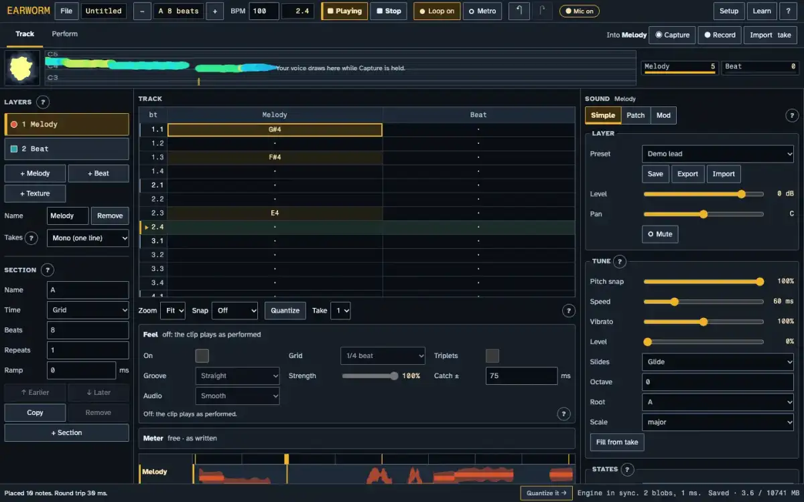
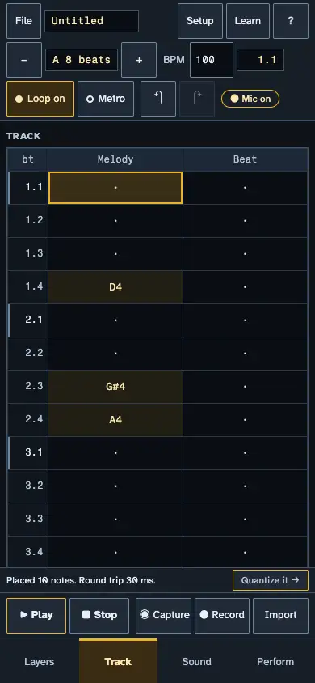

# Tutorial 1: Hum a melody into a synth line

[Guide contents](../README.md) · About 10 minutes · In the app: Learn, **Capture onto the track**

You will hum a short tune, let Earworm turn it into notes, put a synth on it and snap it into key.

You need headphones and a mic.

## 1. A fresh song

1. Open Earworm. Press **File**, then **New**, then **Close**. The song has two layers, **Melody** and **Beat**, and one 8-beat section, **A**.
2. Press **Start with mic** and allow the microphone. The chip reads **Mic on** and the status line says **Mic on. Hold Capture, or hold C.**
3. Make sure **1 Melody** is selected in the Layers panel. The place bar reads **Into Melody**.
4. Optional: press **Metro** so you hear the beat while you hum.

## 2. Capture

1. Think of four to eight notes. Something you can hum at 100 BPM.
2. Hold **C** (or hold the **◉ Capture** button). You hear one bar of clicks, then the section starts.
3. Hum the tune. Your pitch draws as a ribbon in the strip above the track.
4. Let go after the 8 beats.

The status line says **Second pass on … s…**, then **Placed 10 notes. Round trip 30 ms.** (your count will differ). The notes appear in the Melody column of the grid and as bars in the timeline, with your sung pitch drawn as a ribbon behind them.

If it says **Ignored: … is under 0.5 s**, you let go too early; hold longer.

## 3. Hear it

Press **Space**. The section loops and the Melody layer plays your notes on **Choir pad**, following the pitch you hummed, slides and all.

In the **Tune** box of the Sound panel, **Root** and **Scale** now show the key Earworm heard (for example **A** and **major**).

## 4. Give it a synth sound

While it plays, open **Preset** at the top of the Sound panel and try **Demo lead**, **Reed** and **Glass**. Keep the one you like.

## 5. Put it in key

Your humming is probably a little off the notes, which can sound nice on a voice and wobbly on a synth.

1. In **Tune**, drag **Pitch snap** to **100%**. The line now lands on the notes of the scale.
2. Try **Slides**: **Glide** follows your slides, **Gliss** steps through the semitones, **Jump** goes straight from note to note. **Jump** sounds most like a keyboard.
3. Lower **Vibrato** to flatten the wobble, or leave it at 100% to keep it.
4. Set **Octave** to **-1** for a bass line, or **1** to lift it.

## 6. Tighten it (optional)

The status line offers **Quantize it →**. Press it to pull the notes onto the beat while the song plays. [Tutorial 6](06-tighten-with-feel.md) goes into this.

## 7. Keep it

Press **File**, type a name in **Name**, press **Rename**. The song is already saved in the browser. **Export mix (WAV)** saves what you hear as a file.

## If it went wrong

- **Notes land off the beat**: measure the mic timing (**Setup → Measure**, with headphones on), then capture again.
- **Too many short notes**: hum more legato, on "oo" or "mm", and keep the mic a hand's width away.
- **Nothing happens on C**: the mic is off (press **Enable mic**), or the cursor is in a text box (click the track first).

Next: [Build a beat from beatbox](02-beat-from-beatbox.md).
