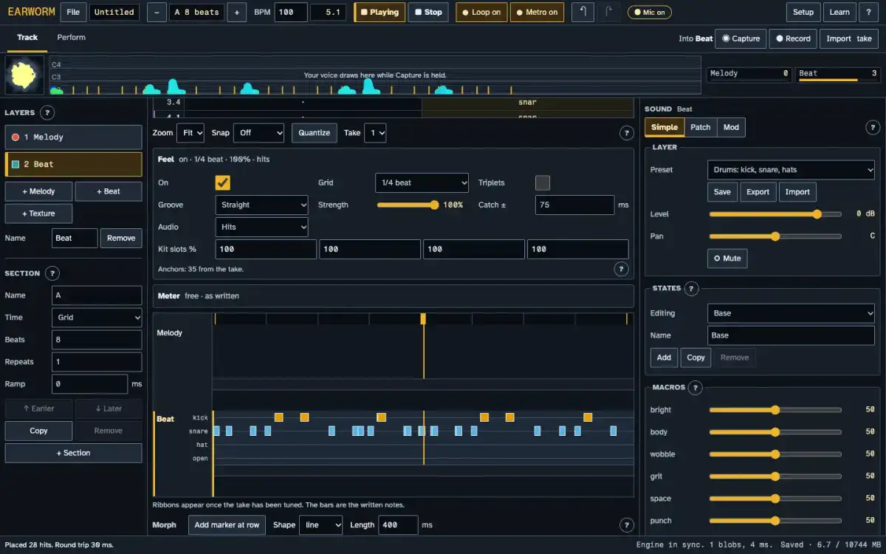
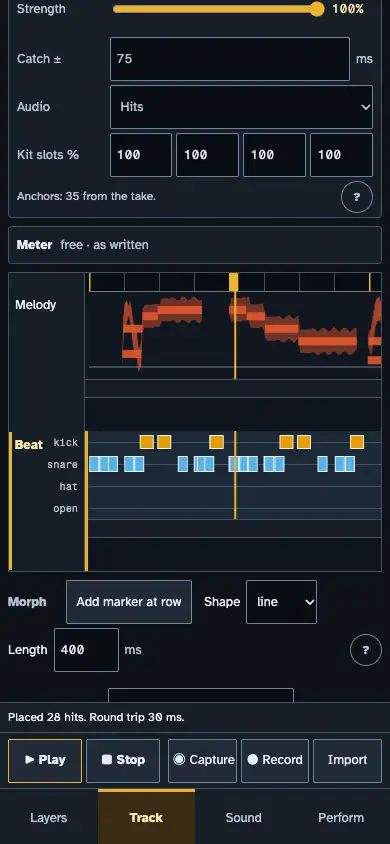

# Tutorial 2: Build a beat from beatbox

[Guide contents](../README.md) · About 10 minutes · In the app: Learn, **Use your sound for a kit slot**, **Measure, match and keep** (step "Teach a kit slot")

You will beatbox a groove, let Earworm turn it into drum hits, fix any hits that landed on the wrong drum, and tighten the timing.

You need headphones and a mic.

## 1. Set up

1. **File → New → Close**, then **Start with mic**.
2. Select **2 Beat** in the Layers panel. The place bar reads **Into Beat**, and the Sound panel shows the **Drums: kick, snare, hats** preset.
3. Press **Metro** to hear the click. At 100 BPM an 8-beat section is two bars of 4.

## 2. Teach Earworm your sounds (optional, recommended)

Earworm sorts each beatboxed hit into one of four kit slots: kick, snare, hat, open. It guesses well on its own, and better if you show it your sounds first.

1. In the Sound panel, scroll to **Kit slot**. Set **Slot** to **1** (kick).
2. Hold **Teach (hold)** and say your kick sound four or five times: "b, b, b, b". Let go.
3. Set **Slot** to **2** and teach your snare ("k" or "psh"), then **3** for the hat ("ts").

What you teach lasts until you close the page.

## 3. Capture the groove

1. Hold **C** (or **◉ Capture**). After one bar of clicks the section starts.
2. Beatbox two bars: for example "b ts k ts b b k ts".
3. Let go.

The status line reads **Placed 28 hits. Round trip 30 ms.** (your count will differ). In the timeline, the Beat lane shows the hits on the **kick**, **snare**, **hat** and **open** rows, each slot with its own color and shape. The grid shows **kick**, **snar**, **hat** in the Beat column.

## 4. Fix wrong drums

If a hit landed on the wrong slot:

- In the timeline, drag it up or down to the right row; or
- In the grid, put the cursor on it and press **1**, **2**, **3** or **4**.

To remove a stray hit, select it and press **Delete**. To add one, double-click the empty spot in its row.

## 5. Tighten it

1. Press **Quantize it →** in the status line. The **Feel** row opens and reads **on · 1/4 beat · 100% · hits**.
2. Press **Space** to play. The hits now sit on the 16ths.
3. For a human feel, set **Strength** to about **70%**, or keep the kick and snare tight and loosen only the hats: in **Kit slots %**, set the third box to **50**.
4. For swing, set **Groove** to **Swing** and **Swing** to about **60%**.

## 6. Make the kit yours (optional)

Swap a drum for a sound you make: pick **Slot 2**, press **Record one hit**, and make one snare sound into the mic. **Hear slot** plays it. The groove now plays your snare.

## If it went wrong

- **Everything is a kick**: teach the slots (step 2), and make the sounds more different: a deep "b", a sharp "k", a hissy "ts".
- **The hits drift late**: measure the mic timing in **Setup → Measure**.

Next: [Make hardness control the attack](03-hardness-controls-attack.md).
