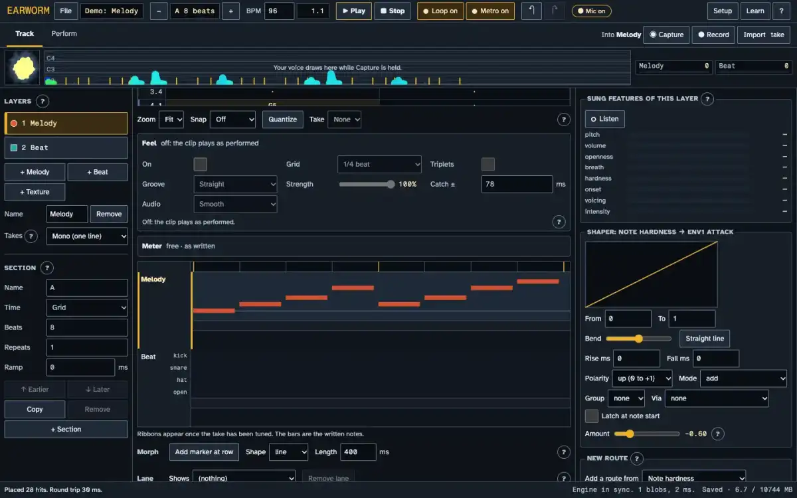
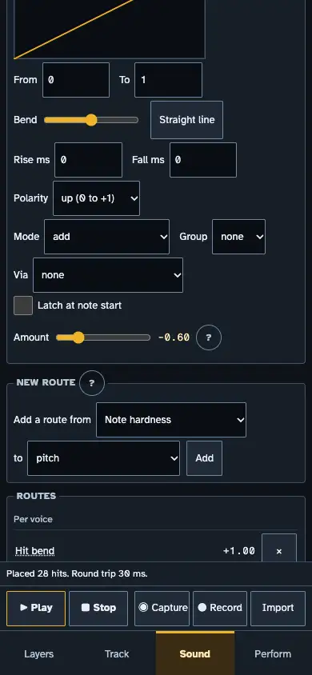

# Tutorial 3: Make hardness control the attack

[Guide contents](../README.md) · About 10 minutes · In the app: Learn, **Make hardness set the attack** (the same steps, with the controls highlighted)

You will add a modulation route so that the harder a note starts, the quicker its attack. Sung "da" notes will snap in; sung "ah" notes will swell. This is the core idea of [Modulation](../05-modulation.md): a source, a value, and a shaper between them.

## 1. Open the Melody demo

1. Press **Learn**. Either start the lesson **Make hardness set the attack**, which opens the demo for you and highlights each control below, or under **Demos** press **Melody**.
2. Press **Start** (or **Start with mic** if you want to sing in step 5).
3. The song is **Demo: Melody**, eight notes on a choir pad. **1 Melody** is selected.

## 2. Open the Patch view

In the Sound panel, press **Patch**. It shows every knob of the Melody layer's sound, one card per module.

## 3. Pick hardness as the source

Open **Modulate with** at the top of the Patch view and choose **Note hardness**. Hardness is how hard each note starts: the strength of a sung onset, or a written note's hardness.

A **+** appears beside every slider that hardness can reach.

## 4. Route it to the attack

Find the **ENV1** card. env1 is the envelope that shapes each note's level. Press the **+** beside **attack**.

The Sound panel switches to **Mod** and opens the new route: **Shaper: Note hardness → env1 attack**. Back in Patch, the attack slider now has a bar showing how far the route can move it, and a **⟲ Note hardness** badge.

(The attack slider may already carry a **⟲ Note hardness** badge from the preset. Yours is a second route; they add up.)

## 5. Harder means quicker

At the bottom of the shaper, drag **Amount** left of the middle, to about **-0.60**. A negative amount reverses the route: the harder a note starts, the shorter its attack.

If you followed the lesson, it closes here.

## 6. Hear the difference

The demo's written notes all have the same hardness, so to hear the route, give it notes that differ:

- **With the mic:** select **1 Melody**, hold **C**, and sing the tune alternating hard and soft starts: "da, ah, da, ah". Play it back with **Space**. The "da" notes start with a click of speed; the "ah" notes fade in.
- **With a MIDI keyboard:** a keyboard sends velocity rather than a sung onset. Repeat steps 3 to 5 with **Velocity** as the source instead of Note hardness, then play some notes hard and some gently in **Perform** (**Alt 3**).

## 7. Shape the response (optional)

In the shaper:

- Move **Bend** to curve the line, so only the hardest notes get much quicker, or drag the curve's end points.
- Raise **Rise ms** to soften how fast the route reacts.
- Press **Straight line** to reset the curve.

Every change is one undo step.

Next: [Play and record a live pass](04-live-pass.md).
