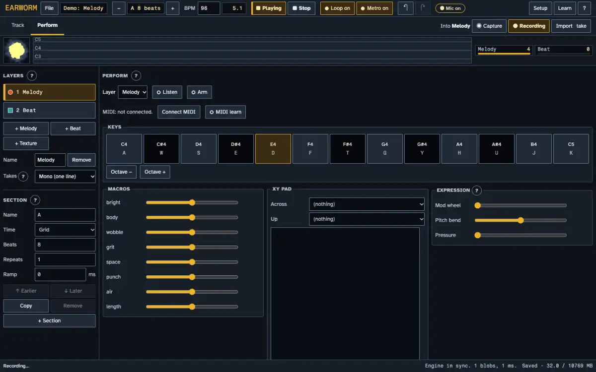
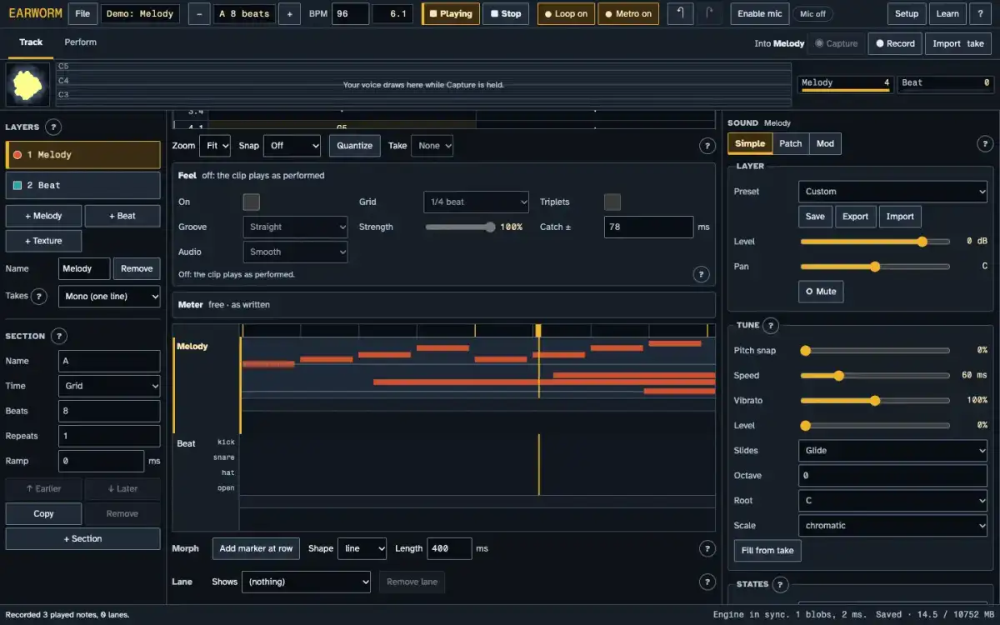
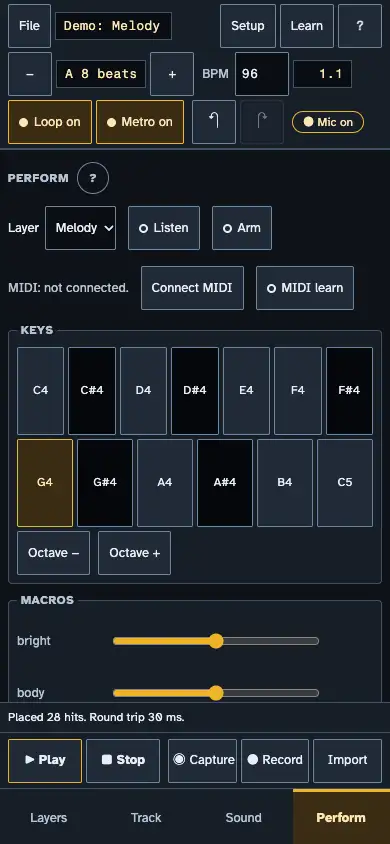

# Tutorial 4: Play and record a live pass

[Guide contents](../README.md) · About 10 minutes

You will play a part on the computer keys (or a MIDI keyboard) over the Melody demo, move a macro while you play, and record it all as one pass.

## 1. Set up without the mic

1. **Learn → Demos → Melody**. The song is **Demo: Melody**.
2. Reload the page if the mic is on, then press **Start**, not Start with mic.

Why no mic: with the mic on, Record also records a take from the mic into the layer, and a take replaces the notes already written there. With the mic off, what you play is added to the existing notes. (If you do record with the mic by mistake, one **Undo** puts everything back.)

## 2. Go to Perform

Press **Perform** in the place bar, or **Alt 3**. The keys show **C4** to **C5** with their letters.

- Press **A**, **D**, **G** on your keyboard: C, E and G. Each key lights up while held.
- **X** moves up an octave, **Z** down.

With a MIDI keyboard: press **Connect MIDI** and allow it. The line reads **MIDI:** and your device's name. Play.

## 3. Practise

Press **Space** to play the demo, and play along: a counter-melody, or one note per bar. Press **Space** again to stop.

## 4. Record

1. Press **R** (or **● Record**). After one bar of count-in, the section starts and the button reads **● Recording**.
2. Play your part. While you play, drag the **bright** macro up and back down with the mouse (or turn a knob you have mapped with **MIDI learn**).
3. Press **R** again to stop.

The status line says **Recorded 3 played notes, 1 lanes.** or similar, and offers **See it on the track →**.

## 5. See it

Press **See it on the track →**. Your notes are in the Melody lane beside the demo's notes. If you moved the macro, under **Lane** pick **Shows: macro bright**: its strip under the Melody lane draws the move.

Press **Space**. The pass plays back, macro move and all.

## 6. Fix it up

- Not happy? **Ctrl Z** (**⌘ Z**) undoes the whole pass in one step. Record again.
- Notes a little loose? Press **Quantize** on the timeline toolbar ([Feel](../09-quantizing-with-feel.md)).
- Drag a note in the timeline to move it, or its right edge to change its length.

## 7. Try scenes (optional)

1. Go to **Track**, Sound, **States**, press **Copy**, and change some macros on the copy (the new state).
2. Back in **Perform**, the **Scenes** box has a button per state. Record a pass and tap between them. Each tap becomes a morph marker on the track.

Next: [Slide from the synth into your real voice](05-synth-to-voice.md).
