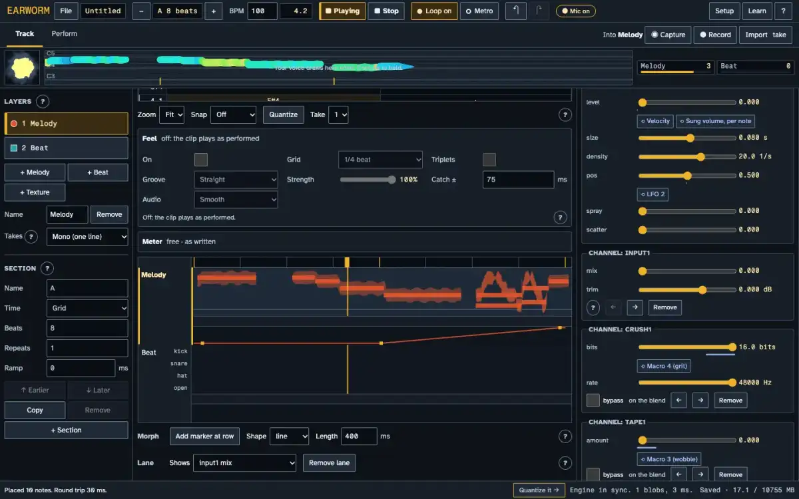
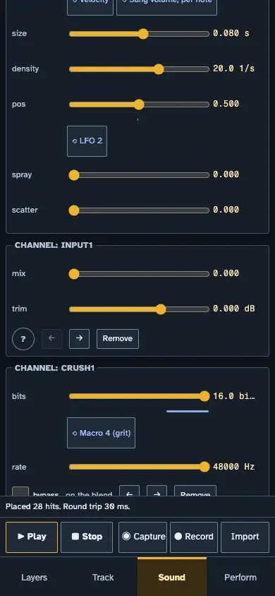

# Tutorial 5: Slide from the synth into your real voice

[Guide contents](../README.md) · About 10 minutes

You will sing a line, let the synth play it, then automate a crossfade so the section starts as pure synth and ends as your real voice. The same idea gives you a doubled vocal, a synth that "becomes" the singer, or a voice that dissolves into a pad.

You need headphones and a mic.

## 1. Capture a sung line

1. **File → New → Close**, **Start with mic**, select **1 Melody**.
2. Hold **C**, sing a phrase across the 8 beats, let go. The status line says **Placed … notes**.
3. Press **Space**. You hear the synth (**Choir pad**) playing what you sang. Your voice itself is not in the mix yet. Stop.

## 2. Add the raw input

1. In the Sound panel press **Patch**.
2. Open **+ channel effect** and choose **input (the raw mic or take beside the synth)**.
3. A card **Channel: input1** appears at the top of the channel chain, with **mix** at **0.000** and **trim** at **0.000 dB**.

Because it is first in the chain, every effect after it (crush, tape, delay, reverb in Choir pad) works on the blend of synth and voice: they share one room.

## 3. Try it by hand

Play the section and drag **mix** slowly to **1.00**. The synth fades out as your voice fades in; at 1 you hear only your voice, with the layer's effects on it. Halfway, both play at once, which makes a nice double. Drag it back to **0** and stop.

The crossfade is equal-power, so the middle does not dip in level. If your voice is quieter than the synth, raise **trim**.

## 4. Automate the slide

1. Under the timeline, set **Lane → Shows** to **input1 mix**.
2. In the timeline, the thin strip at the bottom of the Melody lane is now the mix. Double-click near the **bottom left** of the strip: a point at 0.
3. Double-click the bottom of the strip **halfway** across: another point at 0.
4. Double-click near the **top right** of the strip: a point at 1.

The strip now draws a line that stays at the bottom for four beats, then rises to the top.

Press **Space**. The first half is pure synth; across the second half the synth melts into your voice. When the section loops, it snaps back to synth.

Drag a point to move it; double-click a point to remove it. **Remove lane** clears the whole lane.

## 5. Variations

- **Voice to synth**: put the high point first and the low one last.
- **A swell in the middle**: points at 0, 1, 0.
- **Louder means more voice**: instead of a lane, choose **Modulate with → Sung volume, whole layer** in Patch and press the **+** beside **mix**; set the route's amount in Mod.
- **Live**: in **Perform**, set the XY pad's **Across** to **input1 mix** and record a pass while you sweep it ([tutorial 4](04-live-pass.md)). In Perform with **Listen** or **Arm** on, the input plays your live mic instead of the take.

Next: [Tighten a loose take with Feel](06-tighten-with-feel.md).
