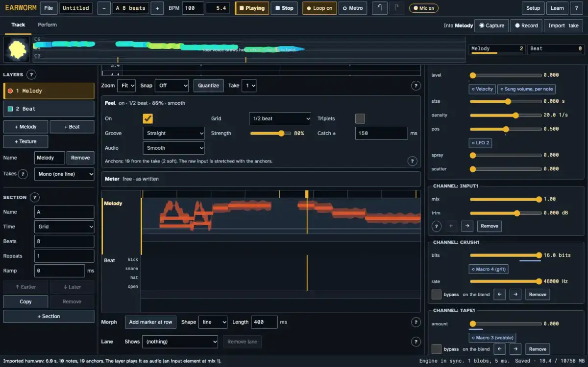
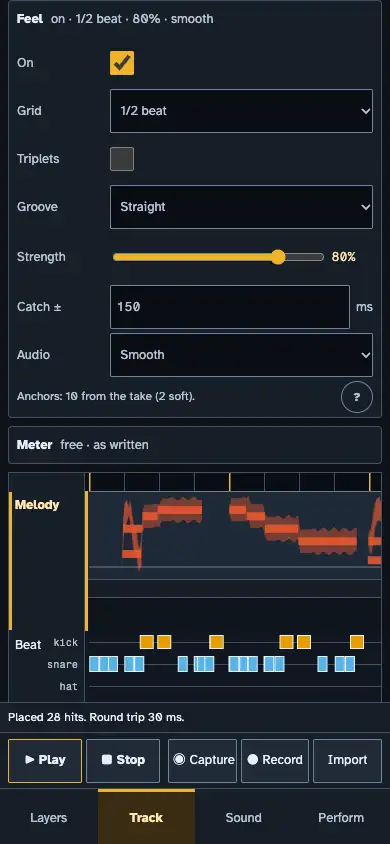

# Tutorial 6: Tighten a loose take with Feel

[Guide contents](../README.md) · About 10 minutes · In the app: Learn, **Edit the arrangement** (step "Zoom, snap and quantize")

You will bring in a sung take that drifts off the beat, pull it onto the grid with Feel, and keep just enough of the original timing that it still sounds sung. The take's audio moves with it.

You need an audio file of a short sung or hummed phrase (a WAV or MP3 from your phone's voice memos works), or a mic to sing one.

## 1. Get a loose take

1. **File → New → Close**, then **Start** (or **Start with mic**). Select **1 Melody**.
2. Either:
   - press **Import take** and choose your file. The status line says something like **Imported hum.wav: 6.0 s, 10 notes, 10 anchors. The layer plays it as audio (an input element at mix 1).**; or
   - hold **C** and sing a phrase, a little lazily, against the click (**Metro** on). The status line says **Placed … notes**.
3. Press **Space** and listen. Some notes are early, some late.

An imported file comes with an **input** at full mix, so you hear the recording itself. A captured take plays on the synth; to hear your voice stretch too, add an input as in [tutorial 5](05-synth-to-voice.md).

## 2. Quantize

Press **Quantize it →** in the status line (or **Quantize** on the timeline toolbar). The Feel row opens:

**Feel on · 1/4 beat · 100% · smooth**, and under it **Anchors: 10 from the take (2 soft). The raw input is stretched with the anchors.**

Play it. Every note now starts exactly on a 16th, and the audio is stretched so each syllable starts with its note, without changing your pitch.

## 3. Pick the right grid

A ¼-beat grid can pull notes onto off-beats you did not mean. For a simple tune:

1. Set **Grid** to **1/2 beat** (8ths). **Catch ±** may change with it (150 ms at 1/2 beat).
2. Play. Notes that were near an 8th snap to it; notes far from any grid line (more than Catch away) ride along with their neighbours instead.

## 4. Bring back some feel

1. Set **Strength** to **80%**. Each note now goes 80% of the way to the grid, so the take is tight but not robotic.
2. Try **Groove → Swing** and **Swing 58–62%** for a laid-back shuffle.
3. Try **Audio → Hits** and compare with **Smooth**: Hits cuts the audio at each attack and moves the pieces, which suits percussive singing; Smooth stretches evenly, which suits legato lines.

## 5. Compare

Untick **On**: the take plays exactly as sung. Tick it again: tightened. Nothing you recorded was changed, so you can come back and change your mind any time.

## Why some notes do not move

- They are more than **Catch** away from a grid line. Raise Catch.
- Two notes wanted the same grid spot; only the stronger one gets it.
- A soft anchor (a slide between notes with no new attack) only bends the timing.

Next: [Capture guitar or piano chords into synth voices](07-chords-into-synth.md).
