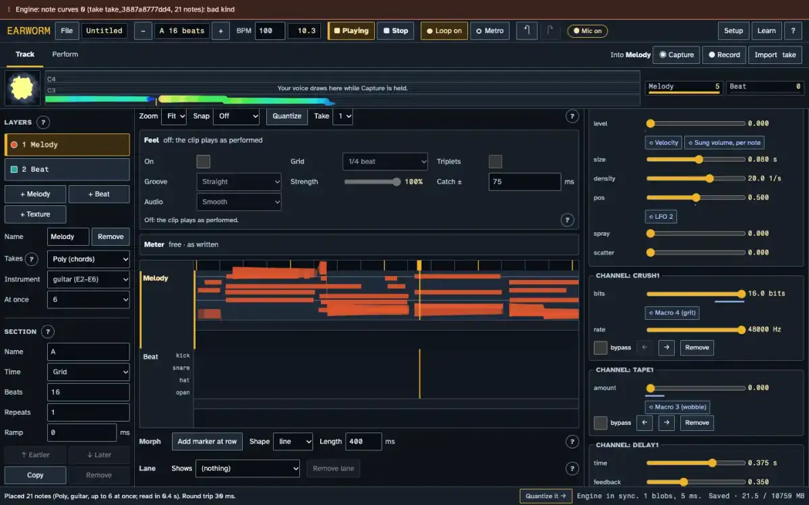
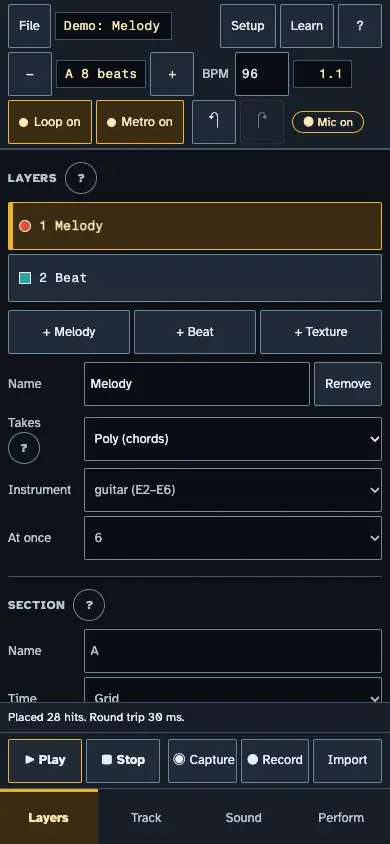

# Tutorial 7: Capture guitar or piano chords into synth voices

[Guide contents](../README.md) · About 15 minutes

You will strum four chords on a guitar (or play them on a piano), let Earworm read every note of each chord, and play them back on a synth pad.

You need a guitar or piano, a mic (or the instrument into an audio interface), and headphones.

## 1. Set up a Poly layer

1. **File → New → Close**, **Start with mic**.
2. Select **1 Melody**.
3. In the Layers panel, set **Takes** to **Poly (chords)**. Two more rows appear: **Instrument** and **At once**.
4. Set **Instrument** to **guitar (E2–E6)** or **piano (A0–C8)**. **At once** becomes **6** for guitar, **8** for piano.
5. In the Section box, set **Beats** to **16**: four bars of 4 at 100 BPM, one chord per bar.
6. Press **Metro** to hear the click.

## 2. Capture

1. Hold **C** (or **◉ Capture**). After one bar of clicks, the section starts.
2. Strum C, G, Am, F, one per bar, letting each ring.
3. Let go after the fourth bar.

The layer stays **silent while you play**; that is expected, there is no live chord sound yet. When you let go, the status line says **Reading the notes of 10.6 s…**, and a moment later **Placed 21 notes (Poly, guitar, up to 6 at once; read in 0.4 s).**

The timeline's Melody lane now shows stacks of overlapping bars: each chord's notes, one bar per string.

A red line at the top, **Engine: note curves 0 (take …): bad kind**, is a known bug in the current build: the notes play, but without their per-note bends and fades. Carry on.

## 3. Play them on a synth

1. In the Sound panel, set **Preset** to **Glass** (or **Choir pad** for a softer pad).
2. Press **Space**. Your chords play on the synth, with the timing you strummed.

## 4. Tidy up

- **Fewer notes**: lower **At once** to **3** or **4** and capture again for a thinner voicing; when more notes ring than that, Earworm drops the quieter ones.
- **Stray notes**: select one in the timeline and press **Delete**.
- **Timing**: set **Snap** to **Beat** and press **Quantize** to land each chord on the beat ([Feel](../09-quantizing-with-feel.md)).
- **Octave**: drag notes up or down in the timeline, or select them in the grid and press **Shift ↑ / ↓**.

## 5. Make it a pad

Add a texture layer underneath: **+ Texture**, set its **Takes** to Poly too, pick a soft preset, and capture the same chords again into it. The two layers blend into one wide sound.

## If it went wrong

- **Too many notes, or wrong octaves**: get the mic closer to the strings or soundhole, or go direct from a pickup into an audio interface. Room echo reads as extra notes.
- **Notes missing**: raise **At once**, and let each chord ring longer.
- **Import take gave one note**: Import reads a file as a single line, even on a Poly layer. Play the recording into the mic instead.

Next: [Turn a 4/4 groove into 3/4 and shuffle its beats](08-four-four-to-three-four.md).
