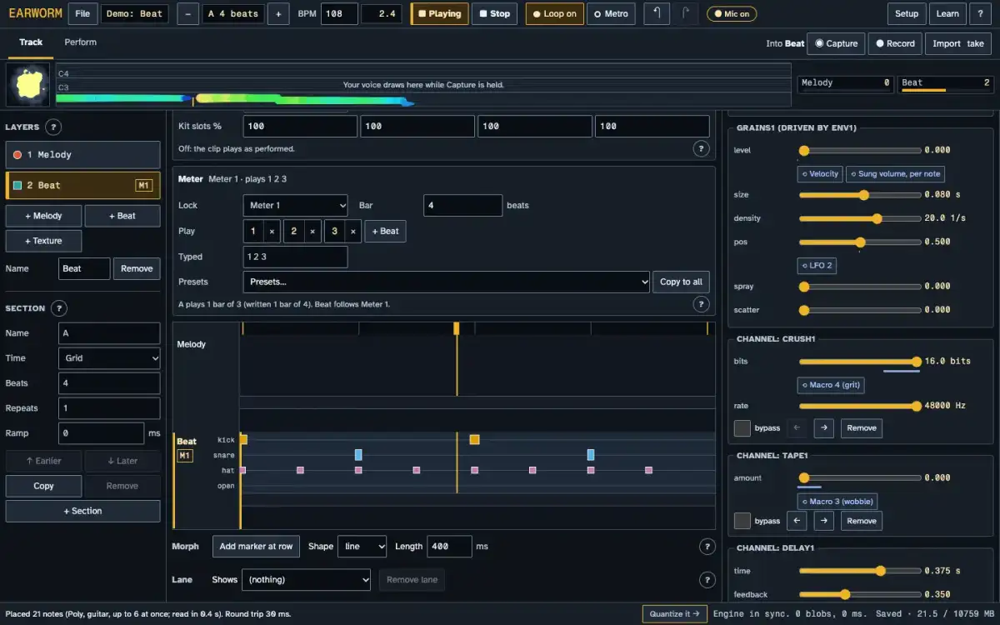
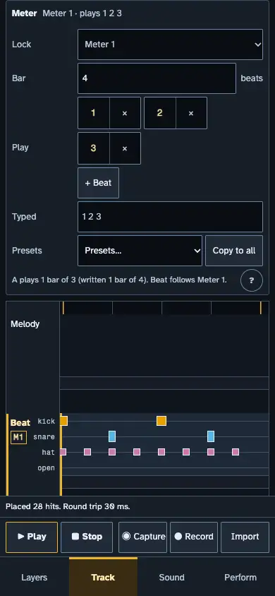

# Tutorial 8: Turn a 4/4 groove into 3/4 and shuffle its beats

[Guide contents](../README.md) · About 10 minutes

You will take a groove in 4/4, play it as a waltz-time 3/4 by dropping a beat, then shuffle the beats into a new pattern. Nothing you recorded changes; Earworm only plays the beats in a new order.

## 1. Open the Beat demo

1. **Learn → Demos → Beat**. The song is **Demo: Beat**: kick, snare and hats in one 4-beat bar at 108 BPM, the click on.
2. Press **Start**, then **Space**. Listen to the groove: kick on 1 and 3, snare on 2 and 4, eighth-note hats. Stop.
3. Select **2 Beat** in the Layers panel.

(With your own beat from [tutorial 2](02-beat-from-beatbox.md) it works the same.)

## 2. Lock the beat to Meter 1

Under the Feel row, open **Meter** (it reads **free · as written** while folded).

Set **Lock** to **Meter 1**. The layer list now shows **M1** beside **2 Beat**, and so does the Beat lane in the timeline. Nothing sounds different yet: the pattern is as written.

## 3. Drop the last beat

Open **Presets** and choose **Drop last**.

- **Play** now shows three chips: **1 × 2 × 3 ×**.
- The line under the row says **A plays 1 bar of 3 (written 1 bar of 4). Beat follows Meter 1.**
- The summary reads **Meter 1 · plays 1 2 3**.

Press **Space**. The groove plays three beats and goes round: kick, snare, kick. The click counts three, and the playhead skips beat 4.

## 4. Shuffle the beats

Now change the order. Any of these:

- Type `1 3 2` into **Typed**. The chips become **1 3 2**: kick, kick, snare, a different 3/4 feel.
- Drag a chip to a new place.
- Press a chip to play that beat twice: press **3** and you get `1 2 3 3`, back to four beats with the third doubled.
- Press **×** on a chip to drop it.
- **+ Beat** adds the first missing beat, or the last one again.
- **Presets → Shuffle 1 3 4 2** for the full 4/4 shuffle.

Every change is one undo step, and you can keep the song playing while you try them.

With the chips focused: **← →** move between beats, **Shift ← →** moves a beat, **Enter** repeats it, **Delete** drops it.

## 5. Use it across the song

The pattern belongs to this section. To play it in every section, press **Copy to all**. To keep a melody as written while only the beat changes, leave the melody's **Lock** on **Free**.

To get the original back: **Presets → As written**, or clear **Typed**.

## Good to know

- Meter 1's **Bar** (4 here) is the same number as **Setup → Beats in a bar**: changing one changes the other.
- The transport stepper says what plays and keeps the written length beside it, for example **A 3 beats (4 written)**.
- A note held across a dropped beat can ring on without its attack. If that sounds odd, drop a different beat.

You have reached the end of the tutorials. The [guide](../README.md) has a chapter for every part of the app.
