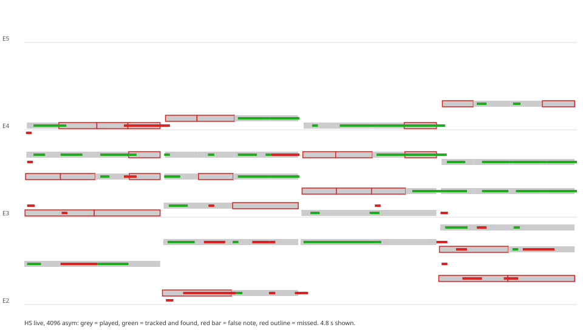

# Polyphonic capture: chords into synth voices

Nov 22, 2026. Design for the owner's review; nothing on this page is built in the app. The figures come from a throwaway prototype in `experiments/poly`, first run on a synthetic guitar and then, as stage P0, on public labelled recordings of real guitar, piano and chamber trios ([Stage P0: real recordings](#stage-p0-real-recordings)). P0 changed the detector, widened it to piano and other sources, and changed the build plan.

The owner asked for this: play a chord, or several strings at once, on a guitar; capture it; and have the synth play the same notes, up to some number of capture channels. Capture today is monophonic. The live tier (`dsp::capture`) runs YIN on the mic and the armed layer gets one live voice (`crates/klont/src/live.rs`); the second pass (`crates/analysis`) turns a take into one line of notes. A chord gives YIN one pitch at best. This page asks whether one mic or line input can be turned into several notes at once, live and on takes, each driving its own synth voice, and how that fits the patch, listen and record model of [synth.md](synth.md) and stages S2 to S5.

## Summary

| Concern | Decision |
| --- | --- |
| Feasible? | For takes, yes. Live, roughly. On 2.5 hours of real guitar held out from all tuning (GuitarSet), a small learned model (Basic Pitch) finds 76% of the notes with 74% of what it reports right (F1 0.75); on piano 0.70 and on chamber trios 0.66. The live detector, revised after P0, scores F1 0.57 on the same guitar (0.57 piano, 0.50 trios), 22 ms median from pluck to note: single lines and solos come through well (84% of solo notes), strummed chords lose about half their notes. The design as first written scored F1 0.27 on real guitar; the synthetic guitar had hidden that. |
| Detector | Live: template decomposition (NMF), a fixed dictionary of two harmonic templates per semitone plus a few broadband atoms that soak up body thump, rumble and room sound, solved per frame on a 4096-sample window every 5 ms. On guitar a note may only start within 120 ms of a broadband onset. Takes: a learned model of the Basic Pitch kind (230 KB, Apache 2.0), which beat NMF offline on every real source by 0.18 to 0.30 F1. |
| Instruments | A profile per instrument sets the dictionary: guitar (E2 to E6), piano (A0 to C8, with piano string stiffness), generic (A1 to C7, plain harmonic). Generic templates come within 0.02 F1 of piano's on piano, for about 40% less work; on guitar the guitar profile wins live (F1 0.57 against 0.39). The learned model needs no profile. |
| Capture channels | N channels, 1 to 8 (default 6 for guitar, 8 for piano and other sources; never more than the patch's voice count). Each channel holds at most one note at a time and drives one voice. More than 8 would gain nothing live: the detector seldom holds more than six notes at once. |
| Per-note features | Each channel has its own pitch (with bends), volume, intensity, hardness and onset, which become the `voice.*` sources of the modulation matrix. Openness, breath and vowel stay whole-input features. |
| Re-strums | A broadband onset plus a rise in a note's upper partials restarts that note. A per-layer Strum switch restarts every sounding note that rose at all, for rhythm playing. |
| Live and offline | Live: the NMF detector runs in the engine, like the live tier, only while a layer is armed in Poly. Offline: the second pass runs the learned model on the take and writes notes and per-note curves into the clip. Recommended order changes: poly takes first, then live (see [Build plan](#build-plan)). |
| Fit | Arm gains a mode, Mono or Poly. Listen, routes, recording, automation, export and the raw input element work as they do; a poly take is stored as notes plus per-note curves, so playback stays deterministic. |
| Other inputs | A hex pickup into a multichannel interface, or a MIDI guitar, could fill the same capture channels with no detection at all. They need hardware; they are a question for the owner. |

What does not change: one engine for live, export and matching; the feature-frame format; no allocation, locks or waits on the audio thread; mono Live follow, as it is.

## What exists today

| Piece | Where | What it does for one note |
| --- | --- | --- |
| Live tier | `crates/dsp/src/capture.rs` | Bands, loudness, YIN pitch (about 24 ms), voicing, openness, breath, onset and hardness, every 2.5 ms; a 10 ms frame. One pitch. |
| Live follow | `crates/klont/src/live.rs`, `engine.rs` | One armed layer. A gate opening or an onset starts its one live voice; the voice reads the live record every control tick. |
| Listening layers | `engine.rs` (`tick`) | Any number of layers read the live tier's features; their notes come from elsewhere. |
| Second pass | `crates/analysis/src/notes.rs`, `second.rs` | Splits the take's pitch curve into notes (one at a time), repairs pitch with pYIN, onsets from spectral flux. |
| Voices | `crates/klont/src/voice.rs`, `layer.rs` | Up to 8 per layer, fewer for costly patches; per-voice routes read `voice.*` from the voice's own take curve or the live record. |

## Feasibility on a synthetic guitar

### Test material

There are no guitar recordings in the repository or its fixtures, and no labelled ones were at hand, so every figure here comes from a synthetic guitar with an exact list of the notes it plays (`experiments/poly/src/guitar.rs`). Each pluck is an additive string: inharmonic partials (f_m = m f0 sqrt(1 + B m^2), B per string and fret), the comb of the pluck position, a pick low-pass that opens with velocity, two polarizations that beat and decay at different rates, decay that grows with frequency, a small pitch glide at the attack, pick noise, and either an acoustic body (a few broad resonances and a thump) or an electric pickup (a comb at the pickup position and a resonant peak). Strings are tuned up to 4 cents off. A string plays one note at a time, as a real one does. Room noise sits at -66 dBFS.

Each set is 48 to 50 seconds per instrument, played on both instruments:

| Section | What is played |
| --- | --- |
| Single strums | 12 or 13 chords, strummed once and left to ring 1.6 s: open chords (E, Am, C, G, D, Em, A, Dm, E7, Cmaj7, G7, D/F#), barre chords (F, Bm, A at 5, Cm at 3, Bb, F#m), power chords and two- and three-note shapes. 2 to 6 notes. |
| Strummed | A four-chord progression, twice, each chord strummed down, up, down, up 0.3 s apart. Up-strums catch only the top three strings, so those notes are re-plucked while the bass rings. |
| Arpeggio | Three chords picked one string at a time, eighth notes, strings left ringing. |
| Line | A single-note line with three two-note stops. |
| Palm mute | Eight muted chugs of a power chord, 90 ms each. |

The **dev** set (seed 1) is what every threshold was tuned on. The **test** set (seed 2) is held out: other chords, another progression, other arpeggios and lines, other random draws. All results below are on the test set: 522 notes over 100 s. The rendered audio is written with `--wav <dir>` for anyone who wants to hear how real it sounds.

### How to run it

| Command | What it does |
| --- | --- |
| `cd experiments/poly && cargo run --release -- test` | Renders the test set, runs every detector, prints the tables on this page (about 15 s on the build machine). Since P0 it runs the revised detector; add `POLY_NOISE=0 POLY_OPEN_GATE=0` for the detector as first designed, which the tables in this section show |
| `cargo run --release -- dev` | The same on the dev set |
| `cargo run --release -- test --wav <dir> --svg <dir>` | Also writes the rendered guitar as WAV files and the piano rolls below |
| `POLY_<NAME>=<value> cargo run --release -- dev` | Overrides one tuning value (`MIN_OFF`, `RETRIG`, `SHARE`, `OPEN`, `GAMMA`, `NOISE`, `OPEN_GATE`, `MAX_NOTES`, ...; see `knob` in `main.rs`), as the tuning was done |
| `cargo run --release -- real <dir> --profile guitar` | Real recordings; see [Stage P0](#stage-p0-real-recordings) |

The crate has its own Cargo workspace, so the app's `cargo test --workspace` and `pnpm test` do not build it.

### Two detectors, one tracker

Both work causally on the last N samples every 5 ms (240 samples at 48 kHz), the live tier's pitch hop.

- **HS, harmonic sum** (`hs.rs`), after Klapuri (2006): whiten the spectrum in 30 ERB bands, score every candidate f0 (a fifth of a semitone apart, E2 to E6) by the weighted peaks of its first 20 partials, take the best, subtract its partials (each limited to the mean of its neighbours, so a partial shared with another note is only partly removed), and repeat while the polyphony estimate grows.
- **NMF, template decomposition** (`nmf.rs`): explain the frame's compressed magnitude spectrum (|X|^0.6, up to 5 kHz) as a sum of fixed templates, two per semitone from E2 to E6 (a bright and a dark partial slope, each partial drawn with the window's own peak shape). Activations are solved by 10 KL-divergence multiplicative updates with an L1 penalty, warm-started from the last frame. A pitch is present when it carries at least 4% of the frame. The templates are generic; nothing is learned from the test guitar.

One note tracker serves both (`track.rs`): a pitch starts a note after 2 frames in a row (for NMF, at 8% of the frame or more), and ends it after 50 ms missing. A broadband onset from a short 1024-sample window, followed within about 60 ms by a rise of 1.2 times in the note's partials 2 to 10, restarts the note (a re-pluck). At most 6 notes at once.

The **offline** runs use an 8192-sample Hann window and move each note's start back to the latest broadband onset before it was first seen, as the second pass refines onsets today.

### How it is scored

A played note is found when a tracked note of the same semitone starts near it: live, from 20 ms before to 100 ms after (so the latency counts against it); offline, within 50 ms either way. Precision is found notes over tracked notes; recall is found notes over played notes. Frame F1 compares what sounds and what is tracked every 10 ms, so it also counts note ends. False notes are sorted by what they sit on: an octave or two from a sounding note, a fifth, fourth or higher partial, a semitone, the same note again (a dropout and return, or a restart with no re-pluck), or nothing. Velocity r is the correlation between the played velocity and the tracked level, both in dB. CPU is wall time for the whole analysis (spectra, detector, tracker, onsets) per 128-sample block, release build, native on the build machine (Apple M4, 10 cores, load 4.4 to 5.4 from other work). A block is 2,667 µs.

### Results

Held-out test set, both instruments:

| Detector | Precision | Recall | F1 | Latency median / p90 | Frame F1 | Velocity r | Pitch error median / p90 | CPU per block |
| --- | --- | --- | --- | --- | --- | --- | --- | --- |
| HS live, 4096 asymmetric | 0.443 | 0.701 | 0.543 | 27 / 55 ms | 0.601 | 0.49 | 6.6 / 25.2 cents | 31 µs |
| HS live, 2048 asymmetric | 0.408 | 0.634 | 0.497 | 18 / 36 ms | 0.591 | 0.55 | 10.2 / 28.6 cents | 19 µs |
| **NMF live, 4096 asymmetric** | **0.584** | **0.772** | **0.665** | **29 / 61 ms** | **0.782** | 0.46 | **6.0 / 16.6 cents** | 80 µs |
| NMF live, strum mode | 0.527 | 0.816 | 0.640 | 25 / 60 ms | 0.782 | 0.42 | 5.5 / 15.7 cents | 81 µs |
| HS offline, 8192 Hann | 0.483 | 0.716 | 0.577 | onsets snapped | 0.587 | 0.27 | 3.9 / 17.8 cents | 53 µs |
| NMF offline, 8192 Hann | 0.733 | 0.651 | 0.690 | onsets snapped | 0.854 | 0.29 | 3.3 / 8.7 cents | 82 µs |

On the dev set, which the thresholds were tuned on, NMF live scores F1 0.690 and NMF offline 0.726; the held-out set is 0.025 to 0.04 lower, so the tuning did not overfit much.

The detector as revised after P0 (eight broadband atoms and the onset gate, both explained under [Stage P0](#stage-p0-real-recordings)) does better on the synthetic test set too, by trading recall for precision:

| Detector, revised | Precision | Recall | F1 | Latency median / p90 | Frame F1 | Pitch error median / p90 | CPU per block |
| --- | --- | --- | --- | --- | --- | --- | --- |
| NMF live, 4096 asymmetric | 0.851 | 0.713 | 0.776 | 34 / 62 ms | 0.736 | 5.6 / 15.8 cents | 87 µs |
| NMF live, strum mode | 0.746 | 0.749 | 0.748 | 29 / 60 ms | 0.736 | 5.2 / 15.4 cents | 94 µs |
| NMF offline, 8192 Hann | 0.880 | 0.646 | 0.745 | onsets snapped | 0.841 | 2.9 / 6.6 cents | 116 µs |

The cost is in single strums, whose recall falls from 0.73 to 0.60: the broadband atoms take part of a full chord's dense spectrum. The onset gate alone costs nothing there; the atoms are what real recordings need, so the trade stands.

Recall by section:

| Detector | Single strums | Strummed | Arpeggio | Line | Palm mute |
| --- | --- | --- | --- | --- | --- |
| HS live, 4096 | 0.72 | 0.59 | 1.00 | 1.00 | 0.77 |
| NMF live, 4096 | 0.73 | 0.69 | 0.98 | 1.00 | 0.98 |
| NMF live, strum mode | 0.73 | 0.77 | 1.00 | 1.00 | 0.98 |
| NMF offline, 8192 | 0.75 | 0.51 | 0.96 | 1.00 | 0.65 |

Recall by how many notes were struck together (within 50 ms):

| Detector | 1 | 2 | 3 | 4 | 5 | 6 |
| --- | --- | --- | --- | --- | --- | --- |
| NMF live, 4096 | 0.99 (67/68) | 1.00 (20/20) | 0.65 (97/150) | 0.88 (7/8) | 0.78 (94/120) | 0.76 (118/156) |
| NMF live, strum mode | 1.00 | 1.00 | 0.73 | 0.88 | 0.82 | 0.78 |

Most three-note groups (16 of 25 per instrument) are up-strums: three strings re-plucked over a ringing bass, which is the re-strum problem, not the size.

Where the errors go, NMF live (522 played, 690 tracked, 403 found):

| False notes (287) | | Missed notes (119) | |
| --- | --- | --- | --- |
| Octave from a sounding note | 71 | A note one or two octaves below was sounding | 85 |
| Fifth, fourth or higher partial | 38 | Other | 34 |
| Semitone from a sounding note | 42 | | |
| Same note again (dropout or restart without a pluck) | 104 | | |
| Other | 32 | | |

Live latency by register, NMF live: 35 / 65 ms (median / p90) from E2 to D#3, 28 / 58 ms from E3 to D#4, 28 / 64 ms from E4 up. Low strings take longer because their partials are close together and need more of the window to separate.

The two instruments come out close: NMF live F1 0.646 acoustic, 0.687 electric.

### What it looks like

The strummed passage of the test set (Am, F, C, G, each strummed down, up, down, up), acoustic. Grey bars are played notes, green bars tracked notes that were found, red bars false notes, red outlines missed notes.


NMF holds most notes for their whole length. Most misses are upper notes re-plucked by the up-strums (the second and fourth strum of each chord) and octave doublings. The red bars along the bottom are low notes (E2, F2) that the dictionary uses to explain the partials of notes above them: octave-below and harmonic-below errors.



HS breaks held notes into pieces as its estimate of how many notes are sounding goes up and down from frame to frame; each piece after the first counts as a false note.

### What was tried and did not help

All on the dev set:

- Octave checks by spectral smoothness (drop the upper of two octave-related pitches unless the lower one's even partials stand out; move a pitch up an octave when its odd partials are weak): no change for HS, a lower F1 for NMF (0.605 at the gentlest setting, from 0.671). Left in the prototype, off.
- Holding notes longer through dropouts (70 to 240 ms instead of 50): fewer dropouts, but more re-plucks lost; F1 fell.
- 20 NMF iterations instead of 10: no better (F1 0.671 against 0.685) at twice the cost.
- HS polyphony settings (the stop rule's exponent from 0.5 to 1.1, the whitening exponent from 0.2 to 0.7): F1 stayed between 0.46 and 0.54. HS's false notes are structural, not a tuning matter.

### What this does not show

- **No real guitar.** Real recordings add string and fret noise, fret buzz, sympathetic strings, room sound, bends and slides, and pickups or mics that colour the sound in ways this model does not. Stage P0, below, measured it: much worse until the detector changed.
- **Thresholds are tuned on synthetic material.** The held-out set guards against tuning to one passage, not against tuning to one synthesizer.
- **Per-note intensity and hardness were not measured.** The design defines them below; only the level at a note's start was checked against velocity (r 0.46: a rough guide).
- **CPU is native.** The live tier costs 40 µs per block native and about 50 µs in wasm (M2), and the demo song renders 1.6 times faster native than in Chrome (M1), so the NMF detector should cost about 100 to 130 µs per block in the worklet: 4 to 5% of a core.

## Stage P0: real recordings

P0 ran the prototype on public recordings that come with a list of every note played, as the build plan asked, and widened it to piano and mixed ensembles at the owner's request ("we also want to capture piano/keyboard or any other polyphonic sounds generally; doesn't need to be perfect").

### Material

| Source | What it is | Used here | Labels | Licence |
| --- | --- | --- | --- | --- |
| [GuitarSet](https://zenodo.org/records/3371780) | Six players on one acoustic guitar, 360 excerpts in five styles (bossa nova, funk, jazz, rock, singer-songwriter), each comped and soloed. One condenser mic in front of the guitar. | All 360, 183 min, 62,476 notes. Player 00 (30 min) for tuning; players 01 to 05 (152 min, 49,253 notes) held out | Per string, from a hex pickup, checked by hand | CC BY 4.0 |
| [MAESTRO v3](https://magenta.tensorflow.org/datasets/maestro) | Piano competition performances on Yamaha Disklavier grands | Eight pieces from the test split, different composers and years (Scriabin, Debussy, Scarlatti, Liszt, Schubert, two Chopin, Bach), 22 min, 10,648 notes. Two pieces for tuning, six held out | From the instrument's own key and pedal sensors | CC BY-NC-SA 4.0 |
| [TRIOS](https://zenodo.org/records/6797837) | Five chamber trio excerpts, each instrument on its own track, mixed: horn, violin and piano; bassoon, trumpet and piano; clarinet, viola and piano; violin, cello and piano; sax, piano and drums | The five mixes, 3.2 min, 1,534 notes. Two pieces for tuning, three held out | MIDI scores aligned to the recording | CC BY-NC-SA 2.0 UK |

Piano labels count a note as sounding while the sustain pedal holds it, as piano transcription work usually does; this matters only for frame F1. GuitarSet has no single strums left to ring, so the nearest thing, **fresh chord notes**, stands in for them: notes struck with two or more others whose pitch was not already sounding. **Re-struck notes** are those whose pitch was sounding until just before, the re-strum problem. Nothing is committed: `experiments/poly/tools/prep.py` makes 48 kHz WAV files and note lists from the downloads.

Every real recording goes through the live tier's 60 Hz high-pass first, as the design has it. Scoring is as for the synthetic set.

### How to run it

From `experiments/poly`, with Python 3.11 (`uv venv -p 3.11 data/venv`, then `VIRTUAL_ENV=data/venv uv pip install numpy scipy soundfile mido basic-pitch "setuptools<81"`):

| Command | What it does |
| --- | --- |
| Download `annotation.zip` and `audio_mono-mic.zip` from GuitarSet, unzip into `<gs>/annotation` and `<gs>/mic` | 700 MB |
| `data/venv/bin/python tools/prep.py guitarset <gs> data/guitar` | WAV and note list per excerpt |
| `data/venv/bin/python tools/prep.py maestro data/piano` | Pulls the eight pieces out of the 108 GB MAESTRO zip by range requests (about 250 MB) |
| Download and unzip TRIOS, then `data/venv/bin/python tools/prep.py trios "<dir>/TRIOS Dataset" data/trios` | 93 MB |
| `data/venv/bin/python tools/run_basic_pitch.py data/guitar` (and the others) | Basic Pitch's notes beside each file, scored as one more row |
| `POLY_FILES=01_,02_,03_,04_,05_ cargo run --release -- real data/guitar --profile guitar` | The held-out guitar tables below, about 10 minutes on 9 threads |
| `cargo run --release -- real data/piano --profile piano`, `... real data/trios --profile generic` | Piano and trios |

`data/` is git-ignored. `POLY_THREADS`, `POLY_SECONDS`, `POLY_FILES` and `POLY_ONLY` narrow a run; CPU figures are only clean with `POLY_THREADS=1`.

### Guitar: the design as written fell short

On held-out real guitar the detector as first designed found 69% of the notes, but tracked four notes for every one played: precision 0.17, F1 0.27. Three quarters of what it tracked sat in the lowest octave, where it was nearly all wrong:

| NMF live, precision of tracked notes by register | E2 to D#3 | E3 to D#4 | E4 to D#5 |
| --- | --- | --- | --- |
| As designed | 0.04 (6,388 of 147,164) | 0.49 | 0.65 |
| Revised | 0.24 (4,610 of 18,907) | 0.66 | 0.78 |

A real acoustic guitar in front of a mic has energy the synthetic one lacked: the body's air resonance (a steady peak near 105 Hz on these recordings), the thump of each pick stroke, rumble below 60 Hz, room sound and string noise. The lowest notes' templates have dense partials from 82 Hz up, so the decomposition used them to explain all of it. Two changes, tuned on player 00 only:

- **Broadband atoms.** The dictionary gains eight smooth bumps on a log-frequency axis from 60 Hz to 5 kHz, which belong to no note. Diffuse energy goes to them instead of to E2. Dev F1 0.34 to 0.53. Four atoms did less; sixteen and thirty-two scored about the same with lower recall, at more cost.
- **Onset gate.** A note may only start within 120 ms of a broadband onset: a string sounds because it was struck. This stops notes reappearing mid-sustain as a decaying string flickers around the threshold. Dev F1 0.53 to 0.56. A 60 ms gate cut recall to 0.38: low notes take longer than that to show.

Lower start and keep thresholds lost F1; leaving out the bins below the lowest note changed nothing.

### Guitar results

Held-out players 01 to 05, 152 minutes, 49,253 notes:

| Detector | Precision | Recall | F1 | Latency median / p90 | Frame F1 | Pitch error median / p90 | CPU per block |
| --- | --- | --- | --- | --- | --- | --- | --- |
| NMF live, as designed | 0.170 | 0.688 | 0.272 | 22 / 69 ms | 0.420 | 9.2 / 28.6 cents | 99 µs |
| NMF offline, as designed | 0.276 | 0.568 | 0.372 | onsets snapped | 0.512 | 5.2 / 23.0 cents | 98 µs |
| HS live, 4096, with the gate | 0.274 | 0.639 | 0.383 | 16 / 54 ms | 0.553 | 11.7 / 36.9 cents | 43 µs |
| HS live, 2048, with the gate | 0.372 | 0.540 | 0.441 | 10 / 33 ms | 0.551 | 12.3 / 36.3 cents | 25 µs |
| **NMF live, revised** | **0.530** | **0.605** | **0.565** | **22 / 67 ms** | **0.647** | **9.2 / 27.9 cents** | **122 µs** |
| NMF live, revised, strum mode | 0.504 | 0.616 | 0.554 | 21 / 66 ms | 0.647 | 9.0 / 27.6 cents | 119 µs |
| NMF offline, revised | 0.629 | 0.522 | 0.571 | onsets snapped | 0.668 | 4.2 / 18.3 cents | 127 µs |
| **Basic Pitch, offline** | **0.741** | **0.758** | **0.749** | onsets from the model | **0.821** | not measured | 17 µs (160x real time) |

CPU is one thread, native, on three excerpts; Basic Pitch ran through Core ML, so its figure is not comparable with the others (see below). On player 00, the tuning set, revised NMF live scored 0.559, a little below the held-out figure, so the tuning did not overfit. GuitarSet carries no velocities, so velocity r is not measured here.

Recall by kind of note:

| Detector | Fresh chord notes | Re-struck notes | Alone or in pairs | Comping | Solos |
| --- | --- | --- | --- | --- | --- |
| NMF live, as designed | 0.64 | 0.55 | 0.87 | 0.60 | 0.92 |
| NMF live, revised | 0.55 | 0.51 | 0.75 | 0.51 | 0.84 |
| NMF live, revised, strum mode | 0.55 | 0.53 | 0.75 | 0.53 | 0.84 |
| NMF offline, revised | 0.44 | 0.40 | 0.71 | 0.42 | 0.78 |
| Basic Pitch, offline | 0.76 | 0.70 | 0.82 | 0.72 | 0.85 |

Where revised NMF live goes wrong (49,253 played, 56,179 tracked, 29,800 found): false notes an octave from a sounding note 4,506, a fifth or other partial 2,653, a semitone 4,153, the same note again 6,878, unrelated 8,189; missed notes with a note an octave or two below 3,349, others 16,104. Live latency by register: 30 / 77 ms (median / p90) from E2 to D#3, 24 / 66 ms from E3 to D#4, 18 / 61 ms from E4 up.

**The P0 bar.** NMF live F1 within 0.1 of 0.665, and single-strum recall at least 0.65:

| | F1 (needs 0.565) | Fresh chord notes (needs 0.65) | Verdict |
| --- | --- | --- | --- |
| NMF live, as designed | 0.272 | 0.64 | Fails |
| NMF live, revised | 0.565 | 0.55 | Meets F1 exactly, misses chords |
| Basic Pitch, offline | 0.749 | 0.76 | Passes both |

So, as P0 said, the design comes back to the owner with these numbers and the learned model beside NMF. Live NMF is usable for lines, solos and arpeggios and patchy on strummed chords; the learned model is good enough for takes.

**About Basic Pitch.** Spotify's model (Bittner et al., ICASSP 2022): a harmonic constant-Q front end and a few small convolutional layers, 230 KB as ONNX, Apache 2.0, run here with its default settings. Its paper lists GuitarSet and MAESTRO among its training data (their training splits; the pieces here are MAESTRO's test split, and which GuitarSet players it saw is not stated), so its guitar and piano figures are likely somewhat flattering. TRIOS was not in its training, and it leads there too. It works on whole files in two-second windows, so it is an offline detector; its speed here (115 to 160 times real time) is Core ML on the M4 and says little about the browser.

### Piano

The piano profile spans A0 to C8, reaches up to 8 kHz so the top octave keeps a second partial, and bends each template's partials by piano string stiffness (inharmonicity B from about 1e-4 in the bass to 4e-4 at C4 and 3e-2 at C8). Tuned on two pieces: four broadband atoms and **no onset gate**, because the onset detector, tuned on guitar, misses many key strikes in fast passages; with the guitar's gate, recall fell to 0.31.

All eight pieces (22 min, 10,648 notes), piano profile:

| Detector | Precision | Recall | F1 | Latency median / p90 | Frame F1 | Velocity r | Pitch error median / p90 | CPU per block |
| --- | --- | --- | --- | --- | --- | --- | --- | --- |
| HS live, 4096 | 0.383 | 0.624 | 0.475 | 42 / 72 ms | 0.453 | 0.20 | 7.2 / 21.2 cents | 61 µs |
| NMF live, piano range only | 0.488 | 0.592 | 0.535 | 33 / 65 ms | 0.554 | 0.20 | 7.4 / 21.2 cents | |
| **NMF live** | **0.611** | **0.535** | **0.570** | **36 / 72 ms** | 0.509 | 0.22 | 6.9 / 20.5 cents | **295 µs** |
| NMF live, strum mode | 0.533 | 0.543 | 0.538 | 35 / 72 ms | 0.509 | 0.22 | 6.8 / 20.2 cents | |
| NMF offline | 0.595 | 0.298 | 0.398 | onsets snapped | 0.413 | 0.25 | 3.6 / 9.5 cents | 343 µs |
| **Basic Pitch, offline** | **0.719** | **0.677** | **0.698** | onsets from the model | **0.634** | 0.05 | not measured | 23 µs |

On the six held-out pieces alone: NMF live 0.576, Basic Pitch 0.688. Per piece, NMF live runs from 0.48 (Liszt's "Gnomenreigen", 20 notes a second) to 0.72 (Bach). Pitch error is against equal temperament at A440; a piano's stretched tuning is part of it.

- **Latency** grows down the keyboard: 32 ms median from E4 up, 43 ms from E3, 65 to 74 ms below E3, where notes are slow to separate.
- **Chords.** Recall by notes struck together: 0.61 alone, 0.59 in pairs, 0.43 for three, 0.30 to 0.36 for four to six (Basic Pitch 0.58 to 0.70 throughout).
- **Sustain pedal.** With the pedal down, notes ring on and decay; the tracker drops a note once it falls under 4% of the frame, so frame F1 (0.51) counts held notes as ended early. For the synth that is mostly harmless: a decayed note's voice would be quiet anyway. A pedal cannot be detected reliably from the sound; a MIDI keyboard's pedal (S4) can.
- **Channels beyond 6.** Labels with the pedal have more than 6 pitches sounding in 27% of frames, more than 8 in 15%, more than 10 in 8% (median 4, up to 35). But capping the tracker at 6, 8, 10 or 16 notes gives identical results: a note must carry 4% of the frame to stay on, so the detector seldom holds more than six at once. Live, 8 channels (the voice cap) is plenty. Takes store notes in the clip, and playback already steals voices past 8.
- **Velocity** follows the key velocity only loosely (r 0.22 live, 0.05 for Basic Pitch's amplitudes).

### Other sources: chamber trios

Generic profile (A1 to C7, plain harmonic templates, four broadband atoms, no onset gate, because bowed and blown notes can start without one), all five mixes, 3.2 min, 1,534 notes:

| Detector | Precision | Recall | F1 | Latency median / p90 | Frame F1 | Pitch error median / p90 | CPU per block |
| --- | --- | --- | --- | --- | --- | --- | --- |
| HS live, 4096 | 0.272 | 0.535 | 0.361 | 49 / 82 ms | 0.473 | 9.6 / 28.0 cents | 42 µs |
| NMF live, as designed (generic range) | 0.303 | 0.562 | 0.394 | 46 / 80 ms | 0.556 | 9.1 / 24.0 cents | |
| **NMF live** | **0.511** | **0.498** | **0.504** | 52 / 84 ms | **0.606** | 8.7 / 22.7 cents | **144 µs** |
| NMF offline | 0.513 | 0.283 | 0.365 | onsets snapped | 0.482 | 4.9 / 15.7 cents | 158 µs |
| **Basic Pitch, offline** | **0.667** | **0.644** | **0.655** | onsets from the model | **0.685** | not measured | |

On the three held-out mixes alone: NMF live 0.496, Basic Pitch 0.665. Latency is longer here, 42 to 81 ms by register, partly because bowed and blown notes swell rather than start, partly because the aligned score labels sit a little early (Basic Pitch's onsets land a median 8 ms after them). One mix has a drum kit in it; the drums are in the audio and out of the labels.

### Templates per instrument or generic

NMF live F1, then NMF offline F1, by source and profile (each profile with its own atoms and gate):

| Source | Guitar profile | Piano profile | Generic profile |
| --- | --- | --- | --- |
| Guitar, held out | **0.565** / 0.571 | 0.397 / 0.535 | 0.387 / 0.592 |
| Piano | 0.418 / 0.263 | **0.570** / 0.398 | 0.551 / 0.391 |
| Trios | not run | 0.518 / 0.322 | **0.504** / 0.365 |

The range matters more than the template shape: the guitar profile on piano loses everything outside E2 to E6. Piano templates gain little over generic ones, at about 1.7 times the cost. Guitar needs its own profile live: generic loses 0.18 there, nearly all of it in false notes (its range reaches down to A1 and it has no gate). So the app needs a **Range** setting, which the interface sketch already has, plus an instrument choice of guitar, piano or other that sets the range, the gate and the atoms; piano's stiffer templates are not worth their cost.

### What P0 does not show

- **The owner's own guitar and input.** GuitarSet is one acoustic guitar, one mic, one room. An electric through a line input has no body thump and should do better; a phone mic in a lively room, worse.
- **Basic Pitch in the browser.** Its speed and its figures from a port or a web runtime are untested.
- **Per-note intensity and hardness** are still unmeasured on real recordings (stage P2).
- **Bends and slides** are in the GuitarSet solos but not scored apart; a bend past half a semitone still splits a note.

## Live and offline: what is feasible where

| | Live, in the engine (NMF, revised) | Offline, second pass on a take (learned model) |
| --- | --- | --- |
| Window | 4096 samples, newest eighth tapered short (85 ms) | The whole take, in two-second windows |
| When a note starts | When seen: on real guitar median 22 ms, p90 67 ms after the pluck | From the model: median 5 ms before the labelled onset, p90 13 ms after |
| Notes, F1, real guitar | 0.565 | 0.749 |
| Notes, F1, piano / trios | 0.570 / 0.504 | 0.698 / 0.655 |
| Notes, F1, synthetic guitar | 0.776 (0.665 as first designed) | Not run on it |
| Precision, real guitar | 0.53 | 0.74 |
| Strummed chords (GuitarSet comping), recall | 0.51, or 0.53 with Strum on | 0.72 |
| Pitch error, median | 9 cents on real guitar, 6 synthetic | Semitones plus bend curves; not measured |
| What sounds when, frame F1, real guitar | 0.65 | 0.82 |
| Cost | 122 µs per 128-sample block native with the guitar range, about 5% of a core; 295 µs with the piano range | A 230 KB model; 160 times real time native through Core ML; speed in the browser still to measure |

Live is good enough to play lines, riffs and arpeggios with: on real guitar it finds 84% of solo notes at a median 22 ms, about the delay of today's mono pitch (24 ms). Strummed chords come through about half: a strum gives the synth most of its distinct pitches, rarely all, plus some wrong extra notes (47% of what it tracks is false). The slowest tenth of notes (67 ms and later, more of them low) miss the 50 ms Live follow budget before any device delay is added. On piano it finds about half the notes, at 32 to 43 ms in the middle of the keyboard and 65 to 74 ms in the bass.

Offline, the learned model is clearly better on every source: on guitar it finds 21 points more of a strum's notes than live NMF, with half the false notes, and puts onsets on the pluck. The NMF offline settings are dropped from the design: on real recordings they did no better than live NMF on guitar and much worse on piano and trios (0.40 and 0.37), because the long window blurs fast notes and the onset snapping assumes plucks. A take's notes can also be fixed by hand in the piano roll, which exists today.

## The detector

### How it works

```text
 mic (high-passed at 60 Hz, as the live tier has it)
   │
   ├─ every 5 ms: last 4096 samples × asymmetric window → FFT → |X|^0.6 up to 5 kHz (8 kHz for piano)
   │       │
   │       └─ NMF: V ≈ W h, W fixed: 2 templates per semitone over the profile's range
   │               (98 for guitar E2..E6, 176 for piano A0..C8) and 4 to 8 broadband atoms;
   │               10 KL updates from last frame's h → share of the frame per pitch
   │
   ├─ every 5 ms: last 1024 samples × Hann → log-spectral flux → broadband onset
   │
   └─ tracker: start at 8% for 10 ms (guitar: only within 120 ms of an onset),
               keep at 4%, end after 50 ms missing,
               restart on onset + partial rise, at most N notes
               → per note: pitch (partial peaks), level, features → capture channels
```

The asymmetric window (a Hann rise over the first seven eighths, a short Hann fall over the newest eighth) gives the newest samples more weight than a Hann window does, so a pluck shows sooner. It is a trade: with a symmetric Hann window of the same length, NMF scores a little better on the test set (F1 0.680, precision 0.66, frame F1 0.845) but detects at 45 ms median and 77 ms p90, against 29 and 61. A 2048 window is faster again (18 ms with HS) but cannot separate the low strings.

Memory: the guitar dictionary is about 11,000 (bin, weight) pairs, under 100 KB, plus the broadband atoms; the piano range's is a few times larger, since its low notes have partials all the way up. With the FFT tables and buffers the detector needs well under 1 MB. Everything is allocated when the detector is made; a frame allocates nothing.

The broadband atoms belong to no note: each is a smooth bump on a log-frequency axis, together covering 60 Hz to the top of the fitted range. They take the energy that is not a string's partials (a body's air resonance, pick thump, rumble, room sound), which the lowest notes' dense templates otherwise soak up; that one effect made the design as written track four notes for every one played on real guitar.

The profile (guitar, piano or generic) sets the range, how far up the templates reach, how stiff the strings are (piano partials run sharp), how many atoms there are, and whether the onset gate is on. The gate is on for guitar only: in fast piano passages the onset detector misses key strikes, and bowed and blown notes can begin without a strike.

### Limits

| Limit | Value | Why |
| --- | --- | --- |
Figures are on real recordings (held-out guitar unless said), with the synthetic figure where it helps.

| Limit | Value | Why |
| --- | --- | --- |
| Notes at once | 6 tracked for guitar, 8 for piano and other sources (the voice cap) | Recall falls with chord size: on real guitar 0.76 alone, 0.43 to 0.54 for three to six struck together; on piano 0.61 alone, 0.30 to 0.43 for three or more. Raising the cap past 6 changed nothing on piano. |
| Range | Guitar E2 to E6, piano A0 to C8, generic A1 to C7 | The dictionary. A wider range costs more and adds low false notes, so the Range setting should be as narrow as the instrument allows. |
| Low notes | Guitar E2 to D#3: median 30 ms, p90 77 ms. Piano below E3: 65 to 74 ms median | Their partials sit close together, so more of the window must hold the new note before its pattern stands out; notes a semitone apart below about 200 Hz differ only in their upper partials. |
| Octave doublings | 3,349 of 19,453 misses (85 of 119 on the synthetic guitar) | A note an octave above another has all its partials inside the lower note's. The synth plays the distinct pitches of an open E (E2, B2, G#3, E4) and usually not the doubled E3 and B3. On real guitar most misses are other notes of strummed chords. |
| False notes | 47% of tracked notes (42% synthetic as first designed, 15% revised) | Unrelated notes (8,189 of 26,379), the same note again after a dropout or with no pluck (6,878), octaves (4,506), semitones (4,153), other partials (2,653). On a synth these are extra attacks and the odd wrong note. |
| Re-strums | Real guitar: 51% of re-struck notes found, 53% with Strum on | A re-pluck of G3 also lifts G2's even partials, so a note's own rise cannot always say which string was struck. |
| Bends | Not handled in the prototype | A note is a semitone. A bend past half a semitone would end it and start the next one. Stage P1 adds a continuity rule. |
| Pitch | 9 cents median live on real guitar (6 synthetic) | Peak interpolation on the first six partials. Enough to drive the voice pitch. Vibrato was not tested. |

## From notes to voices

### Capture channels

A **capture channel** is one stream of tracked notes, one note at a time: a virtual string. A layer armed in Poly has N of them (1 to 8; default 6 for guitar, 8 for piano and other sources). N also caps how many notes the tracker holds. Each channel drives one voice at a time. N cannot exceed the patch's voice count, which is 1 to 8 depending on its cost (synth.md "Rules for the graph"); a patch that allows 4 voices gets 4 channels, and the Perform view says so.

Voices beyond N are not wasted: when a channel's note ends, its voice plays its release while the channel takes the next note on another voice. If every voice is busy, the oldest releasing voice is stolen with today's 3 ms choke.

### Tracking notes across frames

As in the prototype, plus one rule it did not have:

- **Start**: a pitch present for 2 frames (10 ms) with at least 8% of the frame; for guitar, only within 120 ms of a broadband onset.
- **Keep**: present with at least 4%, or missing for less than 50 ms.
- **End**: missing for 50 ms. The voice is released (its `env1` release), not cut.
- **Restart**: a broadband onset, then within about 60 ms the note's partials 2 to 10 rise by 1.2 times over where they were just before it. Same channel, the voice restarts as today's live voice restarts on an onset.
- **Bends** (new): a sounding note whose pitch moves without an onset keeps its channel as long as it stays within 250 cents of where it started, so a bend or slide is one note with a moving pitch. The mono live tier's continuity guard (700 cents, 30 ms) is the model.

### Voice allocation

1. A new note takes a free channel. It prefers the channel whose last note was nearest in pitch and ended within the last second, so a line stays on one channel as it would on one string (and a later legato mode could glide it). Otherwise it takes the channel that has been free longest.
2. If all N channels hold notes, the new note takes the channel of the quietest one when it is at least 6 dB louder than that note; otherwise it is dropped. Notes ring down, so this replaces the oldest notes first in practice.
3. A restart stays on its channel.
4. Each channel's voice reads that channel's record every control tick, as the mono live voice reads `LiveCapture::record` today.

### Strum mode

A per-layer switch, off by default. When on, a broadband onset restarts every sounding note whose partials rose at all (by 1.05 times), not only the ones that jumped. Recall in the strummed passage goes from 0.69 to 0.77; precision falls from 0.58 to 0.53, because a bass note left ringing under an up-strum gets restarted too. For rhythm playing, a synth that re-attacks with every strum is closer to what the hand did than one that misses nearly a third of the notes. For picking, leave it off.

### Per-note features in the modulation matrix

Each channel computes, per 10 ms frame, from its note's partials in the detector's spectrum:

| Source | What it is | Range |
| --- | --- | --- |
| `voice.pitch` | The note's pitch from its partial peaks, in cents, through the layer's Tune (octave and reference always, scale snap only if set) | As the sung pitch |
| `voice.volume` | The note's level (partials 1 to 8), between the gate's closing level and the running ceiling, as the sung volume | 0 to 1 |
| `voice.intensity` | The note's tilt: partials 5 to 10 against partials 1 to 4, in dB, less the tilt its template expects for that pitch. A hard pick or a bright pickup reads high; it falls as the note rings | -10 to +10 dB as 0 to 1, as the sung intensity |
| `voice.hardness` | The rise of the note's level in the 10 ms after its onset, in dB per ms, as the live tier's hardness. Held for the note | 0 to 1 |
| `voice.onset` | One frame's pulse when the note starts or restarts | 0 or 1 |
| `voice.openness`, `voice.breath`, `voice.vowel` | The whole input's values from the mono live tier, the same for every channel | As today |
| `voice.voicing` | Voiced while the channel holds a note | |

`note.velocity` is the note's volume at its start (latched), `note.hardness` its hardness and `note.pitch` its pitch at the start. The prototype found the level at a note's start follows the played velocity only roughly (r 0.46), so routes from velocity should be shallow or smoothed.

Layer sources (`layer.*`) keep coming from the mono live tier on the whole input: the guitar's overall volume, intensity, openness, onset. One change: in Poly, `layer.pitch` is the highest sounding note, since YIN's single pitch means nothing on a chord. The top note is usually the melody.

The classic patch's default routes then work per string: `voice.volume` to `amp1.gain` makes each synth voice follow its own string's decay, and `note.hardness` to `click1.start` gives each note its own attack. The intensity and hardness definitions are new and untested; stage P2 tests them.

## Fit with patch, listen and record

### Arm and listen

- **Arm gains a mode** on melody and texture layers: Mono (Live follow as today) or Poly. One layer is armed at a time, as today. Beat layers keep their hits; Poly does not apply to them.
- **The detector runs only while a layer is armed in Poly**, once, inside `ew_process` after the live tier, on the same high-passed input. Nothing is spent otherwise.
- **Listening layers are unchanged.** They read the mono live tier's features of the whole input. A guitar can be both: one layer armed in Poly plays the chord's notes; another listens and lets the guitar's volume drive its filter.

### Patches and voice count

Nothing changes in the patch format. The number of channels is a layer setting (with the arm mode, like Tune), capped by the patch's voice count. A patch built for poly capture will want a cheap voice so it gets six or more voices.

### Recording a poly take

Record (S5) with a layer armed in Poly records the take as today: the input audio and the mono frames. When the pass is committed, the second pass runs the learned note model on the take's audio, then measures each note's features from the take's spectrum with the same per-note code as live (`dsp::poly`), and writes:

- the notes into the clip, as `notes` with `t`, `dur`, `cents`, `vel` and `hard`, which the piano roll already shows and edits;
- a **note-curve blob** for the take: for each note, one record per 10 ms of its life holding pitch, volume, intensity, hardness and onset.

The live notes heard while recording are not kept; the second pass's notes replace them, as the second pass repairs the mono live pitch today. S5's rule that a take into a listening layer keeps no notes of its own still holds for listening layers.

### Playback and export

Each note of a poly take plays a voice that reads its own note curve for its `voice.*` sources (at clip time minus the note's start, through the warp map), and the take's mono frames for the layer's sources. Everything is stored data, so synth.md's deterministic playback rules hold: live playback and export null, and a voice's features never depend on what else sounded. A note drawn or moved by hand has no curve, or keeps its curve and moves with it, and plays as any drawn note.

### The raw input beside the synth

The `input` element (S5) works as it is: the guitar itself beside the synth, crossfaded. Live, the synth's notes start about 25 ms later than the raw guitar (the detection delay), since the input is held back only by the level delay (5 ms); holding a guitar back 30 ms would be heard as a late monitor. On playback, notes start where the model put them, so the take's audio and the synth line up within about 15 ms (on GuitarSet the model's onsets fell a median 5 ms early, 13 ms late at p90).

### Other inputs: hex pickup and MIDI guitar

The capture channels do not care where their notes come from. Two other front ends could fill them, each with hardware the owner may or may not have:

| Front end | How | Gains | Costs |
| --- | --- | --- | --- |
| One mic or line input, this design | The detector above, the learned model for takes | Any guitar, no hardware; also piano and other sources | Live: about half of a strum's notes, 47% of tracked notes false, 22 ms median. Takes: three quarters of the notes, a quarter false |
| Hex pickup into a multichannel interface | Each string's channel runs today's mono live tier | Every note, every doubling, per-string features from code that exists; about 24 ms | A hex pickup and a six-input interface. About 40 µs per string per block native. Whether the browser opens more than two input channels needs checking. |
| MIDI guitar or pitch-to-MIDI converter | MIDI notes per string, one MIDI channel per string | No detection; S4's MIDI input already plays notes | The hardware and its own delay; per-string bends need channel-per-note (MPE-style) handling, which synth.md lists as small to add |

## Engine changes

| Change | Detail |
| --- | --- |
| `dsp::poly` (new) | The live detector: input ring, 4096 and 1024 FFTs, the template dictionary and broadband atoms for the chosen profile (guitar, piano, generic) and range, NMF, onsets, tracker, per-note features, channel allocation. Allocates in `new` only. The per-note features also run in the analysis worker on a take's notes. |
| `MSG_ARM` | Gains a mode (mono or poly), a channel count and the Strum switch. |
| `LiveCapture` | In Poly: per-channel actions (start with pitch, velocity and hardness; restart; release) and per-channel records the voices read each tick, beside today's mono record and the listening record. |
| `Layer` | Binds channels to voices; a voice started by a channel reads that channel's record. |
| Note curves (new load kind) | `LOAD_NOTE_CURVES`, one blob per poly take: a note table (start frame, frame count, offset) and 5-float records at 100 per second. Pooled like curves. |
| Track blob v4 | A note may carry a note-curve id and index. Older blobs load; the encoder writes the oldest version that holds the track, as v3 does. |
| Meter block | Per channel: note, pitch, volume, for the Perform view. |
| Note model (new) | The learned offline model in the `analysis` crate: Basic Pitch's network (a harmonic constant-Q front end and a few small convolutions, 230 KB of weights), ported to Rust or run through a web runtime in the worker (a choice for the owner). Same input and output as the Python reference, so P0's figures carry over. |
| `analysis` | `an_poly`: the note model over a take's audio, then per-note features; returns notes and the note-curve blob. |
| Benchmark | `bench --poly`: the detector's cost per block, armed and not. |

## Interface sketch

The Perform view gains the arm mode and a channel strip. Channels are not strings (a note goes to the nearest free channel), but on a guitar they mostly behave like them.

```text
┌ Perform ── Layer: Guitar pad ▾ ── [Listen ○] Arm [Mono][Poly ●] ── channels 6 ▾ ── Strum ☐ ┐
│ 1  E2   ▮▮▮▮▯  −3¢         guitar ▾ E2–E6 ▾   sensitivity ◐       voices 8 (patch)        │
│ 2  B2   ▮▮▮▯▯  +2¢                                                                      │
│ 3  G#3  ▮▮▮▮▯  +1¢         detection now 31 ms                                          │
│ 4  B3   ▮▯▯▯▯  −4¢                                                                      │
│ 5  E4   ▮▮▯▯▯  +0¢                                                                      │
│ 6  —                                                                                    │
│ volume ▮▮▮▮▯  intensity ▮▮▯▯▯  hardness ▮▯▯▯▯ (whole input)          [Record ●]       │
└─────────────────────────────────────────────────────────────────────────────────────────┘
```

- **Sensitivity** moves the start and keep thresholds together (8% and 4% of the frame at the middle).
- **Instrument** is guitar, piano or other. It sets the default range, the broadband atoms and whether a note needs an onset to start (guitar only).
- **Range** sets the lowest and highest note the dictionary covers: E2–E6 for guitar (down to B1 for drop tunings and 7-strings), A0–C8 for piano, A1–C7 for other, with the cost and the latency of the lowest notes said beside it. Narrower is better: a wider range costs more and adds low false notes.
- In the Mod view, `voice.*` sources read "per channel" when the layer is armed in Poly.
- A poly take's notes appear in the clip's piano roll as chords, with the existing note editing.

## Build plan

Each stage ends with checks anyone can run. P0 is done. The numbers change the order: **P3 (poly takes) now comes before P1 (live)**, because takes are where real recordings work well (F1 0.75 on guitar, 0.70 piano, 0.66 trios), while live play gets about half a strum. Recommended order: P3, P1, P2, P4.

The real-recording checks below need the public sets, which are not in the repository; they run from `experiments/poly` (or a script that replaces it) on the build machine, not in CI.

### P0: real recordings (done)

The prototype reads WAV files with note lists and ran on GuitarSet, MAESTRO and TRIOS ([Stage P0](#stage-p0-real-recordings)). Against its bar: NMF live as designed failed (F1 0.27); revised, it met the F1 floor exactly (0.565) and missed the single-strum figure (0.55 against 0.65); the learned model passed both (0.749 and 0.76). The detector gained broadband atoms, an onset gate for guitar and instrument profiles.

If the owner records ten minutes of their own playing with a list of what was played (question 2), run it through `real` before P3; it is the only check on their guitar and input.

### P3: poly takes (first)

The note model in the analysis worker, per-note features from the take, notes into the clip, the note-curve blob, `LOAD_NOTE_CURVES`, track blob v4, playback reading note curves. Record with a layer armed in Poly, with no live poly sound yet (the armed layer can stay silent or play mono Live follow while recording).

- The port gives the Python reference's notes on the P0 recordings: at least 99% of notes identical (pitch, and onset within 12 ms), and F1 within 0.01 of the reference on held-out GuitarSet (0.749), MAESTRO (0.698) and TRIOS (0.655).
- Recall on re-struck GuitarSet notes at least 0.70.
- Record 30 s of a synthetic guitar through the live engine with a layer armed in Poly (as S5's record test does with singing); commit; live playback from the start and an export null within -90 dB; two exports are bit-identical.
- Undo removes the pass in one step; the journal replays it after a reload.
- The second pass runs at 10 times real time or better in the worker in Chrome on the build machine, and the worker's memory stays under 64 MB for a five-minute take.

### P1: live poly follow

`dsp::poly` with the live settings and the three profiles, Arm Poly with N channels (1 to 8), channel-to-voice allocation, per-channel pitch and volume, restarts, the bend continuity rule, Strum, and the arm mode, instrument, range and channel count in the Perform view.

- On the synthetic test set (generated in a Rust test from a seed): F1 at least 0.77, median latency at most 35 ms.
- On held-out GuitarSet: F1 at least 0.56 and solo recall at least 0.82. On the MAESTRO pieces with the piano profile: F1 at least 0.56. On TRIOS with the generic profile: at least 0.49.
- The same notes from 128-sample and 333-sample `ew_process` calls (the detector is independent of block size).
- The no-allocation test, with a layer armed in Poly, for each profile.
- Loopback: a synthetic chord into `ew_process` gives voice output on each of its notes; the delay from pluck to each voice's first sample is reported per register.
- `bench --poly`: the detector's cost per block for each profile, native and in Chrome; the M1 gate re-run with a layer armed in Poly. The piano range costs about 2.4 times the guitar's (295 against 122 µs native); if Chrome cannot hold it, the piano profile's default range narrows.
- A bend of 200 cents is one note on one channel.

### P2: per-note features

`voice.intensity`, `voice.hardness`, `voice.onset` per channel, `note.velocity` and `note.hardness` from channels and from take notes, `layer.pitch` as the highest note, Tune per channel (one tuner per channel).

- Unit tests per feature on synthetic plucks: a harder pick (brighter, faster attack) reads higher intensity and hardness than a soft one on the same string, in at least 90% of pairs.
- Two notes decaying at different rates: with the default `voice.volume` route, each voice's output follows its own note within 1 dB.
- On MAESTRO, which has the key velocity of every note: `note.velocity` and `note.hardness` correlate with it at r 0.5 or better. The note level at the start reached only 0.22 in P0, so this is a real target, not a formality.

### P4: interface

The channel strip and meters, instrument, sensitivity and range, "per channel" in the Mod view, a factory preset made for poly capture (a cheap voice with eight voices, volume and hardness routes), and a tutorial step.

- In Chrome, arming Poly and playing a GuitarSet excerpt through a virtual input shows the channels filling; nothing wider than the window at 500 px; no console errors.
- A tutorial step "Record a chord on a Poly layer" can be finished in under a minute by someone new to the app.

## Not in this design

- Naming chords (showing "Am7") and chord-based features. Easy to add on top of the tracked notes if wanted.
- MPE or per-string MIDI output, and MIDI export of poly takes.
- Polyphonic pitch from voices (several singers into one mic), and synthesizers or organs as the source. The generic profile might do something with them; nothing was measured.
- More than 8 notes at once from one layer. The voice cap is 8, and live the detector seldom holds more than six notes.
- Sustain pedal from audio. Notes held by the pedal ring on as long as the detector hears them; a MIDI keyboard's pedal is another matter (S4).
- Per-string pickup position, string assignment by fret plausibility, and other guitar-specific reasoning that might win back octave doublings. A string model (which fret on which string could have played this set) is the next thing to try if the doublings matter.
- Live use of the learned model. It needs about two seconds of audio per window; a streaming version with a short look-ahead is research, not a build stage.

## Choices for the owner

Each has a recommendation; the design above assumes it.

1. **Input.** One mic or line input with the detector (recommended: works with any guitar and no hardware), a hex pickup into a multichannel interface, or a MIDI guitar. The engine side is the same for all three, so another can be added later. For a keyboard with MIDI out, S4's MIDI input already plays its notes and needs no detection.
2. **Detector.** NMF templates live and the learned model for takes (recommended), NMF for both (simpler, no trained model, but takes come out about 0.18 to 0.30 F1 worse), or the learned model for takes only with no live poly at all.
3. **How the learned model runs.** A Rust port inside the `analysis` crate (recommended: no new runtime, the same wasm build, deterministic; a harmonic constant-Q transform and a few convolutions to write and check against the reference), or a web runtime such as ONNX Runtime Web in the worker (quicker to start, adds a few MB to the download and a second toolchain).
4. **Instruments.** One instrument setting with guitar, piano and other, plus Range (recommended), or guitar only for now.
5. **Octave doublings.** Play the distinct pitches found and accept that doubled octaves are usually missing (recommended), or spend more work trying to keep them (no method tried here worked).
6. **Strum.** A per-layer switch, off by default (recommended), or on by default for Poly. On real guitar it gains 2 points of recall on re-struck notes and loses 3 of precision.
7. **`layer.pitch` in Poly.** The highest sounding note (recommended) or the lowest.
8. **Order.** Poly takes first (P3, recommended since P0: that is where real recordings work well), or live first (P1: the owner plays with it sooner, at about half a strum).
9. **Scale snap on poly notes.** Off by default (recommended: frets already quantize, and snap would flatten bends), on when the layer's Tune says so.

## Questions for the owner

1. Which instruments and inputs will you use: a mic on an acoustic guitar, a line from an electric, an acoustic piano through a mic, a digital keyboard (through its audio, or its MIDI)?
2. Can you record ten minutes of your own playing, with a list of what you played? GuitarSet is one acoustic guitar with one mic, so it is the only check on your instrument and room.
3. Is a captured take that comes back as notes a few seconds after you stop what you want first, or is hearing the synth play along live the point?
4. Live gets about half of a strummed chord's notes plus some wrong ones, but most single notes and arpeggios. Good enough to play with, or should live poly wait until it is better?
5. Is a trained model from someone else (Spotify's Basic Pitch, Apache 2.0, trained partly on GuitarSet and MAESTRO) acceptable inside the app?
6. Do you mostly strum chords or pick lines and arpeggios? That decides how much the re-strum gap matters and what Strum's default should be.
7. Besides guitar and piano, which sources matter: voices, strings, winds, synths or organs?
8. When an open chord doubles a note an octave up, is it fine for the synth to play it once?
9. Should the synth's notes be quantized to the nearest semitone, or follow bends and vibrato as played (the design follows them)?
