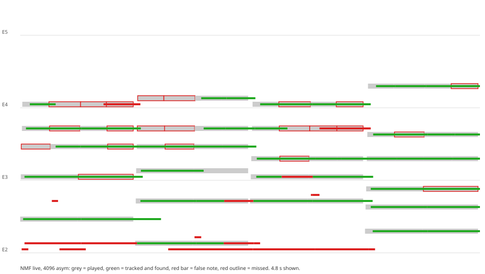

# Polyphonic capture: chords into synth voices

Nov 22, 2026. Design for the owner's review; nothing on this page is built in the app. The figures come from a throwaway prototype in `experiments/poly`, run on a synthetic guitar.

The owner asked for this: play a chord, or several strings at once, on a guitar; capture it; and have the synth play the same notes, up to some number of capture channels. Capture today is monophonic. The live tier (`dsp::capture`) runs YIN on the mic and the armed layer gets one live voice (`crates/klont/src/live.rs`); the second pass (`crates/analysis`) turns a take into one line of notes. A chord gives YIN one pitch at best. This page asks whether one mic or line input can be turned into several notes at once, live and on takes, each driving its own synth voice, and how that fits the patch, listen and record model of [synth.md](synth.md) and stages S2 to S5.

## Summary

| Concern | Decision |
| --- | --- |
| Feasible? | Yes, with limits that the design has to live with. On a synthetic guitar the chosen detector finds 98 to 100% of the notes of single lines, arpeggios and two-note stops, and about three quarters of the notes of full chords, with a median of 29 ms from pluck to detection. Octave doublings (the E3 in an open E chord, over E2) are the main loss, and a re-strum of the same chord is only partly caught. No real guitar was tested; that is the first build stage. |
| Detector | Template decomposition: NMF with a fixed dictionary of two harmonic templates per semitone (E2 to E6), solved per frame on a 4096-sample window with a short newest edge, every 5 ms. It beat a harmonic-sum detector on accuracy at every setting tried; harmonic sum is cheaper and, with a short window, quicker. |
| Capture channels | N channels, 1 to 6 (default 6, never more than the patch's voice count). Each channel holds at most one note at a time and drives one voice. |
| Per-note features | Each channel has its own pitch (with bends), volume, intensity, hardness and onset, which become the `voice.*` sources of the modulation matrix. Openness, breath and vowel stay whole-input features. |
| Re-strums | A broadband onset plus a rise in a note's upper partials restarts that note. A per-layer Strum switch restarts every sounding note that rose at all, for rhythm playing. |
| Live and offline | Live: the detector runs in the engine, like the live tier, only while a layer is armed in Poly. Offline: the second pass runs the same detector with a longer window and snaps note starts to onsets, and writes notes and per-note curves into the clip. |
| Fit | Arm gains a mode, Mono or Poly. Listen, routes, recording, automation, export and the raw input element work as they do; a poly take is stored as notes plus per-note curves, so playback stays deterministic. |
| Other inputs | A hex pickup into a multichannel interface, or a MIDI guitar, could fill the same capture channels with no detection at all. They need hardware; they are a question for the owner. |

What does not change: one engine for live, export and matching; the feature-frame format; no allocation, locks or waits on the audio thread; mono Live follow, as it is.

## What exists today

| Piece | Where | What it does for one note |
| --- | --- | --- |
| Live tier | `crates/dsp/src/capture.rs` | Bands, loudness, YIN pitch (about 24 ms), voicing, openness, breath, onset and hardness, every 2.5 ms; a 10 ms frame. One pitch. |
| Live follow | `crates/klont/src/live.rs`, `engine.rs` | One armed layer. A gate opening or an onset starts its one live voice; the voice reads the live record every control tick. |
| Listening layers | `engine.rs` (`tick`) | Any number of layers read the live tier's features; their notes come from elsewhere. |
| Second pass | `crates/analysis/src/notes.rs`, `second.rs` | Splits the take's pitch curve into notes (one at a time), repairs pitch with pYIN, onsets from spectral flux. |
| Voices | `crates/klont/src/voice.rs`, `layer.rs` | Up to 8 per layer, fewer for costly patches; per-voice routes read `voice.*` from the voice's own take curve or the live record. |

## Feasibility: what the prototype measured

### Test material

There are no guitar recordings in the repository or its fixtures, and no labelled ones were at hand, so every figure here comes from a synthetic guitar with an exact list of the notes it plays (`experiments/poly/src/guitar.rs`). Each pluck is an additive string: inharmonic partials (f_m = m f0 sqrt(1 + B m^2), B per string and fret), the comb of the pluck position, a pick low-pass that opens with velocity, two polarizations that beat and decay at different rates, decay that grows with frequency, a small pitch glide at the attack, pick noise, and either an acoustic body (a few broad resonances and a thump) or an electric pickup (a comb at the pickup position and a resonant peak). Strings are tuned up to 4 cents off. A string plays one note at a time, as a real one does. Room noise sits at -66 dBFS.

Each set is 48 to 50 seconds per instrument, played on both instruments:

| Section | What is played |
| --- | --- |
| Single strums | 12 or 13 chords, strummed once and left to ring 1.6 s: open chords (E, Am, C, G, D, Em, A, Dm, E7, Cmaj7, G7, D/F#), barre chords (F, Bm, A at 5, Cm at 3, Bb, F#m), power chords and two- and three-note shapes. 2 to 6 notes. |
| Strummed | A four-chord progression, twice, each chord strummed down, up, down, up 0.3 s apart. Up-strums catch only the top three strings, so those notes are re-plucked while the bass rings. |
| Arpeggio | Three chords picked one string at a time, eighth notes, strings left ringing. |
| Line | A single-note line with three two-note stops. |
| Palm mute | Eight muted chugs of a power chord, 90 ms each. |

The **dev** set (seed 1) is what every threshold was tuned on. The **test** set (seed 2) is held out: other chords, another progression, other arpeggios and lines, other random draws. All results below are on the test set: 522 notes over 100 s. The rendered audio is written with `--wav <dir>` for anyone who wants to hear how real it sounds.

### How to run it

| Command | What it does |
| --- | --- |
| `cd experiments/poly && cargo run --release -- test` | Renders the test set, runs every detector, prints the tables on this page (about 15 s on the build machine) |
| `cargo run --release -- dev` | The same on the dev set |
| `cargo run --release -- test --wav <dir> --svg <dir>` | Also writes the rendered guitar as WAV files and the piano rolls below |
| `POLY_<NAME>=<value> cargo run --release -- dev` | Overrides one tuning value (`MIN_OFF`, `RETRIG`, `SHARE`, `OPEN`, `GAMMA`, ...; see `knob` in `main.rs`), as the tuning was done |

The crate has its own Cargo workspace, so the app's `cargo test --workspace` and `pnpm test` do not build it.

### Two detectors, one tracker

Both work causally on the last N samples every 5 ms (240 samples at 48 kHz), the live tier's pitch hop.

- **HS, harmonic sum** (`hs.rs`), after Klapuri (2006): whiten the spectrum in 30 ERB bands, score every candidate f0 (a fifth of a semitone apart, E2 to E6) by the weighted peaks of its first 20 partials, take the best, subtract its partials (each limited to the mean of its neighbours, so a partial shared with another note is only partly removed), and repeat while the polyphony estimate grows.
- **NMF, template decomposition** (`nmf.rs`): explain the frame's compressed magnitude spectrum (|X|^0.6, up to 5 kHz) as a sum of fixed templates, two per semitone from E2 to E6 (a bright and a dark partial slope, each partial drawn with the window's own peak shape). Activations are solved by 10 KL-divergence multiplicative updates with an L1 penalty, warm-started from the last frame. A pitch is present when it carries at least 4% of the frame. The templates are generic; nothing is learned from the test guitar.

One note tracker serves both (`track.rs`): a pitch starts a note after 2 frames in a row (for NMF, at 8% of the frame or more), and ends it after 50 ms missing. A broadband onset from a short 1024-sample window, followed within about 60 ms by a rise of 1.2 times in the note's partials 2 to 10, restarts the note (a re-pluck). At most 6 notes at once.

The **offline** runs use an 8192-sample Hann window and move each note's start back to the latest broadband onset before it was first seen, as the second pass refines onsets today.

### How it is scored

A played note is found when a tracked note of the same semitone starts near it: live, from 20 ms before to 100 ms after (so the latency counts against it); offline, within 50 ms either way. Precision is found notes over tracked notes; recall is found notes over played notes. Frame F1 compares what sounds and what is tracked every 10 ms, so it also counts note ends. False notes are sorted by what they sit on: an octave or two from a sounding note, a fifth, fourth or higher partial, a semitone, the same note again (a dropout and return, or a restart with no re-pluck), or nothing. Velocity r is the correlation between the played velocity and the tracked level, both in dB. CPU is wall time for the whole analysis (spectra, detector, tracker, onsets) per 128-sample block, release build, native on the build machine (Apple M4, 10 cores, load 4.4 to 5.4 from other work). A block is 2,667 µs.

### Results

Held-out test set, both instruments:

| Detector | Precision | Recall | F1 | Latency median / p90 | Frame F1 | Velocity r | Pitch error median / p90 | CPU per block |
| --- | --- | --- | --- | --- | --- | --- | --- | --- |
| HS live, 4096 asymmetric | 0.443 | 0.701 | 0.543 | 27 / 55 ms | 0.601 | 0.49 | 6.6 / 25.2 cents | 31 µs |
| HS live, 2048 asymmetric | 0.408 | 0.634 | 0.497 | 18 / 36 ms | 0.591 | 0.55 | 10.2 / 28.6 cents | 19 µs |
| **NMF live, 4096 asymmetric** | **0.584** | **0.772** | **0.665** | **29 / 61 ms** | **0.782** | 0.46 | **6.0 / 16.6 cents** | 80 µs |
| NMF live, strum mode | 0.527 | 0.816 | 0.640 | 25 / 60 ms | 0.782 | 0.42 | 5.5 / 15.7 cents | 81 µs |
| HS offline, 8192 Hann | 0.483 | 0.716 | 0.577 | onsets snapped | 0.587 | 0.27 | 3.9 / 17.8 cents | 53 µs |
| NMF offline, 8192 Hann | 0.733 | 0.651 | 0.690 | onsets snapped | 0.854 | 0.29 | 3.3 / 8.7 cents | 82 µs |

On the dev set, which the thresholds were tuned on, NMF live scores F1 0.690 and NMF offline 0.726; the held-out set is 0.025 to 0.04 lower, so the tuning did not overfit much.

Recall by section:

| Detector | Single strums | Strummed | Arpeggio | Line | Palm mute |
| --- | --- | --- | --- | --- | --- |
| HS live, 4096 | 0.72 | 0.59 | 1.00 | 1.00 | 0.77 |
| NMF live, 4096 | 0.73 | 0.69 | 0.98 | 1.00 | 0.98 |
| NMF live, strum mode | 0.73 | 0.77 | 1.00 | 1.00 | 0.98 |
| NMF offline, 8192 | 0.75 | 0.51 | 0.96 | 1.00 | 0.65 |

Recall by how many notes were struck together (within 50 ms):

| Detector | 1 | 2 | 3 | 4 | 5 | 6 |
| --- | --- | --- | --- | --- | --- | --- |
| NMF live, 4096 | 0.99 (67/68) | 1.00 (20/20) | 0.65 (97/150) | 0.88 (7/8) | 0.78 (94/120) | 0.76 (118/156) |
| NMF live, strum mode | 1.00 | 1.00 | 0.73 | 0.88 | 0.82 | 0.78 |

Most three-note groups (16 of 25 per instrument) are up-strums: three strings re-plucked over a ringing bass, which is the re-strum problem, not the size.

Where the errors go, NMF live (522 played, 690 tracked, 403 found):

| False notes (287) | | Missed notes (119) | |
| --- | --- | --- | --- |
| Octave from a sounding note | 71 | A note one or two octaves below was sounding | 85 |
| Fifth, fourth or higher partial | 38 | Other | 34 |
| Semitone from a sounding note | 42 | | |
| Same note again (dropout or restart without a pluck) | 104 | | |
| Other | 32 | | |

Live latency by register, NMF live: 35 / 65 ms (median / p90) from E2 to D#3, 28 / 58 ms from E3 to D#4, 28 / 64 ms from E4 up. Low strings take longer because their partials are close together and need more of the window to separate.

The two instruments come out close: NMF live F1 0.646 acoustic, 0.687 electric.

### What it looks like

The strummed passage of the test set (Am, F, C, G, each strummed down, up, down, up), acoustic. Grey bars are played notes, green bars tracked notes that were found, red bars false notes, red outlines missed notes.



NMF holds most notes for their whole length. Most misses are upper notes re-plucked by the up-strums (the second and fourth strum of each chord) and octave doublings. The red bars along the bottom are low notes (E2, F2) that the dictionary uses to explain the partials of notes above them: octave-below and harmonic-below errors.


HS breaks held notes into pieces as its estimate of how many notes are sounding goes up and down from frame to frame; each piece after the first counts as a false note.

### What was tried and did not help

All on the dev set:

- Octave checks by spectral smoothness (drop the upper of two octave-related pitches unless the lower one's even partials stand out; move a pitch up an octave when its odd partials are weak): no change for HS, a lower F1 for NMF (0.605 at the gentlest setting, from 0.671). Left in the prototype, off.
- Holding notes longer through dropouts (70 to 240 ms instead of 50): fewer dropouts, but more re-plucks lost; F1 fell.
- 20 NMF iterations instead of 10: no better (F1 0.671 against 0.685) at twice the cost.
- HS polyphony settings (the stop rule's exponent from 0.5 to 1.1, the whitening exponent from 0.2 to 0.7): F1 stayed between 0.46 and 0.54. HS's false notes are structural, not a tuning matter.

### What this does not show

- **No real guitar.** Real recordings add string and fret noise, fret buzz, sympathetic strings, room sound, bends and slides, and pickups or mics that colour the sound in ways this model does not. Expect worse figures. Stage P0 measures that before anything is built.
- **Thresholds are tuned on synthetic material.** The held-out set guards against tuning to one passage, not against tuning to one synthesizer.
- **Per-note intensity and hardness were not measured.** The design defines them below; only the level at a note's start was checked against velocity (r 0.46: a rough guide).
- **CPU is native.** The live tier costs 40 µs per block native and about 50 µs in wasm (M2), and the demo song renders 1.6 times faster native than in Chrome (M1), so the NMF detector should cost about 100 to 130 µs per block in the worklet: 4 to 5% of a core.

## Live and offline: what is feasible where

| | Live, in the engine | Offline, second pass on a take |
| --- | --- | --- |
| Window | 4096 samples, newest eighth tapered short (85 ms) | 8192 samples, Hann (171 ms) |
| When a note starts | When seen: median 29 ms, p90 61 ms after the pluck | Snapped to the onset: median 9 ms early, a fixed offset the second pass can take off |
| Notes, F1 | 0.665 | 0.690 |
| Precision | 0.58 | 0.73 |
| Pitch error, median | 6 cents | 3 cents |
| What sounds when, frame F1 | 0.78 | 0.85 |
| Strummed passage, recall | 0.69, or 0.77 with Strum on | 0.51 |
| Cost | 80 µs per 128-sample block native, about 3% of a core | About 30 times real time native, in a worker |

Live works well enough to play with: single notes, double stops, arpeggios and chords with distinct notes come through, at about the delay of today's mono pitch (24 ms) for the median note. The slowest tenth of notes (61 ms and later, more of them on the low strings) miss the 50 ms Live follow budget before any device delay is added.

Offline gives cleaner notes (fewer false ones) and better pitch, and every note start sits on its onset. It is worse on re-strums because its long window blurs the rise of a re-plucked note; the second pass should look for re-plucks on the short window instead (stage P3 has a check for it). A take's notes can also be fixed by hand in the piano roll, which exists today.

## The detector

### How it works

```text
 mic (high-passed, as the live tier has it)
   │
   ├─ every 5 ms: last 4096 samples × asymmetric window → FFT → |X|^0.6 up to 5 kHz
   │       │
   │       └─ NMF: V ≈ W h, W fixed (98 templates, 2 per semitone E2..E6),
   │               10 KL updates from last frame's h → share of the frame per pitch
   │
   ├─ every 5 ms: last 1024 samples × Hann → log-spectral flux → broadband onset
   │
   └─ tracker: start at 8% for 10 ms, keep at 4%, end after 50 ms missing,
               restart on onset + partial rise, at most N notes
               → per note: pitch (partial peaks), level, features → capture channels
```

The asymmetric window (a Hann rise over the first seven eighths, a short Hann fall over the newest eighth) gives the newest samples more weight than a Hann window does, so a pluck shows sooner. It is a trade: with a symmetric Hann window of the same length, NMF scores a little better on the test set (F1 0.680, precision 0.66, frame F1 0.845) but detects at 45 ms median and 77 ms p90, against 29 and 61. A 2048 window is faster again (18 ms with HS) but cannot separate the low strings.

Memory: the dictionary is about 11,000 (bin, weight) pairs, under 100 KB; with the FFT tables and buffers the detector needs well under 1 MB. Everything is allocated when the detector is made; a frame allocates nothing.

### Limits

| Limit | Value | Why |
| --- | --- | --- |
| Notes at once | 6 tracked (up to 8, the voice cap) | Recall falls with chord size: 1.00 for one or two notes, 0.76 to 0.78 for five or six. |
| Range | E2 to E6 (MIDI 40 to 88) | The dictionary. Drop D or a 7-string needs templates down to B1: more cost and slower low notes. |
| Low strings | Median 35 ms, p90 65 ms | Their partials sit close together, so more of the window must hold the new note before its pattern stands out; notes a semitone apart below about 200 Hz differ only in their upper partials. |
| Octave doublings | The largest share of misses (85 of 119) | A note an octave above another has all its partials inside the lower note's. The synth plays the distinct pitches of an open E (E2, B2, G#3, E4) and usually not the doubled E3 and B3. |
| False notes | 42% of tracked notes are false | Octave and harmonic errors (109 of 287), and the same note tracked again after a dropout or restarted with no pluck (104). On a synth these are extra attacks and the odd wrong octave. |
| Re-strums | 69% of the strummed passage's notes found, 77% with Strum on | A re-pluck of G3 also lifts G2's even partials, so a note's own rise cannot always say which string was struck. |
| Bends | Not handled in the prototype | A note is a semitone. A bend past half a semitone would end it and start the next one. Stage P1 adds a continuity rule. |
| Pitch | 6 cents median live, 3 offline | Peak interpolation on the first six partials. Enough to drive the voice pitch. Vibrato was not tested. |

## From notes to voices

### Capture channels

A **capture channel** is one stream of tracked notes, one note at a time: a virtual string. A layer armed in Poly has N of them (1 to 6, default 6). N also caps how many notes the tracker holds. Each channel drives one voice at a time. N cannot exceed the patch's voice count, which is 1 to 8 depending on its cost (synth.md "Rules for the graph"); a patch that allows 4 voices gets 4 channels, and the Perform view says so.

Voices beyond N are not wasted: when a channel's note ends, its voice plays its release while the channel takes the next note on another voice. If every voice is busy, the oldest releasing voice is stolen with today's 3 ms choke.

### Tracking notes across frames

As in the prototype, plus one rule it did not have:

- **Start**: a pitch present for 2 frames (10 ms) with at least 8% of the frame.
- **Keep**: present with at least 4%, or missing for less than 50 ms.
- **End**: missing for 50 ms. The voice is released (its `env1` release), not cut.
- **Restart**: a broadband onset, then within about 60 ms the note's partials 2 to 10 rise by 1.2 times over where they were just before it. Same channel, the voice restarts as today's live voice restarts on an onset.
- **Bends** (new): a sounding note whose pitch moves without an onset keeps its channel as long as it stays within 250 cents of where it started, so a bend or slide is one note with a moving pitch. The mono live tier's continuity guard (700 cents, 30 ms) is the model.

### Voice allocation

1. A new note takes a free channel. It prefers the channel whose last note was nearest in pitch and ended within the last second, so a line stays on one channel as it would on one string (and a later legato mode could glide it). Otherwise it takes the channel that has been free longest.
2. If all N channels hold notes, the new note takes the channel of the quietest one when it is at least 6 dB louder than that note; otherwise it is dropped. Notes ring down, so this replaces the oldest notes first in practice.
3. A restart stays on its channel.
4. Each channel's voice reads that channel's record every control tick, as the mono live voice reads `LiveCapture::record` today.

### Strum mode

A per-layer switch, off by default. When on, a broadband onset restarts every sounding note whose partials rose at all (by 1.05 times), not only the ones that jumped. Recall in the strummed passage goes from 0.69 to 0.77; precision falls from 0.58 to 0.53, because a bass note left ringing under an up-strum gets restarted too. For rhythm playing, a synth that re-attacks with every strum is closer to what the hand did than one that misses nearly a third of the notes. For picking, leave it off.

### Per-note features in the modulation matrix

Each channel computes, per 10 ms frame, from its note's partials in the detector's spectrum:

| Source | What it is | Range |
| --- | --- | --- |
| `voice.pitch` | The note's pitch from its partial peaks, in cents, through the layer's Tune (octave and reference always, scale snap only if set) | As the sung pitch |
| `voice.volume` | The note's level (partials 1 to 8), between the gate's closing level and the running ceiling, as the sung volume | 0 to 1 |
| `voice.intensity` | The note's tilt: partials 5 to 10 against partials 1 to 4, in dB, less the tilt its template expects for that pitch. A hard pick or a bright pickup reads high; it falls as the note rings | -10 to +10 dB as 0 to 1, as the sung intensity |
| `voice.hardness` | The rise of the note's level in the 10 ms after its onset, in dB per ms, as the live tier's hardness. Held for the note | 0 to 1 |
| `voice.onset` | One frame's pulse when the note starts or restarts | 0 or 1 |
| `voice.openness`, `voice.breath`, `voice.vowel` | The whole input's values from the mono live tier, the same for every channel | As today |
| `voice.voicing` | Voiced while the channel holds a note | |

`note.velocity` is the note's volume at its start (latched), `note.hardness` its hardness and `note.pitch` its pitch at the start. The prototype found the level at a note's start follows the played velocity only roughly (r 0.46), so routes from velocity should be shallow or smoothed.

Layer sources (`layer.*`) keep coming from the mono live tier on the whole input: the guitar's overall volume, intensity, openness, onset. One change: in Poly, `layer.pitch` is the highest sounding note, since YIN's single pitch means nothing on a chord. The top note is usually the melody.

The classic patch's default routes then work per string: `voice.volume` to `amp1.gain` makes each synth voice follow its own string's decay, and `note.hardness` to `click1.start` gives each note its own attack. The intensity and hardness definitions are new and untested; stage P2 tests them.

## Fit with patch, listen and record

### Arm and listen

- **Arm gains a mode** on melody and texture layers: Mono (Live follow as today) or Poly. One layer is armed at a time, as today. Beat layers keep their hits; Poly does not apply to them.
- **The detector runs only while a layer is armed in Poly**, once, inside `ew_process` after the live tier, on the same high-passed input. Nothing is spent otherwise.
- **Listening layers are unchanged.** They read the mono live tier's features of the whole input. A guitar can be both: one layer armed in Poly plays the chord's notes; another listens and lets the guitar's volume drive its filter.

### Patches and voice count

Nothing changes in the patch format. The number of channels is a layer setting (with the arm mode, like Tune), capped by the patch's voice count. A patch built for poly capture will want a cheap voice so it gets six or more voices.

### Recording a poly take

Record (S5) with a layer armed in Poly records the take as today: the input audio and the mono frames. When the pass is committed, the second pass runs the offline detector on the take's audio and writes:

- the notes into the clip, as `notes` with `t`, `dur`, `cents`, `vel` and `hard`, which the piano roll already shows and edits;
- a **note-curve blob** for the take: for each note, one record per 10 ms of its life holding pitch, volume, intensity, hardness and onset.

The live notes heard while recording are not kept; the second pass's notes replace them, as the second pass repairs the mono live pitch today. S5's rule that a take into a listening layer keeps no notes of its own still holds for listening layers.

### Playback and export

Each note of a poly take plays a voice that reads its own note curve for its `voice.*` sources (at clip time minus the note's start, through the warp map), and the take's mono frames for the layer's sources. Everything is stored data, so synth.md's deterministic playback rules hold: live playback and export null, and a voice's features never depend on what else sounded. A note drawn or moved by hand has no curve, or keeps its curve and moves with it, and plays as any drawn note.

### The raw input beside the synth

The `input` element (S5) works as it is: the guitar itself beside the synth, crossfaded. Live, the synth's notes start about 25 ms later than the raw guitar (the detection delay), since the input is held back only by the level delay (5 ms); holding a guitar back 30 ms would be heard as a late monitor. On playback, notes start at their snapped onsets, so the take's audio and the synth line up within about 10 ms.

### Other inputs: hex pickup and MIDI guitar

The capture channels do not care where their notes come from. Two other front ends could fill them, each with hardware the owner may or may not have:

| Front end | How | Gains | Costs |
| --- | --- | --- | --- |
| One mic or line input, this design | The detector above | Any guitar, no hardware | Octave doublings and some re-strums lost; false notes; 29 ms median |
| Hex pickup into a multichannel interface | Each string's channel runs today's mono live tier | Every note, every doubling, per-string features from code that exists; about 24 ms | A hex pickup and a six-input interface. About 40 µs per string per block native. Whether the browser opens more than two input channels needs checking. |
| MIDI guitar or pitch-to-MIDI converter | MIDI notes per string, one MIDI channel per string | No detection; S4's MIDI input already plays notes | The hardware and its own delay; per-string bends need channel-per-note (MPE-style) handling, which synth.md lists as small to add |

## Engine changes

| Change | Detail |
| --- | --- |
| `dsp::poly` (new) | The detector: input ring, 4096 and 1024 FFTs, the template dictionary, NMF, onsets, tracker, per-note features, channel allocation. Allocates in `new` only. Same code in the engine and in the analysis worker (offline settings). |
| `MSG_ARM` | Gains a mode (mono or poly), a channel count and the Strum switch. |
| `LiveCapture` | In Poly: per-channel actions (start with pitch, velocity and hardness; restart; release) and per-channel records the voices read each tick, beside today's mono record and the listening record. |
| `Layer` | Binds channels to voices; a voice started by a channel reads that channel's record. |
| Note curves (new load kind) | `LOAD_NOTE_CURVES`, one blob per poly take: a note table (start frame, frame count, offset) and 5-float records at 100 per second. Pooled like curves. |
| Track blob v4 | A note may carry a note-curve id and index. Older blobs load; the encoder writes the oldest version that holds the track, as v3 does. |
| Meter block | Per channel: note, pitch, volume, for the Perform view. |
| `analysis` | `an_poly`: the offline detector over a take's audio, returning notes and the note-curve blob. |
| Benchmark | `bench --poly`: the detector's cost per block, armed and not. |

## Interface sketch

The Perform view gains the arm mode and a channel strip. Channels are not strings (a note goes to the nearest free channel), but on a guitar they mostly behave like them.

```text
┌ Perform ── Layer: Guitar pad ▾ ── [Listen ○] Arm [Mono][Poly ●] ── channels 6 ▾ ── Strum ☐ ┐
│ 1  E2   ▮▮▮▮▯  −3¢         range E2–E6 ▾      sensitivity ◐       voices 8 (patch)        │
│ 2  B2   ▮▮▮▯▯  +2¢                                                                      │
│ 3  G#3  ▮▮▮▮▯  +1¢         detection now 31 ms                                          │
│ 4  B3   ▮▯▯▯▯  −4¢                                                                      │
│ 5  E4   ▮▮▯▯▯  +0¢                                                                      │
│ 6  —                                                                                    │
│ volume ▮▮▮▮▯  intensity ▮▮▯▯▯  hardness ▮▯▯▯▯ (whole input)          [Record ●]       │
└─────────────────────────────────────────────────────────────────────────────────────────┘
```

- **Sensitivity** moves the start and keep thresholds together (8% and 4% of the frame at the middle).
- **Range** sets the lowest and highest note the dictionary covers: E2–E6 by default, down to B1 for drop tunings and 7-strings, with the latency cost said beside it.
- In the Mod view, `voice.*` sources read "per channel" when the layer is armed in Poly.
- A poly take's notes appear in the clip's piano roll as chords, with the existing note editing.

## Build plan

Each stage ends with checks anyone can run. P0 decides whether to go on.

### P0: real guitar

Teach the prototype to read a WAV file with a note list (onset, offset, MIDI note per line), and run it on real recordings: ten minutes or more of the owner's guitar, labelled by hand or with a MIDI guitar recording alongside, or a public set with per-string labels such as GuitarSet.

- NMF live F1 on real recordings within 0.1 of the synthetic figure (0.665), and recall on single strums at least 0.65. If not, the design goes back to the owner with the numbers and the other front ends above, or a learned transcription model for the offline pass (a small open-source one such as Spotify's Basic Pitch would be the first to try; it was not measured here).
- The figures recorded beside the synthetic ones on this page.

### P1: live poly follow

`dsp::poly` with the live settings, Arm Poly with N channels, channel-to-voice allocation, per-channel pitch and volume, restarts, the bend continuity rule, Strum, and the arm mode and channel count in the Perform view.

- The detector in a Rust test on the synthetic test set (generated in the test from a seed) reaches the prototype's figures: F1 at least 0.66, median latency at most 30 ms.
- The same notes from 128-sample and 333-sample `ew_process` calls (the detector is independent of block size).
- The no-allocation test, with a layer armed in Poly.
- Loopback: a synthetic chord into `ew_process` gives voice output on each of its notes; the delay from pluck to each voice's first sample is reported per register.
- `bench --poly`: the detector's cost per block, native and in Chrome; the M1 gate re-run with a layer armed in Poly.
- A bend of 200 cents is one note on one channel.

### P2: per-note features

`voice.intensity`, `voice.hardness`, `voice.onset` per channel, `note.velocity` and `note.hardness` from channels, `layer.pitch` as the highest note, Tune per channel (one tuner per channel).

- Unit tests per feature on synthetic plucks: a harder pick (brighter, faster attack) reads higher intensity and hardness than a soft one on the same string, in at least 90% of pairs.
- Two notes decaying at different rates: with the default `voice.volume` route, each voice's output follows its own note within 1 dB.
- Hardness and intensity correlations with the played pick, recorded on the synthetic set and, if P0 found recordings, on real ones.

### P3: poly takes

Record with a layer armed in Poly: the offline detector in the analysis worker, notes into the clip, the note-curve blob, `LOAD_NOTE_CURVES`, track blob v4, playback reading note curves. The offline re-pluck search on the short window.

- Offline on the synthetic test set: precision at least 0.73 (the prototype's), and recall in the strummed passage at least the live figure (0.69).
- Record 30 s of a synthetic guitar through the live engine with a layer armed in Poly (as S5's record test does with singing); commit; live playback from the start and an export null within -90 dB; two exports are bit-identical.
- Undo removes the pass in one step; the journal replays it after a reload.
- The second pass runs at 10 times real time or better in the worker on the build machine.

### P4: interface

The channel strip and meters, sensitivity and range, "per channel" in the Mod view, a factory preset made for poly capture (a cheap voice with eight voices, volume and hardness routes), and a tutorial step.

- In Chrome, arming Poly and playing the test WAV through a virtual input shows the channels filling; nothing wider than the window at 500 px; no console errors.
- A tutorial step "Arm Poly and strum a chord" can be finished in under a minute by someone new to the app.

## Not in this design

- Naming chords (showing "Am7") and chord-based features. Easy to add on top of the tracked notes if wanted.
- MPE or per-string MIDI output, and MIDI export of poly takes.
- Polyphonic pitch from voices (several singers into one mic). The detector's templates assume plucked strings; voices have stronger vibrato and wider partials.
- Instruments other than guitar. Piano, harp or mandolin would need their own ranges and template slopes and their own test material.
- Per-string pickup position, string assignment by fret plausibility, and other guitar-specific reasoning that might win back octave doublings. A string model (which fret on which string could have played this set) is the next thing to try if the doublings matter.

## Choices for the owner

Each has a recommendation; the design above assumes it.

1. **Input.** One mic or line input with the detector (recommended: works with any guitar and no hardware), a hex pickup into a multichannel interface, or a MIDI guitar. The engine side is the same for all three, so another can be added later.
2. **Detector.** NMF templates (recommended), harmonic sum (two and a half times cheaper, clearly worse), or a learned model for the offline pass only (to try in P0 if real recordings disappoint).
3. **Octave doublings.** Play the distinct pitches found and accept that doubled octaves are usually missing (recommended), or spend more work trying to keep them (no method tried here worked).
4. **Strum.** A per-layer switch, off by default (recommended), or on by default for Poly.
5. **`layer.pitch` in Poly.** The highest sounding note (recommended) or the lowest.
6. **Order.** Live first (P1, recommended: the owner can play with it sooner) or poly takes first (P3), which avoids the latency question at first.
7. **Scale snap on poly notes.** Off by default (recommended: frets already quantize, and snap would flatten bends), on when the layer's Tune says so.

## Questions for the owner

1. Which guitar and input will you use: a mic on an acoustic, a line from an electric, a hex pickup, or a MIDI guitar?
2. Can you record ten minutes of your own playing for P0, with a list of what you played, or should P0 use a public labelled set?
3. Do you mostly strum chords or pick lines and arpeggios? That decides how much the re-strum gap matters and what Strum's default should be.
4. Is a median of about 30 ms (and up to about 65 ms on low strings) from pluck to synth acceptable live, given the raw guitar can sound beside the synth?
5. When an open chord doubles a note an octave up, is it fine for the synth to play it once?
6. How many capture channels by default: six, one per string, or fewer for cheaper, richer voices?
7. Should the synth's notes be quantized to the nearest semitone, or follow bends and vibrato as played (the design follows them)?
